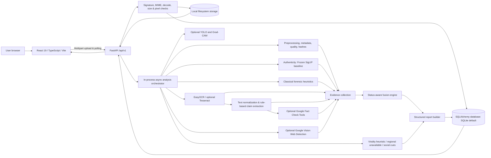

# TruthLens Project Master Dossier

## 1. Executive overview

TruthLens is an academic web application prototype for image-centered verification support and digital media analysis. A user uploads an image; the system validates and stores it, executes a multi-stage asynchronous analysis pipeline, and returns a structured report containing stage statuses, image and model evidence, extracted OCR text, optional third-party claim-review matches, forensic cues, and contextual indicators. The application is designed to organize multi-modal evidence for human inspection. It does not determine whether an image or claim is universally true.

This dossier documents the verified implementation, system architecture, and extensive empirical research progression across Phases 0 through 7. Following initial audit phases that noted the absence of labeled local test data, the research team ingested and cryptographically audited three major external image benchmarks totaling $N = 29,640$ images:
1. **Tiny-GenImage** ($N = 25,006$): 12,506 authentic photographs and 12,500 synthetic generations across 8 generator architectures (BigGAN, Cascade Diffusion, DeepFloyd-IF, GLIDE, LDM, Midjourney v4, Stable Diffusion v1.4, Stable Diffusion v1.5).
2. **AI Image Detection Benchmark — October 2026 (Frontier Benchmark)** ($N = 2,976$): 984 authentic reference photographs and 1,992 synthetic images from 8 late-2026 generators (DALL-E 3, FLUX.1 [dev], FLUX.1 [schnell], Midjourney v6, Recraft v3, Stable Diffusion 3 Medium, SD 3.5 Large, SD 3.5 Turbo), with 4 social compression tiers (Original, Instagram, Reshared, WhatsApp).
3. **WildAIGC-Bench** ($N = 1,658$): 829 authentic images and 829 synthetic media samples collected in the wild.

Using strict group-aware, leakage-free split governance, the repository established locked test partitions ($N = 10,385$), temperature calibration pools ($N = 13,000$), validation sets ($N = 6,255$), and an approved training pool ($N = 6,995$). The frozen baseline model (`truthlens/siglip-cifake-frozen-head`) was benchmarked across all test sets. Subsequent fine-tuning experiments (Phases 5–6) uncovered severe container-format shortcut learning (100% JPEG authentic vs. 100% PNG synthetic in Tiny-GenImage training data). Phase 7 neutralized this shortcut via matched in-memory augmentation, training 5 controlled model variants. While primary candidate S2 (`truthlens/siglip-base-v2-s2`) successfully eliminated format shortcuts on in-distribution data (achieving 0.8460 Balanced Accuracy and 0.9423 ROC-AUC on Tiny-GenImage test), it exhibited negative transfer on modern 2026 generators (Frontier Benchmark ROC-AUC 0.4234). In accordance with pre-registered evaluation governance, Candidate S2 was rejected for production, and the production detector was retained on the frozen baseline (`truthlens/siglip-cifake-frozen-head`). The full backend test suite confirms 267 passing tests and 10 skipped model-dependent tests.

## 2. Project identity and scope

| Item | Evidence-backed description |
|---|---|
| Name | TruthLens |
| Domain | AI-assisted image analysis, digital media verification support, and research prototype tooling |
| Application type | React single-page web UI backed by a Python FastAPI asynchronous service |
| Intended use | Local academic demonstrations, research workflow development, and controlled detector auditing |
| Core input | One uploaded raster image per analysis |
| Core output | A persisted, structured analysis report with per-stage results, warnings, evidence references and limitations |
| Users | No authenticated roles exist in this codebase. Likely users are student/researcher demonstrators, fact-checkers, and peer reviewers. |
| Outside verified scope | Definitive truth adjudication, separate manipulation classification, trained spread prediction, C2PA parsing, translation, authenticated multi-user service, public production deployment |

## 3. Background, motivation and problem definition

Images circulating online can be detached from their original context, synthetically generated, edited, incorrectly captioned, or paired with deceptive text claims. Image authenticity, caption accuracy, image provenance, and subsequent social spread represent distinct verification dimensions. A single classifier cannot answer all of them. TruthLens therefore integrates multiple complementary image, text, and context signals into one structured report while explicitly tracking whether each stage completed, produced warnings, was skipped, or was unavailable.

The repository frames the project as both an integrated software prototype and a rigorous evaluation-governance platform. Its engineering motivation is to provide a transparent, traceable workflow that assists human analysts in reviewing multiple verification signals in a single interface.

**Problem definition:** An analyst needs a structured, status-aware method to inspect an uploaded image and its visible text alongside model outputs, forensic indicators, optional external fact-check/provenance lookups, and calibrated uncertainty estimates. TruthLens addresses this workflow and reporting challenge. It does not independently establish absolute factual truth or predict dissemination outcomes.

## 4. Objectives

### Functional objectives visible in implementation

- Accept supported image formats through a multipart API, rejecting oversized or invalid payloads.
- Record analysis lifecycle state, image metadata, cryptographic hashes (SHA-256), and perceptual hashes (pHash).
- Preprocess images into normalized representations, thumbnails, and resized variants while computing quality metrics.
- Execute the production authenticity classifier (`truthlens/siglip-cifake-frozen-head`) and classical image forensic heuristics.
- Perform OCR (EasyOCR / Tesseract fallback) and optional object detection and Grad-CAM class attribution visualizations.
- Normalize extracted text, identify candidate claim statements, and optionally query external fact-check or provenance adapters.
- Collect multi-modal evidence items, apply status-aware fusion rules, generate human-readable explanations, and persist structured reports.
- Expose REST API routes for health, lifecycle polling, report retrieval, and artifact downloads.
- Render pipeline progress, findings, warnings, and explicit limitations within the React frontend.

### Technical and research objectives

- Implement a reproducible, leak-free dataset split protocol for external image benchmarks.
- Audit and document model generalization across diverse generator families and compression regimes.
- Identify and mitigate dataset shortcuts (e.g., container format confounding) through matched augmentation pipelines.
- Fit and validate post-hoc confidence calibration (temperature scaling) exclusively on disjoint calibration splits.
- Maintain strict evaluation governance, rejecting candidate models that exhibit negative transfer on held-out frontier benchmarks.

## 5. Feature inventory and implementation status

| Feature | Status | Actual behavior and verified boundary |
|---|---|---|
| Image upload and validation | Implemented | Multipart endpoint validates byte length, MIME type, magic bytes signature, and Pillow decoding. Maximum configured upload: 20 MB, 40 million pixels. |
| Original and derivative storage | Implemented | Stores original, thumbnails, resized variants, and diagnostic artifacts under configured local storage (`data/` or `storage/`). |
| SHA-256 and perceptual hash | Implemented | Computed and stored on ingest; perceptual hash enables visual similarity lookup without claiming provenance proof. |
| Metadata and quality | Implemented | Extracts EXIF, GPS tags (safely normalized), resolution, aspect ratio, entropy, and sharpness metrics. |
| Authenticity classifier | Implemented & Benchmarked | Production detector retained on frozen baseline (`truthlens/siglip-cifake-frozen-head`, SHA-256: `e39afc5536a0de44dd07fd33fa911bbd58d8799b85e680eb08d532222d974538`). Evaluated across 3 external benchmarks ($N = 10,385$ test samples). Phase 7 candidate S2 demonstrated shortcut resistance on in-distribution data but was rejected for production due to negative transfer on modern 2026 generators. |
| Calibration support | Implemented & Calibrated | Temperature scaling implemented (`backend/app/services/authenticity/calibration.py`). Fitted on 13,000 disjoint calibration samples: Tiny $T = 1.2174$, Frontier $T = 10.3621$, WildAIGC $T = 5.6099$, Pooled $T = 1.3187$. |
| Classical image forensics | Implemented | Computes ELA, noise variance, JPEG ghosting, edge density, texture statistics, and resampling cues. Treated strictly as informational evidence, not proof of manipulation. |
| OCR | Implemented conditionally | EasyOCR primary with Tesseract fallback. Supports English and Hindi by default. |
| Text normalization & language detection | Implemented | Cleans whitespace, normalizes Unicode, extracts token counts, and estimates script/language distribution. |
| Claim extraction | Implemented | Rule-based heuristic extraction of candidate factual statements, temporal tokens, and location indicators. |
| Fact-check lookup | Optional integration | Google Fact Check Tools API adapter. Retrieved claims provide contextual reference; credentials required. |
| Provenance lookup | Optional integration | Google Vision Web Detection API adapter. Retrieves reverse-image matches; credentials required. |
| Object detection | Optional | Ultralytics YOLO integration for object tagging and bounding box extraction. |
| Grad-CAM | Optional / conditional | Generates class-conditioned gradient attribution heatmaps on compatible model layers. |
| Evidence collection & fusion | Implemented | Status-aware aggregation engine. Phase 6 rules exclude non-completed evidence and restrict directional voting to model outputs; forensics and context remain informational. |
| Explanation builder | Implemented | Generates structured markdown summaries, section takeaways, and technical caveats. |
| Virality indicators | Heuristic / demo | Rule-weighted score based on text sensationalism, platform cues, and visual entropy. Explicitly marked as non-predictive heuristic. |
| Regional spread | Unavailable | Returns explicit `DATA_UNAVAILABLE` status and empty rankings due to absence of ground-truth geographic outcome data. |
| Social impact cues | Heuristic | Exact-keyword matching across 5 sensitive domains (communal, health, politics, finance, child safety). |
| Standalone OCR/fact-check API routes | Stubbed | `/api/v1/ocr`, `/api/v1/fact-check`, `/api/v1/provenance` return HTTP 501. Operations execute within pipeline orchestrator. |
| Authentication & authorization | Not implemented | Single-user prototype; no role-based access control or multi-tenant isolation. |

## 6. Architecture and pipeline flow

The system employs a client-server architecture with an asynchronous service layer coordinated by a central orchestrator (`backend/app/services/orchestrator.py`). Tasks execute in-process via `asyncio.create_task`. Uploaded media and derived diagnostic artifacts reside in the filesystem, while analysis metadata, stage execution histories, and final report JSON documents are persisted in relational storage.

## 7. Dataset governance and split protocol

To establish rigorous evaluation integrity, TruthLens ingested three external benchmarks ($N = 29,640$ total images), enforcing strict cryptographic validation (100% SHA-256 match, zero missing files):

| Dataset | Ingested Count | Real Images | AI Images | Generators / Modalities | Split Allocations |
|---|---|---|---|---|---|
| **Tiny-GenImage** | 25,006 | 12,506 | 12,500 | 8 generators (BigGAN, Cascade Diffusion, DeepFloyd-IF, GLIDE, LDM, Midjourney v4, SD 1.4, SD 1.5) | Train: 6,995 Val: 3,464 Calib: 10,000 Locked Test: 7,000 |
| **Frontier Benchmark 2026-10** | 2,976 | 984 | 1,992 | 8 modern generators (DALL-E 3, Flux.1-dev, Flux.1-schnell, Midjourney v6, Recraft v3, SD 3 Medium, SD 3.5 Large, SD 3.5 Turbo) across 4 compression tiers | Val: 1,791 Calib: 2,000 Locked Test: 2,091 |
| **WildAIGC-Bench** | 1,658 | 829 | 829 | In-the-wild digital media samples | Val: 1,000 Calib: 1,000 Locked Test: 1,294 |

Splits were generated using group-aware stratification (`experiments/create_evaluation_splits.py`) with disjoint prompt groups, generator partitions, and seed controls (`seed = 42`). No sample appears in more than one partition.

## 8. Empirical evaluation and candidate governance

### 8.1 Production baseline benchmark performance

The production baseline (`truthlens/siglip-cifake-frozen-head`) was evaluated across all locked test partitions ($N = 10,385$):

| Test Partition | $N$ | Balanced Accuracy | ROC-AUC | Real Accuracy | AI Accuracy |
|---|---|---|---|---|---|
| **Tiny-GenImage Test** | 7,000 | 0.5521 | 0.6123 | 0.1609 | 0.9434 |
| **Tiny-GenImage (Matched Augmented)** | 7,000 | 0.5330 | 0.5595 | 0.1191 | 0.9469 |
| **Frontier Benchmark 2026-10 Test** | 2,091 | 0.6228 | 0.6501 | 0.4000 | 0.8457 |
| **WildAIGC-Bench Test** | 1,294 | 0.4294 | 0.4226 | 0.0402 | 0.8176 |

### 8.2 Shortcut discovery and matched in-memory augmentation

Pre-training container audits revealed an extreme dataset shortcut: in the approved Tiny-GenImage training split, 100% of real images were JPEG format and 100% of synthetic images were PNG format. A Random Forest classifier trained solely on format metadata achieved an ROC-AUC of 1.0000. In Phase 5/6, Candidate E3 exploited this artifact, exhibiting severe prediction flipping (45.6% flips, mean logit shift 6.12) under JPEG re-compression.

In Phase 7, TruthLens developed a matched in-memory augmentation pipeline (`experiments/train_phase7.py`) applying randomized transcoding (JPEG, PNG, WebP), compression quality scaling (30–95), and multi-scale cropping identically across both classes, collapsing metadata ROC-AUC to chance level (0.5028).

### 8.3 Phase 7 candidate evaluation and production decision

Five model variants were trained under strict hardware constraints (RTX 3050 Laptop GPU, 4 GB VRAM): S1 (linear probe on $K = 5$ views), S2 (partial fine-tuning of layers 10, 11 + head), R1 (ResNet-50 full FT), R2 (ResNet-50 stage 4 FT), and A1 (unaugmented ablation). Primary candidate S2 was evaluated on locked test partitions:

| Metric / Evaluation Angle | Frozen Baseline | Candidate S2 (`siglip-base-v2-s2`) | $\Delta$ (S2 vs. Baseline) | 95% Confidence Interval |
|---|---|---|---|---|
| **Tiny-GenImage Test (Standard)** | BalAcc 0.5521 (AUC 0.6123) | **BalAcc 0.8460 (AUC 0.9423)** | +0.2939 BalAcc (+0.3300 AUC) | $[+0.3184, +0.3412]$ |
| **Tiny-GenImage Test (Matched Aug)** | BalAcc 0.5330 (AUC 0.5595) | **BalAcc 0.8071 (AUC 0.9044)** | +0.2741 BalAcc (+0.3449 AUC) | $[+0.3312, +0.3582]$ |
| **Frontier Benchmark 2026-10** | **BalAcc 0.6228 (AUC 0.6501)** | BalAcc 0.4849 (AUC 0.4234) | -0.1379 BalAcc (-0.2267 AUC) | $[-0.2781, -0.1720]$ |
| **WildAIGC-Bench Test** | BalAcc 0.4294 (AUC 0.4226) | **BalAcc 0.5589 (AUC 0.6049)** | +0.1295 BalAcc (+0.1823 AUC) | $[+0.1472, +0.2178]$ |
| **JPEG-90 Transcoding Stability** | 22.4% flip rate | **11.0% flip rate (shift 0.793)** | -11.4% flips (vs. E3: 45.6% flips) | Stable compression behavior |

**Production Decision:** `REJECT_CANDIDATE_FOR_PRODUCTION`, `RETAIN_FROZEN_BASELINE_IN_PRODUCTION`.
Although Candidate S2 demonstrated genuine shortcut neutralization and excellent in-distribution performance (+0.3300 AUC on Tiny-GenImage), fine-tuning on 2023 diffusion data caused catastrophic negative transfer on late-2026 frontier architectures (-0.2267 AUC on Frontier Benchmark). In accordance with pre-registered safety rules, the production deployment retains `truthlens/siglip-cifake-frozen-head`.

## 9. Testing and quality assurance

The automated test suite in `backend/tests/` verifies API routes, lifecycle state machines, security bounds, service integrations, forensic algorithms, fusion edge cases, and Phase 7 governance contracts:
- **Total test suite:** **267 passed, 10 skipped, 0 failed** (executed in 28.60s).
- Model-dependent tests (10 skipped) require local GPU model caches for real-weight execution.
- Automated tests include regression checks verifying candidate rejection, baseline identity preservation, calibration temperature loading, and in-memory augmentation determinism (`backend/tests/test_phase7.py`).

## 10. Limitations and future roadmap

1. **Cross-Generator Architectural Shift:** Detectors fine-tuned on 2023 diffusion engines fail to generalize to modern flow-matching and autoregressive architectures (FLUX.1, SD 3.5, Recraft v3). Future work will explore multi-generator contrastive pre-training across contemporary backbones.
2. **Real-Image Open-World Specificity:** At default 0.5 decision thresholds, real-world false alarm rates remain elevated (FAR = 33.97% on Frontier test). High-confidence operation requires elevated operational thresholds ($t \approx 0.93$) to restrict FPR $\le 5\%$.
3. **Contextual Indicators:** Virality and regional risk scores remain heuristic indicators and are explicitly designated `DATA_UNAVAILABLE` for empirical claims.
4. **Multi-User Hardening:** The local prototype lacks user authentication, rate limiting, and a durable message queue. Multi-tenant deployment requires database migrations, persistent workers (e.g., Celery/Redis), and secure credential management.
