# TruthLens Project Master Dossier

## 1. Executive overview

TruthLens is an academic web application prototype for image-centered verification support. A user uploads an image; the system validates and stores it, runs a multi-stage analysis pipeline, and returns a structured report with stage status, image/model evidence, OCR text, optional claim-review matches and contextual indicators. The application is designed to organize evidence for human inspection. It does not determine whether an image or claim is true.

This dossier describes the checked-out implementation and repository evidence. It does not claim that every optional provider is configured, every model is available in every environment, or that the model has established real-world accuracy. The strongest current research finding is that authenticity effectiveness is **not evaluable with the approved data in this checkout**: the reviewed manifest has zero eligible examples. Tests and a browser smoke run validate software paths only.

## 2. Project identity and scope

| Item | Evidence-backed description |
|---|---|
| Name | TruthLens |
| Domain | AI-assisted image analysis, digital media verification support, and research prototype tooling |
| Application type | React single-page web UI backed by a Python API |
| Intended use | Local academic demonstrations and research workflow development |
| Core input | One uploaded raster image per analysis |
| Core output | A persisted, structured analysis report with per-stage results, warnings, evidence references and limitations |
| Users | No authenticated roles exist in this codebase. Likely users are student/researcher demonstrators and reviewers; this is an intended-use interpretation, not a role model implemented by the app. |
| Outside verified scope | Definitive truth adjudication, separate manipulation classification, trained spread prediction, C2PA parsing, translation, authenticated multi-user service, public production deployment |

Team names, guide/mentor, institution, enrollment numbers, approved demonstration images and verified author metadata are not established by code. They must be filled from institutional/team records rather than inferred.

## 3. Background, motivation and problem definition

Images can be detached from their original context, edited, generated, captioned incorrectly, or paired with claims unrelated to the depicted event. Image authenticity, factual accuracy of a caption, image provenance and subsequent spread are different questions. A classifier alone cannot answer all of them. TruthLens therefore brings several kinds of image and context signals into one report and preserves whether each stage completed, was unavailable, or produced a warning.

The repository frames the project as an integrated prototype and evaluation-readiness effort. Its stated engineering motivation is to provide a traceable workflow that helps a reviewer inspect multiple signals in one place. The broader research motivation—that fragmented tools may make evidence review harder—is a reasonable interpretation, not an experimentally measured finding about users.

**Problem definition:** a reviewer needs a structured way to inspect an uploaded image and its visible text alongside model output, basic forensic indicators, optional fact-check/provenance lookups, and explicit uncertainty. TruthLens addresses the workflow and reporting problem. It does not independently establish factual truth, original source, or likely dissemination outcomes.

Stakeholders potentially affected include students, academic evaluators, researchers, and people reviewing online media. No access control, user account or stakeholder-specific permission behavior is implemented, so these are not distinct application roles.

## 4. Objectives

### Functional objectives visible in implementation

- Accept supported image formats through a multipart API and reject invalid or oversized content.
- Record analysis state and image metadata, hashes and file locations.
- Preprocess an image into a thumbnail/resized variants and calculate basic quality indicators.
- Run the configured authenticity classifier and image-forensic indicators.
- Attempt OCR and, if available, object detection and class-conditioned attribution visualization.
- Normalize extracted text, identify candidate claim-like statements and optionally retrieve external fact-check or provenance context.
- Collect evidence, apply current evidence/fusion rules, generate explanations and persist a structured report.
- Expose health, status, report, image and artifact routes for the frontend.
- Show processing progress, output sections, unavailable states and limitations in the UI.

### Technical and research objectives

The code implements a modular analysis pipeline and reproducibility utilities. It does **not** currently establish detector performance, calibration, robustness, OCR accuracy, claim extraction quality, user trust or the predictive value of social indicators. Those remain evaluation/research objectives requiring suitable data and protocols.

## 5. Feature inventory and implementation status

| Feature | Status | Actual behavior and boundary |
|---|---|---|
| Image upload and validation | Implemented | Multipart endpoint validates byte size, extension/MIME/signature and Pillow decoding; default configured maximum is 20 MB and 40 million pixels. |
| Original and derivative storage | Implemented | Original, thumbnails, resized variants and generated artifacts are written to configured local storage. No retention/deletion workflow was found. |
| SHA-256 and perceptual hash | Implemented | Stored as image metadata; perceptual matching utilities exist. This supports identity/similarity checks, not provenance proof. |
| Metadata and quality | Implemented | EXIF/basic metadata and image-quality properties are extracted. Metadata can be absent or stripped. |
| Authenticity classifier | Implemented conditionally | Default config selects a frozen SigLIP encoder plus local linear head; requires compatible ML dependencies and backbone availability. Scores are uncalibrated, and effective performance is not evaluable with approved data. UI/score policy and API schemas should be interpreted according to current implementation and documentation. |
| Calibration support | Partial/tooling | Calibration artifact utilities exist; no reviewed matching calibration artifact or validated calibration result is present. Operational thresholds are source-configured, not empirically justified here. |
| Classical image forensics | Implemented | ELA, noise, JPEG, edge, texture and resampling cues are heuristics and encoding-sensitive. They are not proof of manipulation. |
| OCR | Implemented conditionally | EasyOCR is primary with optional Tesseract fallback. Languages default to English and Hindi. Actual engine availability and model files depend on environment. No CER/WER evaluation is documented. |
| Text normalization and language/script signal | Implemented, limited | Unicode/whitespace and token-like features are normalized; language service can be dependency/model-dependent. Script estimation is not a translation system or robust language-quality benchmark. |
| Claim extraction | Implemented as rules | Candidate statements/entities/dates/locations are found with heuristics. It is not a semantic truth classifier. |
| Fact-check lookup | Optional integration | Google Fact Check Tools adapter is credential/network dependent. Retrieved reviews are contextual evidence and may not match the exact image/caption. No evidence of a ClaimBuster implementation was found; a setting name alone is not implementation proof. |
| Provenance lookup | Optional integration | Google Vision Web Detection adapter is credential/network dependent. Matches do not prove first publication or original capture. |
| Object detection | Optional | YOLO through Ultralytics/checkpoint configuration; availability depends on runtime and weights. It detects objects, not truth. |
| Grad-CAM | Optional/conditional | Generates model-attribution visualizations when internals and gradients are compatible. Attribution is not an edit mask or proof. |
| Evidence collection and fusion | Implemented rules | Typed evidence records and weighted rule logic produce an assessment. Phase 6 reports non-completed evidence is excluded and current authenticity direction comes from model evidence; contextual and forensic cues are informational. No predictive benefit is measured. |
| Explanation/report | Implemented | Structured JSON report builder includes summaries, stages, warnings and limitations. |
| Virality/content indicators | Heuristic/demo | Hand-weighted content cues; no trained spread model or validated outcome dataset. Outputs must not be presented as predicted reach. |
| Regional spread | Unavailable as validated prediction | Current regional scores/ranks remain unavailable without outcome data; no defensible state-level prediction. |
| Social impact cues | Heuristic | Exact-token/category cues for potential content topics, not observed harm or impact prediction. |
| Standalone OCR/fact-check/provenance API routes | Not implemented | `/api/v1/ocr`, `/api/v1/fact-check`, `/api/v1/provenance` are explicit HTTP 501 stubs. These operations are instead invoked inside the analysis pipeline. |
| Model listing API | Placeholder | `/api/v1/models` returns an empty list and placeholder message. |
| Authentication / authorization | Not implemented | No user identity, roles, ownership enforcement or login flow was found. |
| Durable jobs / migrations / retention | Not implemented | Work runs in the API process; schema uses `create_all`; no persistent queue, migration scripts or deletion policy are documented. |
| Translation, VLM stage, C2PA parsing | Not operationally verified/implemented | Module shells exist for some future components; the architecture and audit documents explicitly list these capabilities as absent. A module file is not evidence of a working feature. |

## 6. User journeys and system workflow

1. The browser selects a local image and submits it as multipart form data to `POST /api/v1/analyze`.
2. The backend reads no more than the configured byte limit plus one byte, validates format/signature and decodes the image, sanitizes the supplied name, computes SHA-256 and perceptual hash, and stores the original under an opaque generated name.
3. Preprocessing creates a thumbnail and resized variants and collects basic quality statistics. The backend stores an `Analysis`, `ImageAsset` and event records.
4. The API starts `run_analysis_pipeline` as an asyncio task inside the same server process and returns the new analysis ID.
5. The UI polls `GET /api/v1/analysis/{id}` for status/progress, then retrieves `GET /api/v1/analysis/{id}/report` and artifact URLs.
6. The orchestrator runs the image, text, evidence, contextual and report stages. Each stage can complete, be skipped, fail, or be unavailable; optional errors are captured so a partial report may still be returned.
7. The frontend renders report summary, authenticity, evidence, pipeline status, forensics/quality/objects, image/heatmap, OCR, metadata, claims, fact-check, provenance, hashes, virality, regional and social-impact sections, plus limitations when the corresponding data is present.

The background task is not durable. A process restart can interrupt an analysis. There is no end-user analysis list/history page described in the current single-page workflow; records are retrieved by known analysis ID and persist in the database/storage.

## 7. Architecture

```mermaid
flowchart LR
  U[User browser] --> UI[React 19 / TypeScript / Vite]
  UI -->|multipart upload and polling| API[FastAPI /api/v1]
  API --> V[Signature, MIME, decode, size and pixel checks]
  V --> FS[(Local filesystem storage)]
  V --> DB[(SQLAlchemy database: SQLite default; PostgreSQL configurable)]
  API --> ORCH[In-process async analysis orchestrator]
  ORCH --> PRE[Preprocessing, metadata, quality, hashes]
  ORCH --> AUTH[SigLIP classifier]
  ORCH --> FOR[Classical forensic heuristics]
  ORCH --> OCR[EasyOCR / optional Tesseract]
  ORCH --> YOLO[Optional YOLO and Grad-CAM]
  OCR --> CLAIM[Text normalization and rule-based claim extraction]
  CLAIM --> FC[Optional Google Fact Check Tools]
  ORCH --> PROV[Optional Google Vision Web Detection]
  PRE --> EV[Evidence and fusion rules]
  AUTH --> EV
  FOR --> EV
  OCR --> EV
  CLAIM --> EV
  FC --> EV
  PROV --> EV
  ORCH --> SOC[Virality heuristics / regional unavailable / social cues]
  EV --> REPORT[Structured report builder]
  SOC --> REPORT
  REPORT --> DB
  DB --> API
  FS --> API
  API --> UI
```

The broad pattern is a client-server application with a modular service layer and one central asynchronous orchestration function. It is not a distributed microservice system. The database stores state/report JSON; uploaded media and derived artifacts use filesystem paths recorded in database rows. API response sanitization and path containment are used for media retrieval.

## 8. Research foundation and academic relevance

Relevant concepts documented in the project include AI-generated image detection, image forensics, OCR and claim review, explainability, provenance, multimodal evidence reporting and information diffusion. Repository references include work on CNN-generated-image detection, generalization across image generators, GenImage, SigLIP/SigLIP 2, Grad-CAM, and online true/false news diffusion; details are listed in `RESEARCH_FOUNDATION.md`.

The distinctive engineering contribution supported by code is integration and traceable reporting of separate image/text/context signals in one prototype. No novel classifier, validated fusion gain, generalizable accuracy result, or causal impact on misinformation is established. Research questions include cross-generator authenticity generalization, the contribution of forensic/OCR context, OCR/claim quality by language, explanation faithfulness, retrieval relevance, user interpretation, and measured spread prediction. All require additional data or human evaluation.

## 9. Data and experiments

The research-readiness inventory reports 35 readable files under `test_data/originals` (31 JPEG, 4 PNG), with duplicate extra copies and no verified label, source, license, generator, event, annotator or split metadata. Other `test_data` content consists substantially of derivatives (resizes, thumbnails, heatmaps), so its file count is not a unique-sample count. `data/` and temporary runtime storage contain user/application artifacts and are excluded from research evaluation. Their contents are not part of the dataset audit.

The authenticity evaluation script requires reviewed records, labels, rights/source references, group identifiers and a split. The checked-in example manifest is a header-only template. The documented run returned `NOT_EVALUABLE`, n=0; it did not run model inference and produced no precision, recall, F1, specificity, ROC-AUC, PR-AUC, calibration or robustness measurements.

The model branch reportedly gives a 200-image CIFAKE subset result (100 per class; accuracy 0.87, AI recall 0.83, ROC-AUC 0.9613). This is a branch-reported result, not independently reproduced from a reviewed manifest in this checkout. It does not establish performance on this app's curated test data, current generators or in-the-wild images. Do not present it as this project's verified benchmark.

Virality/social indicators are heuristics; regional predictions are unavailable. There is no observed propagation/outcome dataset for virality, content spread, region or social impact. Such datasets and trained predictive models are future scope. Candidate datasets named in docs are research leads only, not datasets used by TruthLens.

## 10. Testing and quality status

The latest repository documentation reports 188 backend tests passed and 10 model-dependent tests skipped in the Phase 6 full suite. Earlier Phase 5 reports document backend tests and frontend build/lint runs, plus one uncontrolled browser upload that completed 14/20 stages in 40.4 seconds. These are historical records from the stated environments; this audit did not rerun them. The browser sample had no documented source, rights or ground truth, and its report was not visually verified. Tests and smoke runs establish code-path behavior, not classifier effectiveness or usability.

Known limitations and risks include optional dependency/model/provider availability, domain shift, uncalibrated scores, encoding-sensitive forensics, OCR and claim-extraction errors, external provider mismatch, no durable queue, no authentication, no deletion/retention workflow, no migrations, no demonstrated public deployment hardening and privacy implications when optional external services receive image bytes or OCR query text.

## 11. Feasibility, deployment and privacy

The project is technically feasible for a trusted local academic demonstration using Python 3.11+, Node.js 22.12+ recommended for Vite 8, a local database and compatible model dependencies. The authenticity backbone may require first-load access to Hugging Face; OCR and optional YOLO models may need separate model files. CPU operation is possible but slower. SQLite is the default; PostgreSQL can be configured with a suitable async driver.

Operational deployment beyond local/trusted use is not ready according to `docs/deployment_guide.md`: there is no authentication, durable worker queue, data deletion/retention workflow, migration system or container deployment definition. Uploads and artifacts persist under `STORAGE_PATH`. Optional Google Vision may send the image; Fact Check Tools may send OCR-derived claim text. Configure such integrations only with consent and a reviewed data-handling basis. `.env.example` documents configuration names; this dossier does not reproduce any secret values.

Economic and schedule feasibility cannot be substantiated from repository artifacts. No cost model or verified project schedule is included.

## 12. Conclusions and next steps

TruthLens is a substantial, modular software prototype with an image upload workflow, conditional ML/OCR/vision services, rule-based text and evidence logic, optional third-party context lookup, persistence, and a UI that can display a structured partial result. Its research efficacy is not yet demonstrated. Before making publication-level performance claims, the team needs licensed and labeled data, source/event/generator group splits, an agreed protocol, independent evaluation, per-task metrics and uncertainty, OCR/claim annotations, suitable baselines, usability work and verified authorship/institution details.

Priority next actions are to confirm the academic cover-page details, curate legal datasets and manifests, reproduce detector metrics from the exact committed checkpoint, evaluate OCR and retrieval separately, test explanation faithfulness, assess fusion on paired evidence, build real outcome datasets for social prediction, and harden operational privacy/security controls before any shared/public deployment.

## 13. Repository map

See `TECHNICAL_ARCHITECTURE.md` for the categorized file/module map. At the time of inspection, Git listed 97 tracked files under `backend/`, 21 under `frontend/`, 39 under `docs/`, 14 under `experiments/`, 190 under `test_data/`, 10 under tracked `data/`, two under `models/`, plus root configuration/documentation and the model download script. The working tree also had untracked runtime image/heatmap artifacts under `data/`; those were left unchanged and excluded from research claims. Local `.venv`, databases, `.pytest_cache` and `temp/` are environment/runtime materials, not sources of model ground truth.

## 14. Unverified information for the team

- Student, guide, department, institute and enrollment details.
- Whether uploaded image examples are licensed/consented for academic demonstration.
- Exact upstream training data and license chain for the fine-tuned head.
- Which optional credentials/models will be present during the viva/demo.
- Whether the report’s historical full-suite result can be reproduced in the target environment.
- Empirical model, OCR, claim retrieval, explainability, usability and social prediction results.
- Operating cost, schedule and user-study evidence.

## Source hierarchy

For implementation claims, source files and their runtime behavior are primary. Existing `docs/` reports are secondary evidence and are dated/contextual. Git commit history helps trace changes but is not proof of runtime behavior. The local `data/` database and images are not treated as research data.
