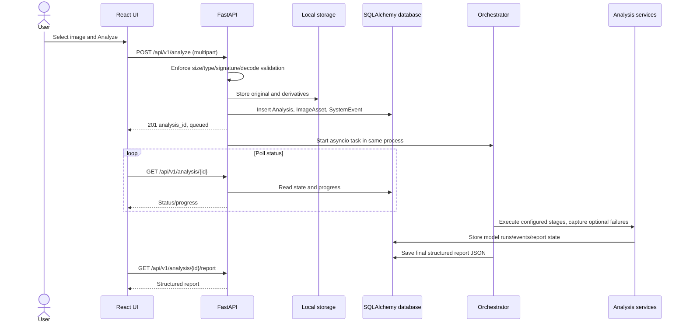

# TruthLens Technical Architecture

## 1. System overview

TruthLens is a browser-based single-page frontend communicating with a Python FastAPI service. The API validates image uploads, persists analysis metadata in a relational database, stores image files and artifacts in local storage, and starts a modular asynchronous pipeline in the API process. The pipeline emits a structured JSON report that the frontend retrieves and displays. Optional models and external providers are stage-local dependencies, not separate always-on services.

## 2. Technology stack

| Layer | Technology established in repository | Use |
|---|---|---|
| Frontend language and UI | TypeScript, React 19 | Single-page upload and results interface (`frontend/src/App.tsx`, `main.tsx`) |
| Build/dev server | Vite 8 | Frontend build and dev proxy to API |
| Styling/UI support | Tailwind CSS, clsx, Lucide icons, Recharts, Leaflet (see package manifest) | Styling, icons and charts/map-oriented presentation components; presence in manifest does not prove all chart/map visuals are connected to meaningful data |
| Backend | Python 3.11+, FastAPI, Uvicorn | HTTP API, lifespan, route composition and local server |
| Schemas/config | Pydantic, pydantic-settings | Response/input validation and environment configuration |
| ORM/database | SQLAlchemy async, aiosqlite by default; PostgreSQL supported when configured with async driver | Persist analysis, image, model run and system event entities |
| Image processing | Pillow, OpenCV, NumPy, imagehash | Decode, transform, quality/forensic operations, metadata and hashing |
| ML | PyTorch, Transformers, SigLIP vision backbone and local linear head | Authenticity inference; optional additional model services |
| OCR | EasyOCR, optional pytesseract/Tesseract | Extract visible text when packages, language data and model cache are available |
| Object detection | Ultralytics YOLO, configurable checkpoint | Optional object boxes/labels |
| Testing | pytest and Python test suite | Automated regression suite with 267 passed, 10 skipped in `backend/tests/` |
| VCS | Git | Working branch: `fix/truthlens-remediation` |

Versions are stated only where the checked-in manifest/docs declare them. Runtime versions vary by validation record; see `docs/phase6_experiment_setup.md` and `docs/phase5_e2e_test_report.md`.

## 3. Component and request flow



The task is in-process, so it is not durable across process termination. The application has no external message broker or worker. Multiple processes would not automatically coordinate task state. SQLite default configuration is convenient locally but does not itself provide a production deployment design.

## 4. Frontend architecture

- `frontend/src/main.tsx`: React root/bootstrap and stylesheet imports.
- `frontend/src/App.tsx`: main screen and result component composition. It contains card and status UI, progress tracker, authenticity summary, evidence, pipeline details, forensics/quality/object detections, original/heatmap viewer, report summary, OCR, metadata, claims, fact-check, provenance, hashes, virality, regional, social impact and limitations sections. The file uses local component state for upload/analysis/report interactions; there is no separate router architecture visible in the source inventory.
- `frontend/src/services/api.ts`: Axios client; upload, status, report, health, model-list and image/heatmap URL helpers.
- `frontend/src/App.css`, `index.css`: application and global styles.
- `frontend/src/assets/`: hero and framework assets.
- `frontend/vite.config.ts`: dev server config/proxy for API paths.
- `frontend/index.html`: app HTML entry.
- `frontend/package.json` / lockfile: actual JavaScript dependencies and scripts.

The UI polls analysis progress and uses result data to conditionally render feature sections. Optional or unavailable stages should be read from statuses/warnings, not interpreted as negative evidence. `getModels()` calls a placeholder backend endpoint that currently returns an empty list.

## 5. Backend architecture and module map

### Application and API

- `backend/app/main.py`: constructs FastAPI app, lifespan and API registration, CORS and common middleware/handlers.
- `backend/app/api/v1/router.py`: groups route modules at `/api/v1`.
- `backend/app/api/v1/endpoints/analyze.py`: upload validation, image hashes/storage, preprocessing and task kickoff.
- `backend/app/api/v1/endpoints/analysis.py`: status, report, original image, heatmap and ELA artifact reads.
- `backend/app/api/v1/endpoints/health.py`: database/GPU/system health and model availability report.
- `backend/app/api/v1/endpoints/stubs.py`: `/ocr`, `/fact-check`, `/provenance` return HTTP 501; `/models` is a placeholder returning no models.
- `backend/app/core/security.py`: MIME/signature/file validations, sanitized and generated filenames, hashes.
- `backend/app/core/exceptions.py`: API exception types and handlers.
- `backend/app/core/logging.py`: logging setup/access.
- `backend/app/config.py`: settings, paths, thresholds, provider configuration and storage directory creation. Defaults include `MAX_UPLOAD_SIZE_MB=20`, `MAX_IMAGE_PIXELS=40_000_000`, default local SQLite and local `data/` storage.

### Database and schemas

- `backend/app/db/base.py`: SQLAlchemy declarative base/model registration.
- `backend/app/db/session.py`: async engine/session and dependency.
- `backend/app/models/analysis.py`: analysis lifecycle state, summary scores/label fields, progress, timing, error and full report JSON; relationships to asset, runs and events.
- `backend/app/models/image_asset.py`: one image per analysis, original filename, opaque storage name/path, SHA-256, perceptual hash, MIME, dimensions, format, thumbnail path.
- `backend/app/models/model_run.py`: model ID/version/task/device/input hash/result/confidence/runtime/error and timestamp.
- `backend/app/models/system_event.py`: analysis-associated event type/severity/source/message/JSON metadata.
- `backend/app/schemas/__init__.py`: Pydantic request/response definitions.

No migration scripts were found. Deployment docs state tables are created with SQLAlchemy `create_all`.

### Analysis services

| Package/file | Responsibility and interaction |
|---|---|
| `services/orchestrator.py` | Central stage runner, status/error capture, executes pipeline and assembles final output. |
| `preprocessing/service.py` | EXIF orientation, RGB conversion, image statistics, thumbnail/resized outputs. |
| `metadata/service.py` | Metadata/EXIF extraction including guarded GPS handling. |
| `quality/service.py` | Resolution and image encoding/quality indicators. |
| `hashing/service.py` | SHA-256/perceptual-hash utilities and similarity support. |
| `authenticity/detector.py` | Production detector (`truthlens/siglip-cifake-frozen-head`), frozen SigLIP-base vision encoder + local linear head; predicts calibrated/uncalibrated probabilities and uncertainty bands. |
| `authenticity/calibration.py` | Enforces cryptographic model identity contracts and applies post-hoc temperature scaling fitted on held-out calibration pools. |
| `forensics/analyzer.py` | ELA, noise, JPEG, edge, texture, resampling indicators with limitations. |
| `ocr/service.py` | EasyOCR first and optional Tesseract fallback; explicit engine/status/text output. |
| `text/normalizer.py`, `nlp/language_detector.py` | Text normalization and optional model-based language/script outputs. No translation. |
| `claims/extractor.py` | Heuristic extraction/scoring of candidate claims and surface entities/dates/locations. |
| `factcheck/service.py` | Config-gated external fact-check search and normalized result/rating context. |
| `provenance/service.py` | Config-gated Google Vision Web Detection request and result normalization. |
| `vision/detector.py` | Optional Ultralytics object detection with configured weights. |
| `xai/gradcam.py` | Conditional class attribution/heatmap generation against model internals. |
| `evidence/schema.py` | Typed evidence collection and conversion from stage results. |
| `fusion/engine.py` | Rule-based score/direction aggregation and conflict/uncertainty handling. |
| `explanation/generator.py` | Human-readable, evidence-grounded explanations by source type. |
| `virality/engine.py` | Hand-weighted content/text cues, no learned propagation outcome predictor. |
| `regional/engine.py` | Regional result structure; returns unavailable without supported outcome data. |
| `social_impact/engine.py` | Exact-token/topic cue assessment, not validated outcome prediction. |
| `reporting/builder.py` | Builds safe structured JSON report with sections/status/warnings/limitations. |
| `utils/device.py` | Device selection support. |
| `vlm/service.py`, `search/`, `services/ml/`, `analysis/`, `workers/` | Package shells exist; architecture docs say VLM and durable worker support are not implemented. Inspect a shell before describing future functionality. |

## 6. Database model and ER diagram

```mermaid
erDiagram
  ANALYSIS ||--o| IMAGE_ASSET : has
  ANALYSIS ||--o{ MODEL_RUN : records
  ANALYSIS ||--o{ SYSTEM_EVENT : emits
  ANALYSIS {
    string id PK
    enum status
    float truth_score
    float truth_confidence
    string truth_label
    string current_step
    text completed_steps
    int processing_time_ms
    text error_message
    text report_json
    datetime created_at
    datetime updated_at
    datetime completed_at
  }
  IMAGE_ASSET {
    string id PK
    string analysis_id FK_unique
    string original_filename
    string storage_filename
    string storage_path
    string sha256_hash
    string perceptual_hash
    string mime_type
    int file_size_bytes
    int width
    int height
    string format
    string thumbnail_path
  }
  MODEL_RUN {
    string id PK
    string analysis_id FK
    string model_id
    string model_version
    string task
    string device
    string input_hash
    text result_json
    float confidence
    int runtime_ms
    text error_message
  }
  SYSTEM_EVENT {
    string id PK
    string analysis_id FK_nullable
    string event_type
    string severity
    string source
    text message
    text metadata_json
  }
```

Analysis state is database-backed. Original images and derived files are on disk and referenced by path. `report_json` is a serialized complete report rather than a separate normalized table for each evidence type. No ORM model for user/account/role was found.

## 7. API inventory

All routes below have the `/api/v1` prefix unless stated otherwise.

| Method/path | Purpose | Auth | Input/output notes | Frontend use / status |
|---|---|---|---|---|
| `POST /analyze` | Upload and create analysis | None | Multipart image; `201` with analysis ID and queued status; validation/storage errors use exception responses. | `uploadImage`; implemented. |
| `GET /analysis/{analysis_id}` | Status/progress and summary | None | `AnalysisOut`: progress, status, optional scores/label, image metadata, model runs, timing and timestamps. | `getAnalysisStatus`; polled by UI. |
| `GET /analysis/{analysis_id}/report` | Full report | None | Stored JSON if available; otherwise queued/processing/failed/legacy minimal response. | `getAnalysisReport`; implemented. |
| `GET /analysis/{analysis_id}/image` | Retrieve original image | None | Checks analysis, UUID and that resolved path remains inside originals directory. | `getAnalysisImageUrl`; rendered by image viewer. |
| `GET /analysis/{analysis_id}/heatmap?variant=overlay\|raw` | Retrieve XAI file | None | Only accepted variants; path constrained; `404` if absent. | `getHeatmapUrl`; conditional display. |
| `GET /analysis/{analysis_id}/forensics/ela` | Retrieve ELA image artifact | None | Analysis and path checked; unavailable artifact returns `404`. | No API helper found in the frontend service excerpt; availability should be verified in UI. |
| `GET /health` | Runtime/database status | None | Health status, app version/environment, GPU information, DB status, uptime. | `getHealth`; available. |
| `GET /health/models` | Model/dependency/checkpoint state | None | Reports configured/available/load state without necessarily loading models. | No direct helper confirmed. |
| `POST /ocr` | Standalone OCR | None | HTTP 501 stub, `NOT_IMPLEMENTED`. | Not a working endpoint; OCR runs as pipeline stage. |
| `POST /fact-check` | Standalone claim lookup | None | HTTP 501 stub. | Not a working endpoint; fact check is pipeline stage. |
| `POST /provenance` | Standalone image search | None | HTTP 501 stub. | Not a working endpoint; provenance is pipeline stage. |
| `GET /models` | List models | None | Placeholder returns empty `models` array and message. | `getModels` calls it; not a true model catalog. |
| `/docs`, `/redoc`, `/openapi.json` | FastAPI-generated docs | None by default | Generated OpenAPI views. | Developer/API use. |

API details are taken from decorators and handler code in `backend/app/api/v1/endpoints/`. No auth requirements are configured because authentication is absent.

## 8. Security, privacy and reliability

**Present controls:** extension/MIME/signature and actual image decode checks; bounded upload read; configured maximum file size and pixel count; sanitized display filename and server-generated storage name; SHA-256; resolved-path containment for original/heatmap/ELA retrieval; no raw storage paths in the intended report/API contract; settings are environment-driven and `.env` is gitignored by the project configuration.

**Unimplemented or unverified controls:** authentication/authorization, per-user ownership, rate limiter implementation, CSRF needs for an authenticated browser scenario, retention/deletion, encryption at rest, operational audit policy, durable work queue, schema migrations, container/orchestration, systematic abuse testing and public deployment controls. A `RATE_LIMIT_PER_MINUTE` setting alone is not evidence that rate limiting is active.

**Privacy:** originals, resized copies and artifacts persist under `STORAGE_PATH`; no deletion endpoint or retention schedule is described. When enabled, Google Vision may receive the image and Google Fact Check Tools may receive extracted claim text. These data flows require clear notice/consent and provider/rights review.

## 9. Operational configuration

Configuration is in `backend/app/config.py` and `.env.example`. Key defaults include local SQLite, storage path under project `data/`, 20 MB upload limit, 40,000,000 pixel limit, `DEVICE=auto`, `AUTHENTICITY_BACKEND=finetuned_siglip`, SigLIP base backbone, local head checkpoint, OCR languages `en,hi`, OCR model directory under `models/ocr`, optional Google credentials/API keys and CORS origins. Never include values from private `.env` in documentation.

`docs/deployment_guide.md` documents local API and frontend commands and warns that public exposure is not advised in the current security state. The repository has no Dockerfile/Compose deployment setup per that guide.

## 10. Project directory map

### Tracked top-level structure

```text
Truthlens/
├── backend/              FastAPI application, service modules, ORM, schemas, tests
├── data/                 tracked/example storage structure; also contains local runtime artifacts
├── docs/                 phase reports, architecture, deployment, evaluation, research drafts
├── experiments/          reproducibility scripts, manifest template and JSON/plot artifacts
├── frontend/             React/Vite UI, API client, assets and build configuration
├── models/               local checkpoint and model-related assets
├── scripts/              model download/helper scripts
├── test_data/            legacy images and many derived outputs; not approved evaluation data
├── .env.example          names/default examples for environment configuration; no secret values
├── .gitignore
└── README.md
```

`backend/` has `app/api/v1/endpoints`, `core`, `db`, `models`, `schemas`, `services/<capability>`, `utils`, `workers`, and `tests/{fixtures,integration,unit}`. `frontend/src` has application entry, main app, API service, styles and assets. `experiments/results` contains saved audits/scenarios, not labeled model performance results. Current untracked `data/heatmaps`, `data/originals`, `data/processed`, `data/thumbnails`, local databases, `temp/` and Python environment files were not altered; user/runtime files are not research evidence.

### Documentation files already in the repository

| File | Content |
|---|---|
| `README.md` | Project overview, startup, current capability and research/deployment caveats. |
| `docs/README.md` | Documentation index and navigation map for all reference files and phase reports. |
| `docs/system_architecture.md` | Concise current system architecture, component data flow, and runtime boundaries. |
| `docs/api_reference.md` | API route/schema overview and structured report JSON specification. |
| `docs/deployment_guide.md` | Local setup, configuration, demonstration workflow and deployment constraints. |
| `docs/phase1_implementation_report.md`, `phase2_implementation_report.md`, `phase3_implementation_report.md`, `phase4_implementation_report.md`, `phase5_implementation_report.md`, `phase6_implementation_report.md` | Phase-specific implementation records; older records can describe prior states, so reconcile with current source. |
| `docs/phase4_dataset_inventory.md`, `phase4_evaluation.md` | Phase 4 input/data availability and evaluation limitations. |
| `docs/phase5_e2e_test_report.md`, `phase5_performance_report.md`, `phase5_security_audit.md`, `phase5_system_audit.md` | Historical end-to-end/software, performance, security and system audit records. |
| `docs/phase6_ablation_study.md`, `phase6_authenticity_evaluation.md`, `phase6_error_analysis.md`, `phase6_explainability_evaluation.md`, `phase6_multilingual_evaluation.md`, `phase6_social_analytics_evaluation.md` | Phase 6 controlled rule behavior and task-specific evaluation readiness/limitations. |
| `docs/phase6_experiment_dataset_inventory.md`, `phase6_experiment_setup.md`, `phase6_research_questions.md` | Dataset audit, reproduction protocol and open research questions. |
| `docs/phase6_research_readiness_audit.md`, `phase6_responsible_ai_assessment.md`, `phase6_usability_protocol.md` | Readiness, risks and proposed (not conducted) usability protocol. |
| `docs/phase6_final_research_report.md`, `TruthLens_IEEE_research_paper.md`, `phase6_viva_preparation.md` | Research-system draft, IEEE-style prototype paper draft and panel preparation. Drafts require team metadata and citation review. |
| `docs/ai_generation_misclassification_review.md` | Specific detector behavior review and corrective context. |
| `docs/VIRALITY_DATA.md`, `virality_methodology.md`, `regional_spread_methodology.md`, `social_impact_methodology.md` | Data/method status for heuristic and regional/context indicators. |

### Experiment files

| Path | Purpose |
|---|---|
| `experiments/README.md` | Experiment tools and intended use. |
| `experiments/calibrate_authenticity.py`, `calibration_utils.py` | Calibration artifact/metric utility workflow; requires valid validation data and matching model identity. |
| `experiments/dataset_audit.py` | Aggregate inventory and duplicate-candidate audit for a selected image directory. |
| `experiments/evaluate_authenticity.py` | Manifest-enforced authenticity evaluation; refuses unsupported data and produces `NOT_EVALUABLE` when no eligible samples exist. |
| `experiments/fusion_controlled_scenarios.py` | Deterministic constructed evidence scenarios; does not use a ground-truth image dataset. |
| `experiments/test_metrics.py` | Unit checks for experiment metric/transform/hash utilities. |
| `experiments/plot_readiness_inventory.py` | Creates a plot from aggregate readiness data. |
| `experiments/manifests/authenticity.example.csv` | Header-only reviewed-manifest template, not a data set. |
| `experiments/results/authenticity_test.json` | Recorded authenticity evaluator state and counts. |
| `experiments/results/fusion_controlled_scenarios.json` | Controlled rule scenario outputs, not model metrics. |
| `experiments/results/repository_test_data_audit.json`, `test_originals_inventory.json` | Aggregate image inventory results. |
| `experiments/results/test_data_readiness.png` | Visualization of readiness counts, not prediction accuracy. |

### Test and build files

- `backend/tests/conftest.py`: shared fixtures/test setup.
- `backend/tests/test_api.py`: API-level integration behavior.
- `backend/tests/test_authenticity_calibration.py`: calibration validation paths.
- `backend/tests/test_phase1.py` through `test_phase6.py`: phase acceptance/regression checks.
- `backend/tests/test_stage3.py` through `test_stage5.py`: stage-specific behavior.
- `backend/tests/test_services.py`: service-level checks; `fixtures/test_photo.jpg` supports code-path tests.
- `backend/tests/integration/` and `unit/`: organization placeholders/directories in current tracked tree.
- `backend/requirements.txt`, `requirements-dev.txt`, `pyproject.toml`: Python dependency and pytest configuration.
- `frontend/package.json`, `package-lock.json`, `tsconfig*.json`, `vite.config.ts`, `frontend/.oxlintrc.json`: frontend scripts/dependencies, TypeScript, Vite and lint configuration.
- `frontend/README.md`: frontend-specific startup notes; `frontend/.env.example` shows frontend environment variable names.

### Other root files

- `.env.example`: backend configuration names/default examples; do not include private `.env` values in reports.
- `.gitignore`: excludes local environment, cache and generated content according to its rules.
- `scripts/download_models.py`: helper for model file retrieval; review network/license requirements before use.
- `models/baselines/siglip_frozen_head.pt`: local trained linear head; its SHA and backbone pairing are recorded in the Phase 6 authenticity report.
- `models/configs/.gitkeep`: placeholder preserving an otherwise empty config directory.
- `models/cache/` and `models/ocr/`: environment-dependent caches; content was not treated as project source or research data.
- Root `yolov8n.pt` and database files exist in this workspace snapshot but were not treated as version-controlled evidence or research data.
- `test_data/` includes originals and many processed/thumbnail/heatmap derivatives; provenance is undocumented and the tree is not an independent labeled corpus.

## 11. Evidence anchors

- System flow: `backend/app/api/v1/endpoints/analyze.py:create_analysis`; `backend/app/services/orchestrator.py:run_analysis_pipeline`.
- API composition: `backend/app/api/v1/router.py`; route definitions under `backend/app/api/v1/endpoints/`.
- Entity relations: `backend/app/models/{analysis,image_asset,model_run,system_event}.py`.
- UI sections: `frontend/src/App.tsx`; API helper calls `frontend/src/services/api.ts`.
- Deployment/runtime caveats: `docs/deployment_guide.md`, `docs/system_architecture.md`.
- Model configuration and limits: `backend/app/config.py`, `backend/app/services/authenticity/detector.py`, `docs/phase6_authenticity_evaluation.md`.
