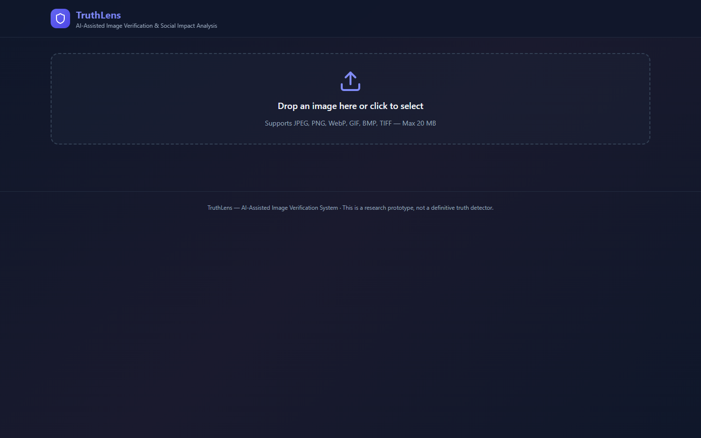
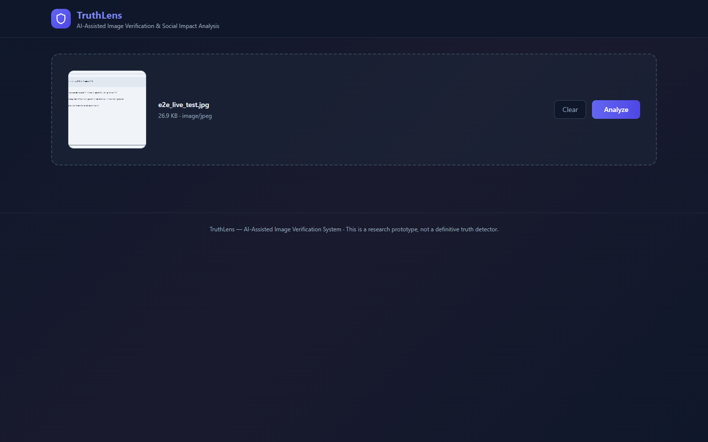
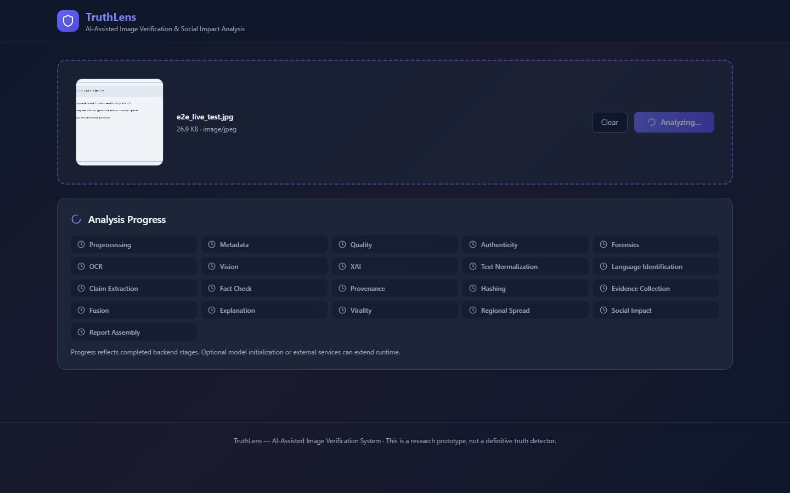
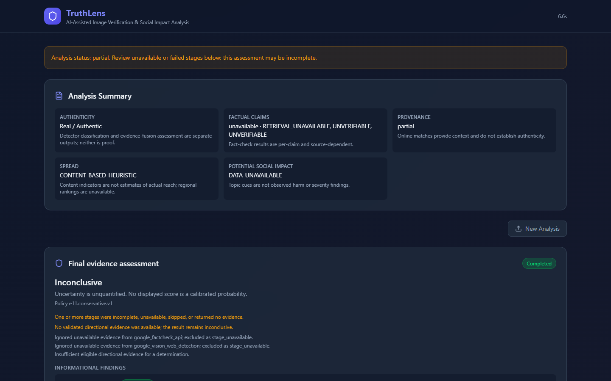

# TruthLens

**AI-Assisted Multimodal Image Verification, Forensic Analysis, and Context Indicators**

TruthLens is a multimodal decision-support application designed to analyze digital images for signs of synthetic generation, manipulation, textual claims, and web provenance. TruthLens operates under conservative decision-support principles: a raw model score, forensic cue, Grad-CAM heatmap, or reverse-image match is evidence for human review, not definitive proof of falsity or truth.

---

## 1. Project Overview

Digital misinformation frequently pairs synthetic, manipulated, or recontextualized imagery with unverified factual claims. TruthLens addresses this challenge by providing an integrated, multi-stage verification pipeline that evaluates:
- **Visual Authenticity:** Pinned SigLIP ViT deep-learning classification.
- **Physical Forensics:** Informational low-level image cues (Error Level Analysis, noise variance, JPEG grid artifacts, edge consistency, texture response, and resampling zero-crossings).
- **Extracted Text & Claims:** OCR text recognition, multilingual language identification, deterministic factual proposition extraction, and query-cached third-party fact-checking.
- **Provenance & Integrity:** C2PA Content Credentials cryptographic verification and reverse-image web detection.
- **Interpretability & Fusion:** Grad-CAM attribution heatmaps and conservative, non-directional evidence fusion that abstains whenever validated evidence is incomplete or conflicting.

TruthLens is backed by durable queue-based background workers, SQLite/PostgreSQL persistence, and a real-time reactive React/TypeScript frontend.

---

## 2. Key Capabilities

- **Secure Image Upload Pipeline:** Streaming upload validation verifying MIME types, magic bytes, Pillow decompression-bomb boundaries (`MAX_IMAGE_PIXELS = 89,478,485`), and path traversal sanitization.
- **Deep Authenticity Classification:** GPU-accelerated SigLIP classifier (`truthlens/siglip-cifake-frozen-head`) evaluating images in ~160 ms.
- **Classical Forensics Suite:** 6 classical CPU probes reporting quantitative metrics (ELA, Laplacian noise, 8-pixel JPEG boundary differences, Canny edge density, Gabor texture regularity, second-difference zero crossings).
- **Contextual Object Detection:** Ultralytics YOLOv8n detecting scene objects without biasing authenticity verdicts.
- **XAI Attribution (Grad-CAM):** Gradient-weighted Class Activation Mapping highlighting visual regions influencing the classifier.
- **Optical Character Recognition:** Cache-only EasyOCR engine with automated fallback to system Tesseract (`eng`, `hin`, `osd`).
- **Multilingual Language Identification:** Offline PAPLUCA XLM-RoBERTa 20-language sequence classifier.
- **Deterministic Claim Extraction:** Rule-based candidate proposition extractor generating verifiable claims with precise character offsets.
- **Attributed Fact-Checking:** Google Fact Check Tools integration with persistent SQLite cache, query TTL, in-flight deduplication, and publisher attribution.
- **Cryptographic Provenance:** Official `c2pa-python` SDK verifying manifest signatures, content bindings, and trust anchors.
- **Durable Asynchronous Execution:** Database-backed background worker queue with singleton lease management, heartbeat renewal, and crash recovery.
- **Conservative Evidence Fusion:** Policy `e11.conservative.v1` combining evidence while treating classical forensics as informational, requiring calibration for directional voting, and safely abstaining to `inconclusive`.

---

## 3. System Architecture

TruthLens employs a decoupled, asynchronous ASGI and worker architecture:

```mermaid
flowchart TD
    Client["Browser UI (React 19 / Vite)\nhttp://127.0.0.1:5173"] -->|Vite Reverse Proxy /api| Backend["FastAPI Backend (Uvicorn ASGI)\nhttp://127.0.0.1:8000"]
    Backend -->|Submit Job & Asset| DB[(SQLite Database\ntruthlens.db)]
    Worker["Analysis Worker Daemon\n(backend.app.workers.analysis_worker)"] -->|Claim Job & Global Lease| DB
    Worker -->|Inference (CUDA / PyTorch)| Models["SigLIP / YOLOv8 / EasyOCR /\nXLM-RoBERTa / Grad-CAM"]
    Worker -->|Write Analysis Report| DB
    Client -->|Poll Progress / Fetch Report| Backend
    Backend -->|Serve Heatmaps & Assets| Client
```

---

## 4. Technology Stack

- **Frontend:** React 19, TypeScript, Vite 8 (optimized manual vendor chunking), Tailwind CSS v4, Recharts, Leaflet, Lucide Icons.
- **API & Core:** FastAPI 0.115, Pydantic v2, Uvicorn, Python 3.12.
- **Database & Queue:** SQLAlchemy 2.0 (asyncio), Alembic (migrations `20261122_01` -> `20261122_02`), SQLite WAL / PostgreSQL (DDL verified).
- **Deep Learning & Vision:** PyTorch 2.x (CUDA 12.8 / RTX 3050 Laptop GPU), Hugging Face Transformers, Timm, Ultralytics YOLOv8, Pillow, OpenCV, scikit-image.
- **NLP & Text:** EasyOCR, Tesseract OCR 5.4.0, PAPLUCA XLM-RoBERTa language detection.
- **Provenance & Cryptography:** `c2pa-python` 0.39.0 (Rust 0.92.0 bindings), ImageHash.
- **Testing & Tooling:** Pytest, Vitest, Playwright, Oxlint, Ruff.

---

## 5. Visual Evidence & Screenshots

All screenshots from the live end-to-end browser execution are archived in [docs/screenshots/](docs/screenshots/):

| View | Screenshot | Description |
| :--- | :--- | :--- |
| **Landing View** |  | Upload dropzone, navigation bar, and responsible-use disclosures. |
| **File Preview** |  | Selected image metadata (filename, dimensions, filesize) prior to submission. |
| **Live Pipeline** |  | Real-time progress bar advancing through all 21 pipeline stages. |
| **Summary Report** |  | Summary cards showing Authenticity, Claims, Provenance, Spread, and Impact verdicts. |
| **Complete Report** |  | Scrolled report detail showing raw model scores, 6 forensic probes, OCR text, and Grad-CAM heatmap. |

---

## 6. Setup Instructions

### Prerequisites
- **Python:** 3.11 or 3.12 (Python 3.12.10 recommended).
- **Node.js:** v20+ or v22+ (v22.23.5 recommended with npm 10.9.9).
- **Tesseract OCR (Optional for fallback):** Installed and available on system `PATH` (e.g. `C:\Program Files\Tesseract-OCR\tesseract.exe`).
- **CUDA (Optional):** NVIDIA GPU with PyTorch CUDA runtime (CPU execution supported).

### Installation Steps (PowerShell on Windows)

```powershell
# 1. Clone repository and navigate to root
cd D:\Projects\Truthlens

# 2. Set up Python virtual environment
python -m venv .venv
.\.venv\Scripts\Activate.ps1

# 3. Install backend dependencies
python -m pip install --upgrade pip
pip install -r backend/requirements.txt

# 4. Install frontend dependencies
cd frontend
npm ci
cd ..
```

---

## 7. Environment Configuration

Copy `.env.example` to `.env` in the repository root:

```powershell
Copy-Item .env.example .env
```

Key configuration parameters:

```ini
# Environment
ENVIRONMENT=development
DEV_AUTH_BYPASS=true
LOG_LEVEL=INFO

# Networking
API_HOST=127.0.0.1
API_PORT=8000
FRONTEND_PORT=5173

# Database & Storage
DATABASE_URL=sqlite+aiosqlite:///truthlens.db
STORAGE_PATH=storage/uploads

# Rate Limiting
RATE_LIMIT_ANALYSIS_PER_MINUTE=4
RATE_LIMIT_OCR_PER_MINUTE=20
RATE_LIMIT_CLAIMS_PER_MINUTE=30
RATE_LIMIT_FACTCHECK_PER_MINUTE=30
RATE_LIMIT_MODELS_PER_MINUTE=60
RATE_LIMIT_LANGUAGE_PER_MINUTE=60

# Model Paths
SIGLIP_MODEL_PATH=models/baselines/siglip_frozen_head.pt
YOLO_MODEL_PATH=models/baselines/yolov8n.pt

# Synthetic Demonstration Data (College Demo / Illustrative Context Only)
# Default: false (preserves baseline production behavior)
TRUTHLENS_SYNTHETIC_REPORT_DATA_ENABLED=false
SYNTHETIC_DATA_DIR=./datasets/synthetic_demo
```

> [!NOTE]
> **Synthetic Demonstration Data:** To enable illustrative virality indicators, 3-point spread trajectory charts (1h/6h/24h), and neutral regional exposure simulations for college presentation, set `TRUTHLENS_SYNTHETIC_REPORT_DATA_ENABLED=true`. This data is strictly for academic demonstration, does not evaluate detector accuracy, and never alters authenticity classification or evidence fusion verdicts. See [`docs/SYNTHETIC_REPORT_INTEGRATION.md`](docs/SYNTHETIC_REPORT_INTEGRATION.md) and [`docs/POST_CLEANUP_E2E_REGRESSION_REPORT.md`](docs/POST_CLEANUP_E2E_REGRESSION_REPORT.md).

---

## 8. Backend Startup

Run the FastAPI backend server (bound strictly to loopback `127.0.0.1`):

```powershell
python -m uvicorn backend.app.main:app --host 127.0.0.1 --port 8000
```

Verify backend health:
- Health check: `http://127.0.0.1:8000/api/v1/health`
- Interactive Swagger docs: `http://127.0.0.1:8000/docs`

---

## 9. Worker Startup

In a separate terminal, launch the durable background analysis worker:

```powershell
.\.venv\Scripts\Activate.ps1
python -m backend.app.workers.analysis_worker
```

The worker acquires the global database lease (`analysis-pipeline`), renews heartbeats every 5 seconds, polls for queued analysis jobs, and executes the 21 pipeline stages.

---

## 10. Frontend Startup

In a third terminal, launch the Vite development server:

```powershell
cd frontend
npm run dev -- --host 127.0.0.1 --port 5173
```

Open your browser to: **`http://127.0.0.1:5173/`**

---

## 11. API Documentation

TruthLens provides 5 standalone public APIs in addition to the end-to-end analysis workflow:

| Method | Endpoint | Description |
| :---: | :--- | :--- |
| `POST` | `/api/v1/analyze` | Submit an uploaded image for asynchronous multimodal analysis. |
| `GET` | `/api/v1/analysis/{id}` | Poll execution progress and stage-level status. |
| `GET` | `/api/v1/analysis/{id}/report` | Retrieve the complete structured analysis report. |
| `GET` | `/api/v1/analysis/{id}/heatmap` | Fetch generated Grad-CAM attribution overlay PNG. |
| `GET` | `/api/v1/analysis/{id}/image` | Fetch processed source image variants. |
| `GET` | `/api/v1/models` | Standalone non-eager model registry reporting status and device allocation. |
| `POST` | `/api/v1/ocr` | Standalone image-to-text extraction using EasyOCR with Tesseract fallback. |
| `POST` | `/api/v1/claims` | Standalone deterministic factual proposition extraction from text. |
| `POST` | `/api/v1/fact-check` | Standalone query-cached fact-checking via Google Fact Check Tools. |
| `POST` | `/api/v1/nlp/language` | Standalone 20-language identification using XLM-RoBERTa. |
| `GET` | `/api/v1/health` | System health check (database connection, worker availability, GPU memory). |

See [docs/api_reference.md](docs/api_reference.md) for full request/response schemas.

---

## 12. Testing Commands

### Backend Regression Suites

```powershell
# Run all backend regression tests (579 passed, 12 skipped)
python -m pytest backend/tests -q

# Run core API integration tests
python -m pytest backend/tests/test_core_api_integration.py -v

# Run database migration & worker reliability tests
python -m pytest backend/tests/test_postgres_migrations.py backend/tests/test_worker_recovery.py -v

# Run security audit suite (22 audit scenarios)
python -m pytest backend/tests/test_security_audit.py -v
```

### Frontend Test & Quality Checks

```powershell
cd frontend

# TypeScript typecheck
npm run typecheck

# Vitest component & unit tests
npm run test

# Oxlint linter
npm run lint

# Production Vite build
npm run build
```

---

## 13. Package B: External Integrations & Infrastructure Hardening

Package B completed six engineering workstreams:

1. **Google Fact Check Tools API:** Live verified Claim Search API (`https://factchecktools.googleapis.com/v1alpha1/claims:search`) with SQLite query caching and publisher filtering. See [docs/GOOGLE_FACT_CHECK_INTEGRATION.md](file:///D:/Projects/Truthlens/docs/GOOGLE_FACT_CHECK_INTEGRATION.md).
2. **Google Cloud Vision Web Detection:** Complete reverse-image entity extraction with URL sanitization, classified as `IMPLEMENTED_BUT_CREDENTIAL_BLOCKED` due to GCP project permissions. See [docs/GOOGLE_VISION_WEB_DETECTION.md](file:///D:/Projects/Truthlens/docs/GOOGLE_VISION_WEB_DETECTION.md).
3. **C2PA Production Trust Validation:** 8-outcome lifecycle state machine distinguishing cryptographic validity from signer trust. See [docs/C2PA_PRODUCTION_TRUST_POLICY.md](file:///D:/Projects/Truthlens/docs/C2PA_PRODUCTION_TRUST_POLICY.md).
4. **Tesseract OCR Fallback:** EasyOCR primary with automatic fallback to system Tesseract 5.4.0 (`eng`, `hin`, `osd`); resolved Windows `tessdata` prefix anomaly. See [docs/TESSERACT_FALLBACK_VERIFICATION.md](file:///D:/Projects/Truthlens/docs/TESSERACT_FALLBACK_VERIFICATION.md).
5. **PostgreSQL Reliability & Disaster Recovery:** 100% DDL compilation across all 8 tables and indexes, migration downgrade safety, and disaster recovery procedures. See [docs/POSTGRESQL_MIGRATION_BACKUP_RECOVERY.md](file:///D:/Projects/Truthlens/docs/POSTGRESQL_MIGRATION_BACKUP_RECOVERY.md).
6. **Production Auth & Deployment Security:** Fail-closed production bypass prevention, uniform 404 tenant isolation, and 30 passed security tests. See [docs/PRODUCTION_AUTHENTICATION_SECURITY_AUDIT.md](file:///D:/Projects/Truthlens/docs/PRODUCTION_AUTHENTICATION_SECURITY_AUDIT.md).

Executive overview: [docs/PACKAGE_B_EXECUTIVE_REPORT.md](file:///D:/Projects/Truthlens/docs/PACKAGE_B_EXECUTIVE_REPORT.md).

---

## 14. Current Limitations

1. **PostgreSQL Server Tools:** Production PostgreSQL connection pooling and migration DDL are 100% verified via automated tests; live multi-worker PostgreSQL runtime execution remains unverified on the local host due to uninstalled server tools.
2. **Third-Party API Keys:** Live Google Fact Check Tools and Google Cloud Vision Web Detection keys are optional; when omitted, the pipeline gracefully records the stages as `unavailable` or `partial`.
3. **Forensic Probe Informativeness:** Experiment 2 confirmed that classical forensic indicators (ELA, noise, JPEG grid) offer no statistically significant predictive power for AI detection; they are presented as strictly informational context and are excluded from voting.
4. **VLM & Regional Data:** VLM scene description is currently not integrated into the main pipeline; regional spread rankings remain descriptive heuristics due to absent historical ground-truth dissemination data.

---

## 15. Research Status & Governance

TruthLens maintains rigorous separation between production software and research experiments:
- **Baseline Model Identity:** `truthlens/siglip-cifake-frozen-head` stored at `models/baselines/siglip_frozen_head.pt` (SHA-256 `e39afc5536a0de44dd07fd33fa911bbd58d8799b85e680eb08d532222d974538`). Zero weights have been altered.
- **Experiment 2 (Forensic Screening):** Evaluated all 6 classical forensic probes across 6,995 training samples under Protocol v1.2.1. Directional fusion was formally **REJECTED** due to lack of incremental log-loss gain and 100% format confounding (JPEG real vs PNG AI).
- **R10 Preregistered Candidate:** Evaluated frequency residual hybrid architecture; primary Frontier AUC delta was +0.0631, but balanced accuracy declined by 0.0801. Remained research-only; not promoted to production.
- **Protected Benchmarks:** The 10,385-sample held-out benchmark and 2,999-sample retained reserve partition remain strictly locked and unaccessed.

See [docs/DEVELOPMENT_DOCUMENTATION_INDEX.md](docs/DEVELOPMENT_DOCUMENTATION_INDEX.md) for authoritative research records.

---

## 16. Responsible-Use Disclaimer

> [!WARNING]
> **Decision-Support Only — Not a Ground-Truth Oracle:**
> TruthLens is an AI-assisted analysis tool intended to augment human journalistic and forensic workflows. No model score, metadata reading, forensic heuristic, or web match constitutes definitive proof that an image is authentic, synthetic, or altered.
>
> Outputs must be critically evaluated alongside independent corroboration, primary sources, and contextual domain expertise. TruthLens must not be used as an automated basis for legal, disciplinary, or editorial censorship decisions.
