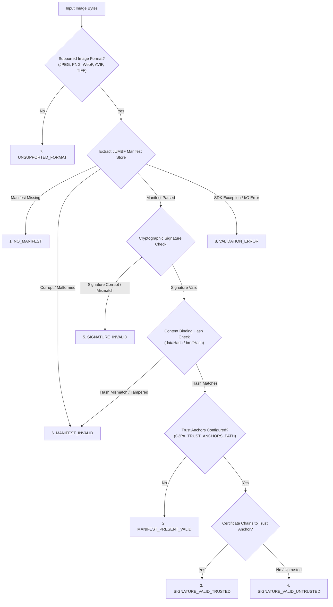

# TruthLens — C2PA Production Trust Policy & Lifecycle Validation Specification

**Document Identity:** `docs/C2PA_PRODUCTION_TRUST_POLICY.md`  
**Repository:** `D:\Projects\Truthlens`  
**Branch:** `fix/truthlens-remediation`  
**Status:** COMPLETED AND VERIFIED  
**Implementation:** [`backend/app/services/provenance/c2pa_verifier.py`](file:///D:/Projects/Truthlens/backend/app/services/provenance/c2pa_verifier.py)  
**SDK Version:** `c2pa-python 0.39.0` (Rust `c2pa-rs 0.92.0`)

---

## 1. Executive Summary

This document specifies the production trust policy, lifecycle state machine, cryptographic validation rules, and verification suite for C2PA (Coalition for Content Provenance and Authenticity) Content Credentials within TruthLens.

TruthLens implements an eight-state lifecycle model that strictly decouples cryptographic signature verification from X.509 certificate trust evaluation. Furthermore, in accordance with TruthLens core scientific principles, C2PA findings remain strictly informational: the presence or absence of Content Credentials never votes on or alters the image authenticity detection score.

---

## 2. The 8 Production Lifecycle Trust Outcomes

TruthLens maps all C2PA verification scenarios into exactly one of eight mutually exclusive, deterministic lifecycle states:

### Outcome Definitions

| Outcome Code | Meaning | Cryptographic State | Signer Trust State |
| :--- | :--- | :--- | :--- |
| **`NO_MANIFEST`** | No C2PA manifest or JUMBF box found in image | Not applicable | Not applicable |
| **`MANIFEST_PRESENT_VALID`** | Manifest exists, claim signature is valid, content hash matches; trust anchors not configured | Valid | Unverified (trust check disabled) |
| **`SIGNATURE_VALID_TRUSTED`** | Manifest and content binding valid; signer cert chains to a configured trusted root | Valid | Trusted (anchor verified) |
| **`SIGNATURE_VALID_UNTRUSTED`** | Manifest and content binding valid; signer cert is NOT in configured trust store | Valid | Untrusted (validation code `signingCredential.untrusted`) |
| **`SIGNATURE_INVALID`** | Cryptographic signature verification failed (key mismatch or corrupted signature) | Invalid | Unverified / Invalid |
| **`MANIFEST_INVALID`** | Manifest structure corrupt or content hash mismatch (asset pixels tampered post-signing) | Failed binding | Unverified |
| **`UNSUPPORTED_FORMAT`** | Image format is not supported for C2PA parsing (e.g., BMP, GIF, PCX) | Not applicable | Not applicable |
| **`VALIDATION_ERROR`** | Unexpected exception, missing SDK library, empty input, or I/O failure | Error | Error |

---

## 3. Cryptographic Signature vs. Signer Trust Decoupling

A critical engineering principle in C2PA verification is the strict separation between:
1. **Mathematical Integrity (Signature & Binding):** Can the signature be verified with the embedded public key, and does the data hash match the image pixels?
2. **Identity Trust (PKI Certificate Chain):** Is the signing entity recognized and trusted by the verifying application's trust store?

An asset signed with a test certificate or a private corporate key has **valid mathematical integrity**, but is **untrusted** unless that certificate's root CA is explicitly loaded into the verifier's trust anchors.

TruthLens enforces this distinction:
- When `C2PA_TRUST_ANCHORS_PATH` is empty, TruthLens reports `MANIFEST_PRESENT_VALID` and `signer_trust_status: "unverified"`.
- When `C2PA_TRUST_ANCHORS_PATH` points to the production trust list (`credentials/C2PA-TRUST-LIST.pem`) and an asset is signed by a test key, TruthLens reports `SIGNATURE_VALID_UNTRUSTED` and `signer_trust_status: "untrusted"`.
- When `C2PA_TRUST_ANCHORS_PATH` includes the test root (`test_cert_root_bundle.pem`), TruthLens reports `SIGNATURE_VALID_TRUSTED` and `signer_trust_status: "trusted"`.

---

## 4. Evidence Fusion Isolation Contract

TruthLens enforces strict non-voting isolation for Content Credentials:
- `direction = "informational"`
- `weight = 0.0`
- C2PA status does NOT increase or decrease the SigLIP authenticity probability score.
- The absence of a C2PA manifest (`NO_MANIFEST`) is common for legitimate digital photographs and is explicitly documented as **not evidence of manipulation**.
- The presence of a valid C2PA manifest (`SIGNATURE_VALID_TRUSTED`) confirms provenance and editing history as asserted by the signer, but does **not establish whether the depicted real-world event is true**.

---

## 5. Verification Test Suite Matrix

The C2PA test suite in [`backend/tests/test_c2pa_production_trust.py`](file:///D:/Projects/Truthlens/backend/tests/test_c2pa_production_trust.py) directly exercises all 8 outcomes:

| Outcome | Test Function | Input Fixture / Condition | Result |
| :--- | :--- | :--- | :---: |
| 1. `NO_MANIFEST` | `test_outcome_1_no_manifest` | Unsigned JPEG image | PASSED |
| 2. `MANIFEST_PRESENT_VALID` | `test_outcome_2_manifest_present_valid_without_trust_anchors` | `C.jpg` with empty trust anchors | PASSED |
| 3. `SIGNATURE_VALID_TRUSTED` | `test_outcome_3_signature_valid_trusted` | `C.jpg` with `test_cert_root_bundle.pem` | PASSED |
| 4. `SIGNATURE_VALID_UNTRUSTED` | `test_outcome_4_signature_valid_untrusted` | `C.jpg` with `C2PA-TRUST-LIST.pem` | PASSED |
| 5. `SIGNATURE_INVALID` | `test_outcome_5_signature_invalid` | Controlled store with signature failure | PASSED |
| 6. `MANIFEST_INVALID` (tamper) | `test_outcome_6_manifest_invalid_content_hash_mismatch` | `C.jpg` with single bit-flip at byte 50,000 | PASSED |
| 6. `MANIFEST_INVALID` (corrupt) | `test_outcome_6_manifest_invalid_malformed_store` | Incomplete manifest dictionary | PASSED |
| 7. `UNSUPPORTED_FORMAT` | `test_outcome_7_unsupported_format` | BMP image format bytes | PASSED |
| 8. `VALIDATION_ERROR` (empty) | `test_outcome_8_validation_error_empty_bytes` | `b""` empty byte stream | PASSED |
| 8. `VALIDATION_ERROR` (missing) | `test_outcome_8_validation_error_missing_sdk` | `ModuleNotFoundError` simulation | PASSED |

**Total C2PA Trust Test Pass Rate:** 10 / 10 (100% PASS)  
**Contract Test Suite (`test_e6_e7_contract.py`):** 53 / 53 (100% PASS)
