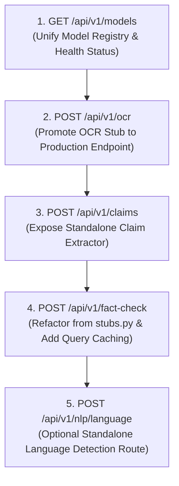

# TruthLens — Prioritized Implementation Queue

**Document Identity:** `docs/IMPLEMENTATION_QUEUE.md`  
**Repository:** `D:\Projects\Truthlens`  
**Branch:** `fix/truthlens-remediation`  
**Date:** 2026-11-23  
**Status:** ACTIVE SPECIFICATION  

---

## 1. Overview & Architectural Context

Following the closeout of Experiment 2 (which established that classical forensic indicators do not warrant directional fusion into authenticity scoring), the repository development focus shifts to completing core API contracts and promoting service implementations from stubs into dedicated production endpoints.

This document details the exact file paths, existing functions/handlers, test suites, missing logic, dependencies, and execution plan for the five target components:
1. `GET /api/v1/models`
2. `POST /api/v1/ocr`
3. Claim extraction service & endpoint (`POST /api/v1/claims`)
4. Fact-check service & endpoint (`POST /api/v1/fact-check`)
5. Language identification service (`LanguageDetector` / `POST /api/v1/nlp/language`)

---

## 2. Component Audits & Detailed Readiness

### Priority 1: `GET /api/v1/models` (Model Registry Endpoint) — COMPLETED AND VERIFIED

- **Target Route:** `GET /api/v1/models`
- **Implementation Path:** [backend/app/api/v1/endpoints/models.py](file:///D:/Projects/Truthlens/backend/app/api/v1/endpoints/models.py) (Service: [backend/app/services/ml/registry.py](file:///D:/Projects/Truthlens/backend/app/services/ml/registry.py), Schema: [backend/app/schemas/models.py](file:///D:/Projects/Truthlens/backend/app/schemas/models.py))
- **Status:** **COMPLETED AND VERIFIED** (2026-11-23)
- **Features Implemented:**
  - Replaced placeholder stub with a unified, non-eager model registry reporting all 5 configured models:
    1. SigLIP Authenticity Detector (`authenticity`)
    2. YOLOv8 Object Detector (`object_detection`)
    3. EasyOCR Text Recognition (`ocr_easyocr`)
    4. Tesseract OCR Fallback (`ocr_tesseract`)
    5. XLM-RoBERTa Language Identification (`language_detection`)
  - Strict non-eager guarantee: singleton state and disk checks only; `.load()` is never called.
  - Strict privacy guarantee: absolute local filesystem paths, environment secrets, and stack traces are sanitized; only public filenames or model IDs are exposed.
  - Distinct status semantics (`loaded`, `available_not_loaded`, `cached_not_loaded`, `checkpoint_missing`, `dependency_unavailable`, `failed`).
  - Protected with Bearer authentication (`get_current_principal`) and rate-limited with scope `"models"` (`RATE_LIMIT_MODELS_PER_MINUTE`).
- **Test Verification:**
  - [backend/tests/test_models_endpoint.py](file:///D:/Projects/Truthlens/backend/tests/test_models_endpoint.py): 10 passed tests covering inventory, schema, non-eager loading, privacy/path redaction, missing checkpoints, missing dependencies, load failures, memory/device reporting, authentication enforcement, and rate limiting.
  - Backward compatibility confirmed: `backend/tests/test_api.py::test_health_models_endpoint` passes without changes.

---

### Priority 2: `POST /api/v1/ocr` (Standalone OCR Endpoint) — COMPLETED AND VERIFIED

- **Target Route:** `POST /api/v1/ocr`
- **Implementation Path:** [backend/app/api/v1/endpoints/ocr.py](file:///D:/Projects/Truthlens/backend/app/api/v1/endpoints/ocr.py) (Service: [backend/app/services/ocr/service.py](file:///D:/Projects/Truthlens/backend/app/services/ocr/service.py), Schema: [backend/app/schemas/ocr.py](file:///D:/Projects/Truthlens/backend/app/schemas/ocr.py))
- **Status:** **COMPLETED AND VERIFIED** (2026-11-23)
- **Features Implemented:**
  - Implemented standalone `POST /api/v1/ocr` using the existing production `OCRService` singleton (`get_ocr_service()`).
  - No second OCR implementation; no eager loading of OCR models on startup.
  - Image upload handling via `image: UploadFile = File(...)` with streaming byte bounds (`max_upload_bytes + 1`) raising HTTP 413 when oversized.
  - Comprehensive image validation using `backend.app.core.security.validate_image_file` (validating magic bytes, allowed MIME types, decompression bombs, zero bytes, unreadable bytes, and dimension limits, raising HTTP 422).
  - Query parameter support: `languages: Optional[str] = Query(None)` parsed into clean lowercase ISO-639 codes with per-request override.
  - Non-blocking execution via `asyncio.to_thread(_run_extract)` with 60-second timeout (`asyncio.wait_for`, raising HTTP 504 on timeout).
  - Rate limiting via database-backed fixed-window rate limiter scoped to `"ocr"` (`RATE_LIMIT_OCR_PER_MINUTE`, default 20 requests/min).
  - Authentication via Bearer token (`Principal = Depends(get_current_principal)`).
  - Preserved EasyOCR primary and Tesseract fallback behavior.
  - Dedicated Pydantic response schema (`OCRResponse`, `OCRBlockResponse`).
  - Sanitized error handling: unhandled internal exceptions return HTTP 500 without leaking stack traces or local filesystem paths.
  - Route registered in `backend/app/api/v1/router.py` under tag `["OCR"]`.
  - Replaced 501 stub in `stubs.py` with backward-compatible re-export.
- **Test Verification:**
  - [backend/tests/test_ocr_endpoint.py](file:///D:/Projects/Truthlens/backend/tests/test_ocr_endpoint.py): 13 passed tests covering:
    1. Successful extraction with EasyOCR (`test_ocr_endpoint_success_easyocr`)
    2. Fallback to Tesseract on EasyOCR failure (`test_ocr_endpoint_tesseract_fallback`)
    3. Custom query `languages` parameter parsing (`test_ocr_endpoint_custom_languages_query`)
    4. Clean `no_results` when image contains no text (`test_ocr_endpoint_no_text_found`)
    5. Rate limiting enforcement for `"ocr"` scope (`test_ocr_endpoint_rate_limiting`)
    6. Authentication enforcement (`test_ocr_endpoint_auth_required`)
    7. HTTP 413 on oversized upload (`test_ocr_endpoint_oversized_upload`)
    8. HTTP 422 on corrupted image bytes (`test_ocr_endpoint_corrupt_image`)
    9. HTTP 422 on empty upload (`test_ocr_endpoint_empty_file`)
    10. HTTP 422 on dimension limit violations (`test_ocr_endpoint_invalid_dimensions`)
    11. HTTP 504 on processing timeout (`test_ocr_endpoint_timeout`)
    12. HTTP 500 safe error sanitization without path leakage (`test_ocr_endpoint_internal_error_sanitization`)
    13. Backward compatibility of `stubs.ocr_endpoint` re-export (`test_ocr_endpoint_backward_compatibility_reexport`)
  - Integration suite verification:
    - `backend/tests/test_ocr_runtime.py`: 25 passed, 2 skipped
    - `backend/tests/test_models_endpoint.py`: 10 passed
    - `backend/tests/test_api.py::test_health_models_endpoint`: 1 passed
    - Model baseline SHA-256 bit-exact preservation: `e39afc5536a0de44dd07fd33fa911bbd58d8799b85e680eb08d532222d974538`.

---

### Priority 3: Claim Extraction Service & Endpoint (`POST /api/v1/claims`)

- **Target Route:** `POST /api/v1/claims`
- **Current File Path:** Service is located at [backend/app/services/claims/extractor.py](file:///D:/Projects/Truthlens/backend/app/services/claims/extractor.py). No dedicated endpoint exists (claims are currently invoked inside orchestrator pipeline or embedded in `POST /api/v1/fact-check`).
- **Functions / Handlers:** `extract_claims(...)`, `ClaimExtractionResult`, `ExtractedClaim`
- **Existing Test Coverage:**
  - [backend/tests/test_e4_e5_contract.py](file:///D:/Projects/Truthlens/backend/tests/test_e4_e5_contract.py) (Tests claim normalization, deterministic IDs, question/opinion/slogan eligibility gating, date/location/number extraction, and E3 language provenance integration).
  - [backend/tests/test_stage4.py](file:///D:/Projects/Truthlens/backend/tests/test_stage4.py) (Coverage across diverse sentence inputs).
  - [backend/tests/test_phase3.py](file:///D:/Projects/Truthlens/backend/tests/test_phase3.py) (Offline coverage).
- **Missing Implementation:**
  1. Define dedicated endpoint router in [backend/app/api/v1/endpoints/claims.py](file:///D:/Projects/Truthlens/backend/app/api/v1/endpoints/claims.py).
  2. Create request model `ClaimExtractionRequest`:
     ```python
     class ClaimExtractionRequest(BaseModel):
         text: Optional[str] = Field(None, max_length=10000)
         sentences: Optional[List[str]] = Field(None, max_length=50)
         language_code: Optional[str] = Field(None, max_length=5)
         max_claims: int = Field(5, ge=1, le=20)
     ```
  3. Validate input: Ensure at least one of `text` or `sentences` is supplied.
  4. Optional language detection chaining: If `language_code` is not provided, invoke `LanguageDetector.detect()` when text length $\ge 20$ chars.
  5. Rate limiting: `check_rate_limit(scope="claims")`.
  6. Return `ClaimExtractionResult.to_dict()`.
- **Dependencies / Blockers:** None. `extract_claims` is purely deterministic CPU text processing.
- **Estimated Complexity:** Low (0.5 engineering day).

---

### Priority 4: Fact-Check Service & Endpoint Promotion (`POST /api/v1/fact-check`)

- **Target Route:** `POST /api/v1/fact-check`
- **Current File Path:** Service at [backend/app/services/factcheck/service.py](file:///D:/Projects/Truthlens/backend/app/services/factcheck/service.py); Endpoint in [backend/app/api/v1/endpoints/stubs.py](file:///D:/Projects/Truthlens/backend/app/api/v1/endpoints/stubs.py) (Lines 84–184).
- **Current Handlers:**
  - `search_fact_checks(...)` in `service.py`.
  - `async def factcheck_endpoint(...)` in `stubs.py`.
- **Existing Test Coverage:**
  - [backend/tests/test_e4_e5_contract.py](file:///D:/Projects/Truthlens/backend/tests/test_e4_e5_contract.py) (Verifies rate limiting, skipping ineligible claims, HTTPS review URL sanitization, credential stripping, provider response truncation, and mock retrieval).
  - [backend/tests/test_phase3.py](file:///D:/Projects/Truthlens/backend/tests/test_phase3.py).
  - [backend/tests/test_e11_fusion.py](file:///D:/Projects/Truthlens/backend/tests/test_e11_fusion.py) (Verifies non-directional evidence handling).
- **Missing Implementation:**
  1. Move endpoint out of `stubs.py` into a dedicated module [backend/app/api/v1/endpoints/factcheck.py](file:///D:/Projects/Truthlens/backend/app/api/v1/endpoints/factcheck.py).
  2. Implement local in-memory or database-backed TTL cache for query hashes to prevent redundant third-party Google API quota consumption.
  3. Add batch claim parallelization: When multiple eligible claims are submitted, search asynchronously up to concurrency limit (e.g., `asyncio.gather` bounded by `asyncio.Semaphore(3)`).
  4. Ensure graceful degradation: When `GOOGLE_API_KEY` or `FACTCHECK_API_KEY` is not configured, return clean `status="unavailable"` with clear explanatory message rather than throwing exceptions.
- **Dependencies / Blockers:** Requires valid Google Fact Check Tools API key for live calls; mocked and safe fallback tests pass without key.
- **Estimated Complexity:** Medium (1 engineering day).

---

### Priority 5: Language Identification Service (`LanguageDetector` / Standalone API)

- **Target Route:** `POST /api/v1/nlp/language` (Optional public route)
- **Current File Path:** [backend/app/services/nlp/language_detector.py](file:///D:/Projects/Truthlens/backend/app/services/nlp/language_detector.py)
- **Functions / Handlers:** `LanguageDetector`, `LanguageDetectionResult`, `get_language_detector()`
- **Existing Test Coverage:**
  - [backend/tests/test_language_detector.py](file:///D:/Projects/Truthlens/backend/tests/test_language_detector.py) (Validates offline cache loading, exact 20-class `id2label` mapping, input bounds 4,096 chars / 256 tokens, uncalibrated softmax confidence, and thread safety).
  - [backend/tests/test_api.py](file:///D:/Projects/Truthlens/backend/tests/test_api.py) (Validates pipeline integration).
- **Missing Implementation:**
  1. The core service is **ALREADY COMPLETE AND VERIFIED**.
  2. If exposed as an API endpoint:
     - Request schema: `LanguageDetectionRequest(text: str = Field(..., min_length=1, max_length=10000))`
     - Response schema: `LanguageDetectionResponse` serializing `LanguageDetectionResult.to_dict()`
     - Authentication and rate limiting (`scope="nlp"`).
- **Dependencies / Blockers:** Hugging Face model weights must be pre-cached in `settings.MODEL_CACHE_DIR` (`papluca/xlm-roberta-base-language-detection`, revision `9865598389ca9d95637462f743f683b51d75b87b`).
- **Estimated Complexity:** Low (0.5 engineering day).

---

## 3. Recommended Implementation Order and Roadmap



### Rationale for Sequence
1. **`GET /api/v1/models` First:** Lowest risk, pure read-only system introspection. Leverages existing inspection code from `health.py` and provides immediate visibility into all installed models without external I/O or network dependencies.
2. **`POST /api/v1/ocr` Second:** Decouples optical character recognition from the heavyweight analysis pipeline. The underlying engine (`OCRService`) is already hardened and tested; creating the endpoint enables immediate utility for image-to-text workflows.
3. **`POST /api/v1/claims` Third:** Follows OCR. Allows users or client applications to extract checkable factual propositions directly from arbitrary text without uploading an image.
4. **`POST /api/v1/fact-check` Fourth:** Builds directly on top of claim extraction. Moving it out of `stubs.py` and adding query caching protects against third-party API rate limits and quotas.
5. **`POST /api/v1/nlp/language` Fifth:** Serves as a complementary NLP utility. The service is already operational internally; public API exposure can be added as a lightweight wrapper.

---

## 4. Governance & Safety Rules for Next Tasks

1. **Model Baseline Preservation:** The production SigLIP checkpoint ([siglip_frozen_head.pt](file:///D:/Projects/Truthlens/models/baselines/siglip_frozen_head.pt)) and YOLOv8n checkpoint ([yolov8n.pt](file:///D:/Projects/Truthlens/models/baselines/yolov8n.pt)) must remain strictly unmodified.
2. **Protected Data Isolation:** Neither the 10,385-sample held-out benchmark nor the 2,999-sample retained reserve partition may be accessed, read, or evaluated during endpoint implementation.
3. **Rate Limiting & Authentication:** Every new or promoted endpoint must enforce token authentication via `get_current_principal` and scope-specific rate limits.
4. **No Secret Leakage:** Error responses and log statements must never reveal local filesystem paths, stack traces, API keys, or private tokens.
5. **Regression Verification:** All changes must pass `pytest backend/tests/test_api.py`, `pytest backend/tests/test_ocr_runtime.py`, and `pytest backend/tests/test_e4_e5_contract.py` before completion.