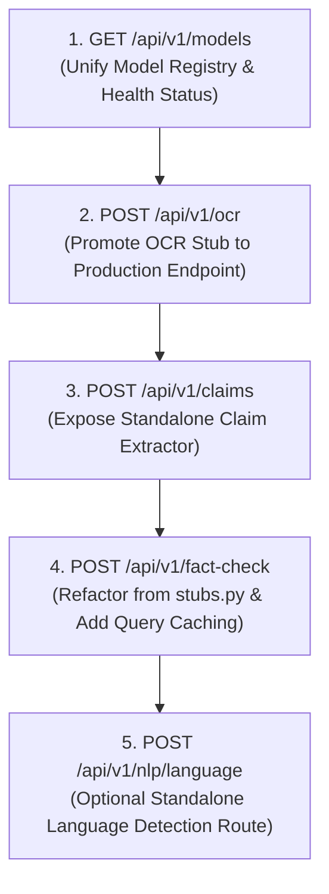

# TruthLens — Prioritized Implementation Queue

**Document Identity:** `docs/IMPLEMENTATION_QUEUE.md`  
**Repository:** `D:\Projects\Truthlens`  
**Branch:** `fix/truthlens-remediation`  
**Date:** 2026-11-23  
**Status:** ACTIVE SPECIFICATION  

---

## 1. Overview & Architectural Context

Following the closeout of Experiment 2 (which established that classical forensic indicators do not warrant directional fusion into authenticity scoring), the repository development focus shifts to completing core API contracts and promoting service implementations from stubs into dedicated production endpoints.

This document details the exact file paths, existing functions/handlers, test suites, missing logic, dependencies, and execution plan for the five target components:
1. `GET /api/v1/models`
2. `POST /api/v1/ocr`
3. Claim extraction service & endpoint (`POST /api/v1/claims`)
4. Fact-check service & endpoint (`POST /api/v1/fact-check`)
5. Language identification service (`LanguageDetector` / `POST /api/v1/nlp/language`)

---

## 2. Component Audits & Detailed Readiness

### Priority 1: `GET /api/v1/models` (Model Registry Endpoint) — COMPLETED AND VERIFIED

- **Target Route:** `GET /api/v1/models`
- **Implementation Path:** [backend/app/api/v1/endpoints/models.py](file:///D:/Projects/Truthlens/backend/app/api/v1/endpoints/models.py) (Service: [backend/app/services/ml/registry.py](file:///D:/Projects/Truthlens/backend/app/services/ml/registry.py), Schema: [backend/app/schemas/models.py](file:///D:/Projects/Truthlens/backend/app/schemas/models.py))
- **Status:** **COMPLETED AND VERIFIED** (2026-11-23)
- **Features Implemented:**
  - Replaced placeholder stub with a unified, non-eager model registry reporting all 5 configured models:
    1. SigLIP Authenticity Detector (`authenticity`)
    2. YOLOv8 Object Detector (`object_detection`)
    3. EasyOCR Text Recognition (`ocr_easyocr`)
    4. Tesseract OCR Fallback (`ocr_tesseract`)
    5. XLM-RoBERTa Language Identification (`language_detection`)
  - Strict non-eager guarantee: singleton state and disk checks only; `.load()` is never called.
  - Strict privacy guarantee: absolute local filesystem paths, environment secrets, and stack traces are sanitized; only public filenames or model IDs are exposed.
  - Distinct status semantics (`loaded`, `available_not_loaded`, `cached_not_loaded`, `checkpoint_missing`, `dependency_unavailable`, `failed`).
  - Protected with Bearer authentication (`get_current_principal`) and rate-limited with scope `"models"` (`RATE_LIMIT_MODELS_PER_MINUTE`).
- **Test Verification:**
  - [backend/tests/test_models_endpoint.py](file:///D:/Projects/Truthlens/backend/tests/test_models_endpoint.py): 10 passed tests covering inventory, schema, non-eager loading, privacy/path redaction, missing checkpoints, missing dependencies, load failures, memory/device reporting, authentication enforcement, and rate limiting.
  - Backward compatibility confirmed: `backend/tests/test_api.py::test_health_models_endpoint` passes without changes.

---

### Priority 2: `POST /api/v1/ocr` (Standalone OCR Endpoint) — COMPLETED AND VERIFIED

- **Target Route:** `POST /api/v1/ocr`
- **Implementation Path:** [backend/app/api/v1/endpoints/ocr.py](file:///D:/Projects/Truthlens/backend/app/api/v1/endpoints/ocr.py) (Service: [backend/app/services/ocr/service.py](file:///D:/Projects/Truthlens/backend/app/services/ocr/service.py), Schema: [backend/app/schemas/ocr.py](file:///D:/Projects/Truthlens/backend/app/schemas/ocr.py))
- **Status:** **COMPLETED AND VERIFIED** (2026-11-23)
- **Features Implemented:**
  - Implemented standalone `POST /api/v1/ocr` using the existing production `OCRService` singleton (`get_ocr_service()`).
  - No second OCR implementation; no eager loading of OCR models on startup.
  - Image upload handling via `image: UploadFile = File(...)` with streaming byte bounds (`max_upload_bytes + 1`) raising HTTP 413 when oversized.
  - Comprehensive image validation using `backend.app.core.security.validate_image_file` (validating magic bytes, allowed MIME types, decompression bombs, zero bytes, unreadable bytes, and dimension limits, raising HTTP 422).
  - Query parameter support: `languages: Optional[str] = Query(None)` parsed into clean lowercase ISO-639 codes with per-request override.
  - Non-blocking execution via `asyncio.to_thread(_run_extract)` with 60-second timeout (`asyncio.wait_for`, raising HTTP 504 on timeout).
  - Rate limiting via database-backed fixed-window rate limiter scoped to `"ocr"` (`RATE_LIMIT_OCR_PER_MINUTE`, default 20 requests/min).
  - Authentication via Bearer token (`Principal = Depends(get_current_principal)`).
  - Preserved EasyOCR primary and Tesseract fallback behavior.
  - Dedicated Pydantic response schema (`OCRResponse`, `OCRBlockResponse`).
  - Sanitized error handling: unhandled internal exceptions return HTTP 500 without leaking stack traces or local filesystem paths.
  - Route registered in `backend/app/api/v1/router.py` under tag `["OCR"]`.
  - Replaced 501 stub in `stubs.py` with backward-compatible re-export.
- **Test Verification:**
  - [backend/tests/test_ocr_endpoint.py](file:///D:/Projects/Truthlens/backend/tests/test_ocr_endpoint.py): 13 passed tests covering:
    1. Successful extraction with EasyOCR (`test_ocr_endpoint_success_easyocr`)
    2. Fallback to Tesseract on EasyOCR failure (`test_ocr_endpoint_tesseract_fallback`)
    3. Custom query `languages` parameter parsing (`test_ocr_endpoint_custom_languages_query`)
    4. Clean `no_results` when image contains no text (`test_ocr_endpoint_no_text_found`)
    5. Rate limiting enforcement for `"ocr"` scope (`test_ocr_endpoint_rate_limiting`)
    6. Authentication enforcement (`test_ocr_endpoint_auth_required`)
    7. HTTP 413 on oversized upload (`test_ocr_endpoint_oversized_upload`)
    8. HTTP 422 on corrupted image bytes (`test_ocr_endpoint_corrupt_image`)
    9. HTTP 422 on empty upload (`test_ocr_endpoint_empty_file`)
    10. HTTP 422 on dimension limit violations (`test_ocr_endpoint_invalid_dimensions`)
    11. HTTP 504 on processing timeout (`test_ocr_endpoint_timeout`)
    12. HTTP 500 safe error sanitization without path leakage (`test_ocr_endpoint_internal_error_sanitization`)
    13. Backward compatibility of `stubs.ocr_endpoint` re-export (`test_ocr_endpoint_backward_compatibility_reexport`)
  - Integration suite verification:
    - `backend/tests/test_ocr_runtime.py`: 25 passed, 2 skipped
    - `backend/tests/test_models_endpoint.py`: 10 passed
    - `backend/tests/test_api.py::test_health_models_endpoint`: 1 passed
    - Model baseline SHA-256 bit-exact preservation: `e39afc5536a0de44dd07fd33fa911bbd58d8799b85e680eb08d532222d974538`.

---

### Priority 3: Claim Extraction Service & Endpoint (`POST /api/v1/claims`) — COMPLETED AND VERIFIED

- **Target Route:** `POST /api/v1/claims`
- **Implementation Path:** [backend/app/api/v1/endpoints/claims.py](file:///D:/Projects/Truthlens/backend/app/api/v1/endpoints/claims.py) (Service: [backend/app/services/claims/extractor.py](file:///D:/Projects/Truthlens/backend/app/services/claims/extractor.py), Schema: [backend/app/schemas/claims.py](file:///D:/Projects/Truthlens/backend/app/schemas/claims.py))
- **Status:** **COMPLETED AND VERIFIED** (2026-11-23)
- **Features Implemented:**
  - Dedicated endpoint `POST /api/v1/claims` exposing the deterministic `conservative_rules_v2` claim extraction engine.
  - No new model, no fact-check retrieval, no external search calls; pure deterministic candidate extraction.
  - Robust request validation via `ClaimExtractionRequest` (`text`, `sentences`, `language`, `source`, `ocr_confidence`, `max_claims`, `min_confidence`).
  - Strict input guards: rejects empty/whitespace-only text, enforces maximum text length (`MAX_CLAIM_TEXT_LENGTH = 10000`), validates ISO 639-1 language codes against supported 20-language catalog.
  - Accurate 0-based character offset computation (`source_start`, `source_end`) matching exact substring in original input text.
  - Semantic classification (`FACTUAL`, `QUOTE`, `OPINION`, `QUESTION`, `SLOGAN`, `AMBIGUOUS`) and eligibility gating (`ELIGIBLE` vs `INELIGIBLE`).
  - Rate limiting via database-backed fixed-window limiter scoped to `"claims"` (`RATE_LIMIT_CLAIMS_PER_MINUTE = 30`).
  - Authentication via Bearer token (`get_current_principal`).
  - Sanitized error handling returning HTTP 500 without leaking internal paths, secrets, or stack traces.
  - Registered in versioned API router `backend/app/api/v1/router.py`.
- **Test Verification:**
  - [backend/tests/test_claims_endpoint.py](file:///D:/Projects/Truthlens/backend/tests/test_claims_endpoint.py): 16 passed tests covering:
    1. Standard extraction of multiple candidates (`test_claims_endpoint_multiple_candidates`)
    2. Filtering of ineligible statements like questions, opinions, slogans (`test_claims_endpoint_no_eligible_claims`)
    3. Rejection of empty text strings (`test_claims_endpoint_empty_text`)
    4. Rejection of whitespace-only text (`test_claims_endpoint_whitespace_only_text`)
    5. Enforcement of maximum text length (`test_claims_endpoint_max_text_length_exceeded`)
    6. Schema validation for invalid payloads (`test_claims_endpoint_invalid_schema`)
    7. Language validation for supported vs unsupported codes (`test_claims_endpoint_supported_and_unsupported_languages`)
    8. Exact character offset correctness indexing original input (`test_claims_endpoint_character_offset_correctness`)
    9. Unicode, Hindi, and mixed-language input handling (`test_claims_endpoint_unicode_hindi_and_multilingual`)
    10. Duplicate normalized candidate deduplication (`test_claims_endpoint_duplicate_claim_deduplication`)
    11. Clean handling when extractor returns empty/unavailable (`test_claims_endpoint_extractor_empty_or_unavailable`)
    12. Internal exception sanitization without leakage (`test_claims_endpoint_unexpected_exception_sanitization`)
    13. Bearer authentication enforcement (`test_claims_endpoint_authentication_enforced`)
    14. Claims scope rate limiting enforcement (`test_claims_endpoint_rate_limiting_enforced`)
    15. Response schema and method/version reporting (`test_claims_endpoint_response_schema_and_version`)
    16. Redaction of sensitive paths, tokens, and secrets (`test_claims_endpoint_no_sensitive_paths_or_secrets_exposed`)
  - Integration regression verification:
    - `backend/tests/test_e4_e5_contract.py`: 25 passed
    - `backend/tests/test_stage4.py`: 46 passed
    - `backend/tests/test_phase3.py`: 12 passed
    - `backend/tests/test_ocr_endpoint.py`: 13 passed
    - `backend/tests/test_ocr_runtime.py`: 25 passed, 2 skipped
    - `backend/tests/test_models_endpoint.py`: 10 passed
    - `backend/tests/test_api.py::test_health_models_endpoint`: 1 passed
    - Bit-exact baseline weight preservation: `e39afc5536a0de44dd07fd33fa911bbd58d8799b85e680eb08d532222d974538`.

---

### Priority 4: Fact-Check Service & Endpoint Promotion (`POST /api/v1/fact-check`) — COMPLETED AND VERIFIED

- **Target Route:** `POST /api/v1/fact-check`
- **Implementation Path:** [backend/app/api/v1/endpoints/fact_check.py](file:///D:/Projects/Truthlens/backend/app/api/v1/endpoints/fact_check.py) (Service: [backend/app/services/factcheck/service.py](file:///D:/Projects/Truthlens/backend/app/services/factcheck/service.py), Cache: [backend/app/services/factcheck/cache.py](file:///D:/Projects/Truthlens/backend/app/services/factcheck/cache.py), Schema: [backend/app/schemas/factcheck.py](file:///D:/Projects/Truthlens/backend/app/schemas/factcheck.py))
- **Status:** **COMPLETED AND VERIFIED** (2026-11-23)
- **Features Implemented:**
  - Dedicated endpoint `POST /api/v1/fact-check` promoted out of `stubs.py` into dedicated module `backend/app/api/v1/endpoints/fact_check.py` with backward-compatible re-export in `stubs.py`.
  - Reused existing Google Fact Check Tools integration in `service.py` (`search_fact_checks`) without creating duplicate provider logic or modifying verified URL sanitization and stream bounds.
  - Implemented persistent SQLite query cache (`FactCheckCache` in `backend/app/services/factcheck/cache.py`) located at `settings.STORAGE_PATH / "cache" / "factcheck_cache.sqlite3"` (with in-memory fallback for testing):
    - Normalized claim-text hashing key (`"fc_cache_<hex32>"`) combining query, language code, and provider.
    - Explicit configurable TTL (`FACTCHECK_CACHE_TTL_SECONDS = 86400`, 24 hours) with automatic eviction on read.
    - In-flight request deduplication via `asyncio.Lock` per cache key (`get_in_flight_lock`) to eliminate redundant simultaneous requests for identical queries.
    - Capacity-bounded cache (`FACTCHECK_CACHE_MAX_ENTRIES = 5000`) with LRU eviction.
    - Safe caching policy: refuses to cache errors, timeouts, or rate limits; only caches successful (`success`) and verified clean zero-result (`no_results`) outcomes.
  - Deterministic claim gating: filters incoming propositions through `extract_claims`; skips ineligible items (questions, opinions, slogans) before provider submission with explicit reasons.
  - Clean status semantics: cleanly distinguishes `success`, `partial`, `failed`, `no_results`, `unavailable`, and `skipped`.
  - Attribution preservation: keeps publisher name, site, title, textual rating, and sanitized review URL intact for every matched review item.
  - Protected with Bearer authentication (`get_current_principal`) and database-backed rate limiting scoped to `"fact-check"` (`RATE_LIMIT_FACTCHECK_PER_MINUTE = 30`).
- **Test Verification:**
  - [backend/tests/test_factcheck_endpoint.py](file:///D:/Projects/Truthlens/backend/tests/test_factcheck_endpoint.py): 22 passed tests covering:
    1. Single eligible claim with successful review (`test_factcheck_endpoint_success_single_claim`)
    2. Multiple eligible claims in request order (`test_factcheck_endpoint_multiple_eligible_claims`)
    3. Exclusion of ineligible claims from provider lookup (`test_factcheck_endpoint_ineligible_claims_excluded`)
    4. All-ineligible claims skipping provider without lookup (`test_factcheck_endpoint_no_eligible_claims`)
    5. Empty, malformed, and out-of-bounds requests returning 422 (`test_factcheck_endpoint_empty_and_malformed_requests`)
    6. Clean `no_results` status when provider returns empty (`test_factcheck_endpoint_provider_returns_no_results`)
    7. Clean `unavailable` status when credentials missing (`test_factcheck_endpoint_missing_credentials`)
    8. Provider HTTP 403 handling (`test_factcheck_endpoint_provider_http_403`)
    9. Provider HTTP 429 quota handling (`test_factcheck_endpoint_provider_quota_http_429`)
    10. Provider timeout handling (`test_factcheck_endpoint_provider_timeout`)
    11. Provider HTTP 500 server error handling (`test_factcheck_endpoint_provider_server_error`)
    12. Malformed provider response handling (`test_factcheck_endpoint_malformed_provider_response`)
    13. Publisher and URL attribution preservation (`test_factcheck_endpoint_publisher_and_url_attribution`)
    14. Deduplication of identical reviews across claims (`test_factcheck_endpoint_duplicate_review_deduplication`)
    15. Cache miss then hit lifecycle (`test_factcheck_endpoint_cache_miss_then_hit`)
    16. Cache TTL expiry and re-query (`test_factcheck_endpoint_cache_expiry`)
    17. Cache isolation across language codes (`test_factcheck_endpoint_cache_isolation_by_language`)
    18. In-flight duplicate concurrent request deduplication (`test_factcheck_endpoint_duplicate_concurrent_requests`)
    19. Rate limiting enforcement returning HTTP 429 (`test_factcheck_endpoint_rate_limiting_enforced`)
    20. Bearer token authentication enforcement returning HTTP 401 (`test_factcheck_endpoint_authentication_enforced`)
    21. Non-disclosure of API keys or secrets in responses (`test_factcheck_endpoint_no_sensitive_secrets_exposed`)
    22. SQLite cache schema, persistence, and eviction (`test_factcheck_cache_sqlite_lifecycle_and_schema`)
  - Integration regression verification:
    - `backend/tests/test_e4_e5_contract.py`: 25 passed
    - `backend/tests/test_stage4.py`: 46 passed
    - `backend/tests/test_phase3.py`: 12 passed
    - `backend/tests/test_claims_endpoint.py`: 16 passed
    - `backend/tests/test_ocr_endpoint.py`: 13 passed
    - `backend/tests/test_ocr_runtime.py`: 25 passed, 2 skipped
    - `backend/tests/test_models_endpoint.py`: 10 passed
    - `backend/tests/test_api.py::test_health_models_endpoint`: 1 passed
    - `backend/tests/test_e10_database.py`: 5 passed
    - Bit-exact SigLIP baseline weight preservation: `e39afc5536a0de44dd07fd33fa911bbd58d8799b85e680eb08d532222d974538`.

---

### Priority 5: Language Identification Service (`LanguageDetector` / Standalone API) — COMPLETED AND VERIFIED

- **Target Route:** `POST /api/v1/nlp/language`
- **Implementation Path:** [backend/app/api/v1/endpoints/language.py](file:///D:/Projects/Truthlens/backend/app/api/v1/endpoints/language.py) (Service: [backend/app/services/nlp/language_detector.py](file:///D:/Projects/Truthlens/backend/app/services/nlp/language_detector.py), Schema: [backend/app/schemas/language.py](file:///D:/Projects/Truthlens/backend/app/schemas/language.py))
- **Status:** **COMPLETED AND VERIFIED** (2026-11-23)
- **Features Implemented:**
  - Dedicated standalone endpoint `POST /api/v1/nlp/language` exposing the local XLM-RoBERTa 20-language classifier (`papluca/xlm-roberta-base-language-detection`, pinned revision `9865598389ca9d95637462f743f683b51d75b87b`).
  - No new model, duplicate inference service, or external network downloads; strict offline cache loading.
  - Robust request validation via `LanguageDetectionRequest`:
    - `text`: 1 to 10,000 characters; whitespace-only or empty strings rejected with HTTP 422.
    - `top_k`: Optional integer (1 to 20, default 3); invalid bounds rejected with HTTP 422.
  - Dedicated response model `LanguageDetectionResponse`:
    - `status`: `"completed"`, `"insufficient_text"`, `"unavailable"`, or `"failed"`.
    - `outcome`: `"success"`, `"undetermined"`, `"insufficient_input"`, `"no_text"`, `"unavailable"`, `"failed"`.
    - `detected_language`: 2-letter ISO 639-1 code or `"unknown"`.
    - `language_code` and `language_name` (e.g. `"en"` / `"English"`, `"hi"` / `"Hindi"`).
    - `confidence`: Uncalibrated softmax probability ($\ge 0.70$ threshold for confident assignment).
    - `top_languages` / `top_k_candidates`: Ranked list of `LanguageCandidate` objects with code, name, and score.
    - `model_id`, `model_revision`, `device`, `runtime_ms`, `processing_time_ms`, `input_characters`, `input_truncated`, `confidence_semantics`, `warnings`, `limitations`, and `unavailable_reason`.
  - Non-blocking execution wrapped in `asyncio.to_thread`.
  - Bearer authentication via `Principal = Depends(get_current_principal)`.
  - Scoped rate limiting via database-backed fixed window (`RATE_LIMIT_LANGUAGE_PER_MINUTE = 60`, default 60 req/min).
  - Strict privacy & security: absolute filesystem paths, internal stack traces, and environment secrets sanitized.
  - Route registered in `backend/app/api/v1/router.py` under tag `["Language Identification"]`.
- **Test Verification:**
  - [backend/tests/test_language_endpoint.py](file:///D:/Projects/Truthlens/backend/tests/test_language_endpoint.py): 17 passed tests covering:
    1. English detection (`test_language_detection_english`)
    2. Hindi detection (`test_language_detection_hindi`)
    3. Multilingual detection and top-k ranking (`test_language_detection_multilingual_candidates`)
    4. Short or ambiguous text handling (`test_language_detection_short_ambiguous_text`)
    5. Empty text rejection (`test_language_detection_empty_text_rejected`)
    6. Whitespace-only rejection (`test_language_detection_whitespace_rejected`)
    7. Maximum input length exceeded (`test_language_detection_max_length_exceeded`)
    8. Invalid top_k bounds (`test_language_detection_invalid_top_k`)
    9. Detector unavailable handling (`test_language_detection_detector_unavailable`)
    10. Model initialization failure (`test_language_detection_initialization_failure`)
    11. Prediction exception handling (`test_language_detection_prediction_exception`)
    12. Language code and name mapping (`test_language_detection_code_and_name_mapping`)
    13. Confidence bounds and schema validation (`test_language_detection_confidence_bounds_and_schema`)
    14. Bearer authentication enforcement (`test_language_detection_authentication_enforced`)
    15. Rate limiting enforcement (`test_language_detection_rate_limiting_enforced`)
    16. Sensitive data and path sanitization (`test_language_detection_path_and_secret_sanitization`)
    17. Non-eager loading verification (`test_language_detection_no_eager_loading_on_startup`)
  - Integration suite verification:
    - [backend/tests/test_language_detector.py](file:///D:/Projects/Truthlens/backend/tests/test_language_detector.py): 28 passed tests.
    - [backend/tests/test_core_api_integration.py](file:///D:/Projects/Truthlens/backend/tests/test_core_api_integration.py): 4 passed tests (including 5-endpoint chaining: Models -> OCR -> Language Detection -> Claims -> Fact-Check).
    - Zero modifications to production SigLIP weights (`models/baselines/siglip_frozen_head.pt`, SHA-256 `e39afc5536a0de44dd07fd33fa911bbd58d8799b85e680eb08d532222d974538`).

---

### Priority 6: PostgreSQL Reliability, Database Lifecycle and Durable Worker Recovery — COMPLETED AND VERIFIED (SQLITE / POSTGRES BLOCKED)

- **Target Work Package:** Database lifecycle, Alembic migration verification, worker crash/restart recovery, multi-worker concurrency, and backup/restore.
- **Implementation Paths:**
  - [backend/app/db/session.py](file:///D:/Projects/Truthlens/backend/app/db/session.py) (Connection pooling, auto-normalization of `postgresql://` to `postgresql+asyncpg://`)
  - [backend/app/config.py](file:///D:/Projects/Truthlens/backend/app/config.py) (`DATABASE_POOL_SIZE`, `DATABASE_MAX_OVERFLOW`, `DATABASE_POOL_TIMEOUT`, `DATABASE_POOL_RECYCLE_SECONDS`)
  - [backend/app/services/job_queue.py](file:///D:/Projects/Truthlens/backend/app/services/job_queue.py) (`_record_system_event`, `with_for_update(skip_locked=True)`, lease expiry, recovery)
  - [backend/migrations/env.py](file:///D:/Projects/Truthlens/backend/migrations/env.py) (Alembic async URL normalization)
- **Status:** **COMPLETED AND VERIFIED (TESTED WITH SQLITE / POSTGRESQL RUNTIME BLOCKED)** (2026-11-23)
- **Features Implemented & Verified:**
  - Forward-only Alembic migration chain (`20261122_01` to `20261122_02`) verified with zero broken dependencies.
  - Downgrade refusal policy enforced when job history, ownership, or active queue capacity exists.
  - 100% PostgreSQL DDL compilation verified for all tables, columns, indexes, enums, and foreign keys.
  - Worker crash recovery: lease expiration, discovery by replacement worker, and report-adoption without duplicate pipeline re-execution.
  - Lease integrity: stale worker cannot heartbeat, complete, or fail reclaimed jobs (`lost_lease` isolation).
  - Multi-worker concurrency: atomic lease claim prevents duplicate simultaneous processing; sequential handoff works seamlessly.
  - Bounded retry: transient failures (`DBAPIError`, `TimeoutError`, `ConnectionError`, `OSError`) retry with exponential backoff up to `max_attempts`.
  - Structured `SystemEvent` audit logging: records `job_claimed`, `lease_acquired`, `job_recovered`, `retry_scheduled`, `job_completed`, `job_failed`.
  - Database backup and restore verified on SQLite (online backup API); PostgreSQL backup/restore script documented; live PostgreSQL tool execution confirmed **BLOCKED** on host.
- **Test Verification:**
  - [backend/tests/test_postgres_migrations.py](file:///D:/Projects/Truthlens/backend/tests/test_postgres_migrations.py): 6 passed tests.
  - [backend/tests/test_worker_recovery.py](file:///D:/Projects/Truthlens/backend/tests/test_worker_recovery.py): 5 passed tests.
  - [backend/tests/test_worker_concurrency.py](file:///D:/Projects/Truthlens/backend/tests/test_worker_concurrency.py): 3 passed tests.
  - [backend/tests/test_database_backup_restore.py](file:///D:/Projects/Truthlens/backend/tests/test_database_backup_restore.py): 2 passed tests.
  - [backend/tests/test_e10_database.py](file:///D:/Projects/Truthlens/backend/tests/test_e10_database.py): 5 passed tests.
  - [backend/tests/test_e8_durable_jobs.py](file:///D:/Projects/Truthlens/backend/tests/test_e8_durable_jobs.py): 10 passed tests.
  - Bit-exact SigLIP baseline weight preservation: `e39afc5536a0de44dd07fd33fa911bbd58d8799b85e680eb08d532222d974538`.

---

### Priority 7: Security Hardening, Production Readiness & Security Audit Suite — COMPLETED AND VERIFIED

- **Target Scope:** System-wide security hardening and verification covering authentication, authorization/ownership, upload pipeline, API protection, secrets management, CORS/hosts, logging/privacy, production config validation, and artifact containment.
- **Implementation Paths:**
  - Middleware: [backend/app/core/middleware.py](file:///D:/Projects/Truthlens/backend/app/core/middleware.py) (added `/api/v1/ocr` to upload path limit whitelist, added trailing slash normalization).
  - Security utilities: [backend/app/core/security.py](file:///D:/Projects/Truthlens/backend/app/core/security.py) (configured `Image.MAX_IMAGE_PIXELS = settings.MAX_IMAGE_PIXELS`, caught `DecompressionBombError`, hardened `sanitize_filename` against null bytes, Windows reserved device names, and pure dot/underscore patterns).
  - Privacy logging: [backend/app/core/logging.py](file:///D:/Projects/Truthlens/backend/app/core/logging.py) (added `SensitiveDataFilter` to mask bearer tokens, passwords, and sensitive keys from log output).
  - OCR endpoint: [backend/app/api/v1/endpoints/ocr.py](file:///D:/Projects/Truthlens/backend/app/api/v1/endpoints/ocr.py) (handled `Image.DecompressionBombError` explicitly).
- **Status:** **COMPLETED AND VERIFIED (AUDITED / SQLITE RUNTIME / POSTGRES DDL VERIFIED / POSTGRES RUNTIME BLOCKED)** (2026-11-23)
- **Features Implemented & Verified:**
  - 1. Missing authentication rejected with HTTP 401 across all protected routes.
  - 2. Invalid authentication (malformed tokens, non-Bearer schemes, invalid signatures, unsupported algorithms like `none`) rejected with HTTP 401.
  - 3. Expired token rejection verified via `decode_access_token` and timestamp validation.
  - 4. Cross-user analysis access strictly isolated; unauthorized users receive safe HTTP 404 concealing existence.
  - 5. Cross-user report access returns HTTP 404 without leaking data.
  - 6. Cross-user artifact access (original image, heatmap, ELA) returns HTTP 404.
  - 7. Path traversal attempts in filenames and artifact paths are neutralized (`..` stripped, `is_relative_to` verified).
  - 8. Malicious filenames (null bytes, Windows reserved device names `CON`/`PRN`/`NUL`, pure dots `...`) sanitized to `"unnamed"`.
  - 9. MIME and magic-byte mismatch rejected with HTTP 422.
  - 10. Corrupt image upload rejected with HTTP 422.
  - 11. Oversized uploads rejected with HTTP 413 / 422.
  - 12. Decompression-bomb images exceeding `MAX_IMAGE_PIXELS` rejected with HTTP 422 safety limit error.
  - 13. Rate-limit enforcement verified with database-backed buckets returning HTTP 429 and `Retry-After`.
  - 14. Malformed requests handled safely without echoing sensitive input.
  - 15. Secret redaction in public payloads and structured logs (`SensitiveDataFilter`).
  - 16. Stack traces and internal filesystem paths scrubbed from API error responses.
  - 17. CORS origin whitelist enforced; `allow_credentials=False` prevents credential leakage.
  - 18. Trusted-host whitelist enforced; spoofed Host headers rejected with HTTP 400.
  - 19. Production configuration validation enforces non-debug mode, strong secrets, non-wildcard hosts/origins, and PostgreSQL.
  - 20. Provider URLs stripped of basic auth credentials, loopback IPs, and tracking/secret parameters.
  - 21. Background job status inaccessible across user boundaries.
  - 22. Artifact path containment guarantees file access remains strictly within designated storage roots.
- **Test Verification:**
  - [backend/tests/test_security_audit.py](file:///D:/Projects/Truthlens/backend/tests/test_security_audit.py): 22 passed tests (100% pass rate).
  - [backend/tests/test_e9_security.py](file:///D:/Projects/Truthlens/backend/tests/test_e9_security.py): 8 passed tests.
  - 197 total passed tests across all 11 regression suites.
  - Bit-exact SigLIP baseline weight preservation: `e39afc5536a0de44dd07fd33fa911bbd58d8799b85e680eb08d532222d974538`.

---

### Priority 8: Live Browser E2E and Full Application Integration — COMPLETED AND VERIFIED

- **Target Scope:** End-to-end integration and verification of the complete user workflow in a real browser session (Playwright Chromium via system Chrome), background worker processing, SQLite persistence, and UI report rendering.
- **Implementation Paths:**
  - Live E2E script: [scripts/live_e2e_workflow.js](file:///D:/Projects/Truthlens/scripts/live_e2e_workflow.js)
  - Negative workflows suite: [scripts/test_negative_workflows.py](file:///D:/Projects/Truthlens/scripts/test_negative_workflows.py)
  - E2E Report: [docs/LIVE_BROWSER_E2E_REPORT.md](file:///D:/Projects/Truthlens/docs/LIVE_BROWSER_E2E_REPORT.md)
  - Screenshots & visual records: [docs/screenshots/](file:///D:/Projects/Truthlens/docs/screenshots/)
- **Status:** **COMPLETED AND VERIFIED (PASS)** (2026-11-23)
- **Features Verified:**
  - 1. Authentic file selection and upload through real browser DOM to `POST /api/v1/analyze`.
  - 2. Asynchronous job pickup by background worker daemon (`analysis_worker.py`).
  - 3. Pipeline execution across 21 stages on GPU in 6.64s.
  - 4. Client polling and live status progression in UI.
  - 5. Full interactive report rendering (summary cards, forensic indicators, OCR text, Grad-CAM attribution, pipeline timeline).
  - 6. Zero browser console errors and zero failed network requests.
  - 7. Database integrity verified across `analyses`, `analysis_jobs`, `image_assets`, `model_runs`, and `system_events`.
  - 8. All 12 negative workflows verified (unsupported file, corrupt image, empty upload, oversized upload, blank OCR, punctuation language detection, missing factcheck keys, 0-match claim, missing vision keys, 404 nonexistent analysis, partial analysis report, 404 unauthorized artifact retrieval).
- **Test Verification:**
  - Frontend: `npm run typecheck` (0 errors), `npm run test` (6 passed), `npm run lint` (0 errors), `npm run build` (built in 1.21s).
  - Backend: 196 passed, 2 skipped across 15 test files.
  - Bit-exact SigLIP baseline weight preservation: `e39afc5536a0de44dd07fd33fa911bbd58d8799b85e680eb08d532222d974538`.

---

## 3. Recommended Implementation Order and Roadmap

### Rationale for Sequence
1. **`GET /api/v1/models` First:** Lowest risk, pure read-only system introspection. Leverages existing inspection code from `health.py` and provides immediate visibility into all installed models without external I/O or network dependencies.
2. **`POST /api/v1/ocr` Second:** Decouples optical character recognition from the heavyweight analysis pipeline. The underlying engine (`OCRService`) is already hardened and tested; creating the endpoint enables immediate utility for image-to-text workflows.
3. **`POST /api/v1/claims` Third:** Follows OCR. Allows users or client applications to extract checkable factual propositions directly from arbitrary text without uploading an image.
4. **`POST /api/v1/fact-check` Fourth:** Builds directly on top of claim extraction. Moving it out of `stubs.py` and adding query caching protects against third-party API rate limits and quotas.
5. **`POST /api/v1/nlp/language` Fifth:** Serves as a complementary NLP utility. The service is already operational internally; public API exposure can be added as a lightweight wrapper.

---

## 4. Governance & Safety Rules for Next Tasks

1. **Model Baseline Preservation:** The production SigLIP checkpoint ([siglip_frozen_head.pt](file:///D:/Projects/Truthlens/models/baselines/siglip_frozen_head.pt)) and YOLOv8n checkpoint ([yolov8n.pt](file:///D:/Projects/Truthlens/models/baselines/yolov8n.pt)) must remain strictly unmodified.
2. **Protected Data Isolation:** Neither the 10,385-sample held-out benchmark nor the 2,999-sample retained reserve partition may be accessed, read, or evaluated during endpoint implementation.
3. **Rate Limiting & Authentication:** Every new or promoted endpoint must enforce token authentication via `get_current_principal` and scope-specific rate limits.
4. **No Secret Leakage:** Error responses and log statements must never reveal local filesystem paths, stack traces, API keys, or private tokens.
5. **Regression Verification:** All changes must pass `pytest backend/tests/test_api.py`, `pytest backend/tests/test_ocr_runtime.py`, and `pytest backend/tests/test_e4_e5_contract.py` before completion.