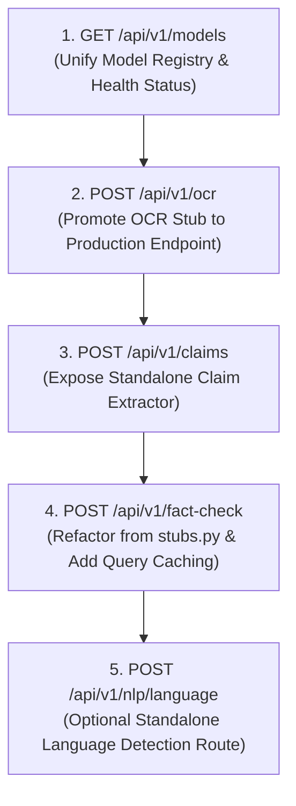

# TruthLens — Prioritized Implementation Queue

**Document Identity:** `docs/IMPLEMENTATION_QUEUE.md`  
**Repository:** `D:\Projects\Truthlens`  
**Branch:** `fix/truthlens-remediation`  
**Date:** 2026-11-23  
**Status:** ACTIVE SPECIFICATION  

---

## 1. Overview & Architectural Context

Following the closeout of Experiment 2 (which established that classical forensic indicators do not warrant directional fusion into authenticity scoring), the repository development focus shifts to completing core API contracts and promoting service implementations from stubs into dedicated production endpoints.

This document details the exact file paths, existing functions/handlers, test suites, missing logic, dependencies, and execution plan for the five target components:
1. `GET /api/v1/models`
2. `POST /api/v1/ocr`
3. Claim extraction service & endpoint (`POST /api/v1/claims`)
4. Fact-check service & endpoint (`POST /api/v1/fact-check`)
5. Language identification service (`LanguageDetector` / `POST /api/v1/nlp/language`)

---

## 2. Component Audits & Detailed Readiness

### Priority 1: `GET /api/v1/models` (Model Registry Endpoint)

- **Target Route:** `GET /api/v1/models`
- **Current File Path:** [backend/app/api/v1/endpoints/stubs.py](file:///D:/Projects/Truthlens/backend/app/api/v1/endpoints/stubs.py) (Lines 219–228)
- **Current Handler:** `async def list_models()` returning stub `{"models": [], "message": "ML models will be available in Stage 3."}`
- **Related Implementation:** [backend/app/api/v1/endpoints/health.py](file:///D:/Projects/Truthlens/backend/app/api/v1/endpoints/health.py) (Lines 88–147) provides `GET /api/v1/health/models`, which queries readiness for authenticity (SigLIP), object detection (YOLOv8n), and OCR (EasyOCR / Tesseract).
- **Existing Test Coverage:**
  - [backend/tests/test_api.py](file:///D:/Projects/Truthlens/backend/tests/test_api.py) line 39 (`test_health_models_endpoint` verifies `/api/v1/health/models`).
  - No dedicated test currently exercises `/api/v1/models`.
- **Missing Implementation:**
  1. Unify model inventory into a structured schema reporting:
     - `name`: Human-readable identifier (`authenticity`, `object_detection`, `ocr`, `language_identification`).
     - `model_id`: Canonical Hugging Face or checkpoint identifier (e.g. `truthlens/siglip-cifake-frozen-head`, `yolov8n.pt`, `papluca/xlm-roberta-base-language-detection`).
     - `task`: Model classification (`authenticity_classification`, `bounding_box_detection`, `optical_character_recognition`, `language_identification`).
     - `status`: Runtime state (`loaded`, `cached_not_loaded`, `available_not_loaded`, `checkpoint_missing`, `download_required`, `dependency_unavailable`).
     - `device`: Device allocation (`cuda:0`, `cpu`).
     - `loaded`: Boolean flag.
     - `capabilities`: Feature flags (e.g., Grad-CAM compatibility, language support list).
  2. Protect endpoint with bearer token authentication (`Principal = Depends(get_current_principal)`).
  3. Ensure zero sensitive internal filesystem paths are exposed in public responses.
- **Dependencies / Blockers:** None. All backing services and model inspection utilities already exist in the codebase.
- **Estimated Complexity:** Low (0.5 engineering day).

---

### Priority 2: `POST /api/v1/ocr` (Standalone OCR Endpoint)

- **Target Route:** `POST /api/v1/ocr`
- **Current File Path:** [backend/app/api/v1/endpoints/stubs.py](file:///D:/Projects/Truthlens/backend/app/api/v1/endpoints/stubs.py) (Lines 74–82)
- **Current Handler:** `async def ocr_endpoint()` returning HTTP 501 `{"detail": "OCR endpoint will be implemented in Stage 4.", "error_code": "NOT_IMPLEMENTED"}`
- **Backing Service:** [backend/app/services/ocr/service.py](file:///D:/Projects/Truthlens/backend/app/services/ocr/service.py) (`OCRService`, `get_ocr_service()`, `OCRResult`, `OCRBlock`)
- **Existing Test Coverage:**
  - [backend/tests/test_ocr_runtime.py](file:///D:/Projects/Truthlens/backend/tests/test_ocr_runtime.py) (10 unit tests covering `OCRService`, EasyOCR loader, Tesseract fallback, coordinate clipping, safety pixel caps, and non-finite bounding boxes).
  - [backend/tests/test_stage3.py](file:///D:/Projects/Truthlens/backend/tests/test_stage3.py) (Stage contract tests for OCR output).
  - [backend/tests/test_api.py](file:///D:/Projects/Truthlens/backend/tests/test_api.py) (Integrated OCR execution through `POST /api/v1/analyze`).
- **Missing Implementation:**
  1. Accept image upload via `image: UploadFile = File(...)`.
  2. Implement stream bounding: Read up to `settings.max_upload_bytes + 1` and raise HTTP 413 if exceeded.
  3. Image file validation using `backend.app.core.security.validate_image_file` (validates magic bytes, MIME types, decompression bombs).
  4. Query parameter support: `languages: Optional[str] = Query(None, description="Comma-separated ISO 639 codes")`.
  5. Asynchronous dispatch: Run CPU/GPU-bound `ocr_service.extract(pil_image)` in worker thread via `asyncio.to_thread`.
  6. Timeout handling: Apply `asyncio.wait_for(..., timeout=settings.OCR_TIMEOUT_SECONDS)`.
  7. Rate limiting: Enforce `check_rate_limit(..., scope="ocr", limit=settings.RATE_LIMIT_OCR_PER_MINUTE)`.
  8. Return structured `OCRResult.to_dict()` with appropriate HTTP status codes (200 on success, 413 on oversize, 422 on unreadable/unsupported formats, 504 on timeout).
- **Dependencies / Blockers:** None. `OCRService` is verified in production with EasyOCR and local Tesseract 5.4.
- **Estimated Complexity:** Low-Medium (1 engineering day).

---

### Priority 3: Claim Extraction Service & Endpoint (`POST /api/v1/claims`)

- **Target Route:** `POST /api/v1/claims`
- **Current File Path:** Service is located at [backend/app/services/claims/extractor.py](file:///D:/Projects/Truthlens/backend/app/services/claims/extractor.py). No dedicated endpoint exists (claims are currently invoked inside orchestrator pipeline or embedded in `POST /api/v1/fact-check`).
- **Functions / Handlers:** `extract_claims(...)`, `ClaimExtractionResult`, `ExtractedClaim`
- **Existing Test Coverage:**
  - [backend/tests/test_e4_e5_contract.py](file:///D:/Projects/Truthlens/backend/tests/test_e4_e5_contract.py) (Tests claim normalization, deterministic IDs, question/opinion/slogan eligibility gating, date/location/number extraction, and E3 language provenance integration).
  - [backend/tests/test_stage4.py](file:///D:/Projects/Truthlens/backend/tests/test_stage4.py) (Coverage across diverse sentence inputs).
  - [backend/tests/test_phase3.py](file:///D:/Projects/Truthlens/backend/tests/test_phase3.py) (Offline coverage).
- **Missing Implementation:**
  1. Define dedicated endpoint router in [backend/app/api/v1/endpoints/claims.py](file:///D:/Projects/Truthlens/backend/app/api/v1/endpoints/claims.py).
  2. Create request model `ClaimExtractionRequest`:
     ```python
     class ClaimExtractionRequest(BaseModel):
         text: Optional[str] = Field(None, max_length=10000)
         sentences: Optional[List[str]] = Field(None, max_length=50)
         language_code: Optional[str] = Field(None, max_length=5)
         max_claims: int = Field(5, ge=1, le=20)
     ```
  3. Validate input: Ensure at least one of `text` or `sentences` is supplied.
  4. Optional language detection chaining: If `language_code` is not provided, invoke `LanguageDetector.detect()` when text length $\ge 20$ chars.
  5. Rate limiting: `check_rate_limit(scope="claims")`.
  6. Return `ClaimExtractionResult.to_dict()`.
- **Dependencies / Blockers:** None. `extract_claims` is purely deterministic CPU text processing.
- **Estimated Complexity:** Low (0.5 engineering day).

---

### Priority 4: Fact-Check Service & Endpoint Promotion (`POST /api/v1/fact-check`)

- **Target Route:** `POST /api/v1/fact-check`
- **Current File Path:** Service at [backend/app/services/factcheck/service.py](file:///D:/Projects/Truthlens/backend/app/services/factcheck/service.py); Endpoint in [backend/app/api/v1/endpoints/stubs.py](file:///D:/Projects/Truthlens/backend/app/api/v1/endpoints/stubs.py) (Lines 84–184).
- **Current Handlers:**
  - `search_fact_checks(...)` in `service.py`.
  - `async def factcheck_endpoint(...)` in `stubs.py`.
- **Existing Test Coverage:**
  - [backend/tests/test_e4_e5_contract.py](file:///D:/Projects/Truthlens/backend/tests/test_e4_e5_contract.py) (Verifies rate limiting, skipping ineligible claims, HTTPS review URL sanitization, credential stripping, provider response truncation, and mock retrieval).
  - [backend/tests/test_phase3.py](file:///D:/Projects/Truthlens/backend/tests/test_phase3.py).
  - [backend/tests/test_e11_fusion.py](file:///D:/Projects/Truthlens/backend/tests/test_e11_fusion.py) (Verifies non-directional evidence handling).
- **Missing Implementation:**
  1. Move endpoint out of `stubs.py` into a dedicated module [backend/app/api/v1/endpoints/factcheck.py](file:///D:/Projects/Truthlens/backend/app/api/v1/endpoints/factcheck.py).
  2. Implement local in-memory or database-backed TTL cache for query hashes to prevent redundant third-party Google API quota consumption.
  3. Add batch claim parallelization: When multiple eligible claims are submitted, search asynchronously up to concurrency limit (e.g., `asyncio.gather` bounded by `asyncio.Semaphore(3)`).
  4. Ensure graceful degradation: When `GOOGLE_API_KEY` or `FACTCHECK_API_KEY` is not configured, return clean `status="unavailable"` with clear explanatory message rather than throwing exceptions.
- **Dependencies / Blockers:** Requires valid Google Fact Check Tools API key for live calls; mocked and safe fallback tests pass without key.
- **Estimated Complexity:** Medium (1 engineering day).

---

### Priority 5: Language Identification Service (`LanguageDetector` / Standalone API)

- **Target Route:** `POST /api/v1/nlp/language` (Optional public route)
- **Current File Path:** [backend/app/services/nlp/language_detector.py](file:///D:/Projects/Truthlens/backend/app/services/nlp/language_detector.py)
- **Functions / Handlers:** `LanguageDetector`, `LanguageDetectionResult`, `get_language_detector()`
- **Existing Test Coverage:**
  - [backend/tests/test_language_detector.py](file:///D:/Projects/Truthlens/backend/tests/test_language_detector.py) (Validates offline cache loading, exact 20-class `id2label` mapping, input bounds 4,096 chars / 256 tokens, uncalibrated softmax confidence, and thread safety).
  - [backend/tests/test_api.py](file:///D:/Projects/Truthlens/backend/tests/test_api.py) (Validates pipeline integration).
- **Missing Implementation:**
  1. The core service is **ALREADY COMPLETE AND VERIFIED**.
  2. If exposed as an API endpoint:
     - Request schema: `LanguageDetectionRequest(text: str = Field(..., min_length=1, max_length=10000))`
     - Response schema: `LanguageDetectionResponse` serializing `LanguageDetectionResult.to_dict()`
     - Authentication and rate limiting (`scope="nlp"`).
- **Dependencies / Blockers:** Hugging Face model weights must be pre-cached in `settings.MODEL_CACHE_DIR` (`papluca/xlm-roberta-base-language-detection`, revision `9865598389ca9d95637462f743f683b51d75b87b`).
- **Estimated Complexity:** Low (0.5 engineering day).

---

## 3. Recommended Implementation Order and Roadmap



### Rationale for Sequence
1. **`GET /api/v1/models` First:** Lowest risk, pure read-only system introspection. Leverages existing inspection code from `health.py` and provides immediate visibility into all installed models without external I/O or network dependencies.
2. **`POST /api/v1/ocr` Second:** Decouples optical character recognition from the heavyweight analysis pipeline. The underlying engine (`OCRService`) is already hardened and tested; creating the endpoint enables immediate utility for image-to-text workflows.
3. **`POST /api/v1/claims` Third:** Follows OCR. Allows users or client applications to extract checkable factual propositions directly from arbitrary text without uploading an image.
4. **`POST /api/v1/fact-check` Fourth:** Builds directly on top of claim extraction. Moving it out of `stubs.py` and adding query caching protects against third-party API rate limits and quotas.
5. **`POST /api/v1/nlp/language` Fifth:** Serves as a complementary NLP utility. The service is already operational internally; public API exposure can be added as a lightweight wrapper.

---

## 4. Governance & Safety Rules for Next Tasks

1. **Model Baseline Preservation:** The production SigLIP checkpoint ([siglip_frozen_head.pt](file:///D:/Projects/Truthlens/models/baselines/siglip_frozen_head.pt)) and YOLOv8n checkpoint ([yolov8n.pt](file:///D:/Projects/Truthlens/models/baselines/yolov8n.pt)) must remain strictly unmodified.
2. **Protected Data Isolation:** Neither the 10,385-sample held-out benchmark nor the 2,999-sample retained reserve partition may be accessed, read, or evaluated during endpoint implementation.
3. **Rate Limiting & Authentication:** Every new or promoted endpoint must enforce token authentication via `get_current_principal` and scope-specific rate limits.
4. **No Secret Leakage:** Error responses and log statements must never reveal local filesystem paths, stack traces, API keys, or private tokens.
5. **Regression Verification:** All changes must pass `pytest backend/tests/test_api.py`, `pytest backend/tests/test_ocr_runtime.py`, and `pytest backend/tests/test_e4_e5_contract.py` before completion.