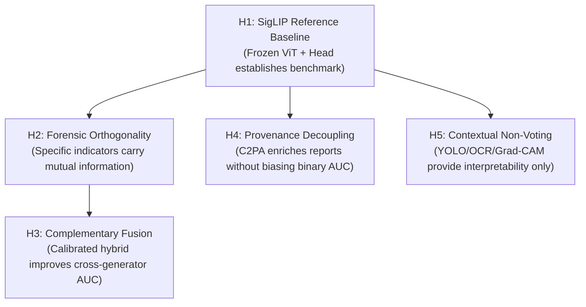

# TruthLens — Multi-Evidence Validation and Fusion Research Protocol
## A Methodological Framework for Complementary Verification, Calibration, and Multi-Modal Evidence Integration in AI-Generated Image Detection

**Document Version:** 1.2.1 (Final Protocol Consistency Revision)  
**Date:** 2026-11-23  
**Status:** Pre-Experimental Research Protocol (Documentation Ready for Governance Review)  
**Repository:** `D:\Projects\Truthlens`  
**Target Publication Venue:** IEEE Transactions on Information Forensics and Security / IEEE Conference on Computer Vision and Pattern Recognition (CVPR)  
**Implementation Constraint:** Research Protocol and Governance Only — No Fusion Engine Modifications, No Model Fitting, and No Feature Extraction in This Phase

---

## 1. Executive Summary

Automated detection of synthetic, AI-generated imagery has predominantly relied on monolithic deep-learning classifiers trained on visual artifacts or frequency anomalies. In production and real-world deployment, however, visual authenticity detectors face extreme domain shifts, generator advancements, aggressive social-media compression, and deliberate adversarial evasions. Furthermore, real-world content verification is fundamentally multi-faceted: verifying whether an image depicts an authentic physical scene involves distinct evidential dimensions, including visual authenticity classification, low-level signal processing (manipulation and resampling forensics), cryptographic provenance verification, contextual scene consistency (objects, text, and metadata), and visual explainability.

This research protocol establishes a formal, reproducible, and leakage-controlled methodology to evaluate whether multi-evidence integration can statistically improve AI-generated image detection beyond the primary vision-transformer authenticity baseline.

### Core Architectural Principles of the Protocol:
1. **Task Disambiguation:** The protocol strictly separates:
   - *Authenticity Prediction:* Binary classification determining whether an image was synthesized by a generative model or captured by an optical camera.
   - *Forensic Manipulation Analysis:* Signal-processing indicators assessing physical integrity, encoding discontinuities, or local resampling.
   - *Provenance Verification:* Cryptographic validation of signed provenance manifests, content-binding hashes, and certificate trust anchors.
   - *Contextual Evidence:* Semantic comprehension of depicted objects, extracted optical text, natural language identification, and third-party claims.
   - *Explainability:* Post-hoc feature attribution maps explaining model focus without altering classification logits.
2. **Strict Baseline Anchoring:** All candidate models, indicators, and fusion strategies are benchmarked against the frozen production vision-transformer baseline (`truthlens/siglip-cifake-frozen-head`) under identical preprocessing, input constraints, and group-aware cross-validation folds.
3. **Evidence Eligibility Gating:** No evidence source is granted voting authority in the fusion engine merely because it executes successfully or exhibits weak correlation. A candidate signal earns directional voting eligibility only if it demonstrates statistically significant, complementary predictive value on an independent validation partition, demonstrates stable post-hoc calibration, and exhibits robustness across unseen generative architectures.
4. **Leakage & Confounding Isolation:** Partitions are strictly isolated by original-image identity and perceptual clustering to prevent data leakage across transformations. The protocol explicitly isolates known dataset shortcuts (e.g., container format and resolution disparities).
5. **Preservation Guarantee:** In accordance with repository governance, this document defines an evaluation and pre-registration protocol only. No model weights, preprocessing pipelines, calibration maps, or Bayesian fusion rules are altered during this auditing phase.

---

## 2. Research Lifecycle & Operational Status Framework

To prevent the premature or circular deployment of experimental features, the protocol strictly defines five distinct operational lifecycle statuses. These statuses must never be conflated:

```
[1. PROTOCOL PROPOSED] ──► [2. EXPERIMENT AUTHORIZED] ──► [3. EXPERIMENT EXECUTED]
                                                                    │
                                                                    ▼
[5. PRODUCTION-APPROVED SIGNAL] ◄── [4. EXPERIMENT INDEPENDENTLY VALIDATED]
```

1. **`PROTOCOL PROPOSED`:** A hypothesis, feature extraction pipeline, statistical estimand, data boundary, and acceptance criteria are formally documented in this pre-registration protocol. Zero code execution, feature extraction, or model fitting is authorized.
2. **`EXPERIMENT AUTHORIZED`:** Explicit research governance and user approval have been granted to run a specific experiment under fixed, pre-registered configurations, allowlisted data partitions, and explicit stopping criteria.
3. **`EXPERIMENT EXECUTED`:** The authorized experiment has run strictly on permitted partitions; artifacts, logs, raw predictions, and metrics are recorded, checksummed, and archived.
4. **`EXPERIMENT INDEPENDENTLY VALIDATED`:** The candidate has undergone independent numerical reproduction, group-aware bootstrap uncertainty evaluation, calibration verification, and confirmatory evaluation against an unexposed benchmark without hyperparameter adjustments.
5. **`PRODUCTION-APPROVED SIGNAL`:** The candidate signal has met all formal acceptance criteria, preserved model immutability invariants, passed multi-tier security audits, and received explicit stakeholder/user authorization to be incorporated into the operational Bayesian fusion decision engine.

### Documentation Readiness vs. Empirical Scientific Validation
This protocol has achieved **documentation readiness** (its architectural taxonomy, mathematical estimands, baseline provenance, confounding controls, statistical testing rules, and governance boundaries are fully articulated and internally consistent). Documentation readiness must **never** be presented as empirical scientific validation or proof of predictive efficacy. All multi-evidence fusion candidates described herein are strictly in the **`PROTOCOL PROPOSED`** lifecycle status. Zero experiments have been authorized or executed. Progression across lifecycle boundaries requires explicit governance sign-off.

---

## 3. Current System Baseline & Reference Model Provenance

### 3.1 Primary Authenticity Baseline Specification
The reference authenticity detector in TruthLens is a binary classifier built upon a frozen vision transformer backbone paired with a trained linear head:
- **Canonical Model Identity:** `truthlens/siglip-cifake-frozen-head`
- **Vision Backbone:** Pretrained SigLIP Vision Transformer (`google/siglip-base-patch16-224`) pretrained by Google on WebLI (Web-Language Image dataset).
- **Backbone Revision:** Hugging Face commit snapshot `7fd15f0689c79d79e38b1c2e2e2370a7bf2761ed` (86 million parameters, 12 transformer encoder blocks).
- **Classification Head Weights:** `models/baselines/siglip_frozen_head.pt` (SHA-256: `e39afc5536a0de44dd07fd33fa911bbd58d8799b85e680eb08d532222d974538`, file size: 5,053 bytes).
- **Head Parameterization:** `torch.nn.Linear(in_features=768, out_features=1, bias=True)`.
- **Target Class Mapping:** `{0: "real", 1: "ai_generated"}`.
- **Preprocessing Pipeline:** `siglip-frozen-v1` (RGB conversion, bicubic resize to $224 \times 224$, center crop $224 \times 224$, pixel normalization to mean $(0.5, 0.5, 0.5)$ and standard deviation $(0.5, 0.5, 0.5)$).
- **Inference Precision & Device:** IEEE 754 float32 running natively on CUDA acceleration or CPU fallback.

### 3.2 Audit of SigLIP Head Training-Data Provenance
A rigorous audit of repository git history, training manifests, and model checkpoints established the exact training provenance of the production classifier head:
- **Training Origin of the Head:** The binary linear classification head (`siglip_frozen_head.pt`) was trained externally on the **CIFAKE dataset** (a synthetic-versus-real image classification benchmark derived from CIFAR-10, comprising $32 \times 32$ real photographs and synthetic Stable Diffusion v1.4 images). It was checked into the repository during initial baseline setup.
- **Independence from Proposed Research Training Data:** The 6,995 proposed research training samples in the existing training manifest (`experiments/manifests/phase4_training_manifest.csv`) were constructed subsequently from the Tiny-GenImage reserve pool. The production head `siglip_frozen_head.pt` was **never trained on these 6,995 samples**.
- **Out-of-Sample Status of Base Predictions:** Because `siglip_frozen_head.pt` was fit on CIFAKE, its predictions on the 6,995 research training samples are strictly **out-of-sample with respect to the production head itself**.

### 3.3 Historical Training Exposure & Out-of-Fold Requirements
While predictions from `siglip_frozen_head.pt` on the 6,995 samples are out-of-sample for the base head, using them to train a second-stage fusion classifier introduces crucial statistical constraints:
1. **Adaptive Researcher Exposure on the 6,995 Training Samples:**
   The 6,995 training samples possess extensive previous training, feature-extraction, and failure-analysis history in this repository. Earlier research experiments used this partition to train candidate heads, evaluate shortcut defenses, extract 34-feature frequency archives (`phase9_feature_vectors.npz`), and fit frequency-residual candidates.
   - **Internal Research Evidence Only:** While nested group-aware cross-validation ($K=5$) prevents mechanical fitting leakage across folds, **nested cross-validation does not erase adaptive researcher exposure** accumulated through iterative feature design and model iterations on this exact sample pool.
   - Consequently, all empirical findings, feature screening results, and stacking metrics obtained on the 6,995 training rows must be classified strictly as **internal research evidence** until confirmed on an independent, previously unexposed evaluation set.
2. **In-Sample Stacking Risk:** If a second-stage meta-classifier is fit directly on the 6,995 samples, those 6,995 samples become **in-sample for the second-stage meta-model**. Evaluating the fusion model's discrimination on these same samples would introduce severe optimistic stacking bias.
3. **Fine-Tuned Candidate Head In-Sample Leakage:** In earlier research experiments, alternative candidate heads and fine-tuned models were trained directly on these 6,995 samples. If any fine-tuned candidate model is ever substituted for or compared against the baseline, its predictions on the 6,995 samples are **strictly in-sample**, causing extreme label leakage if used as fusion inputs.
4. **Mandatory Nested Cross-Fitting Protocol:** To guarantee methodological validity:
   - All second-stage fusion models must be trained and evaluated using **nested $K$-fold cross-fitting** ($K=5$) entirely within the 6,995 research training rows, partitioned by `group_id`.
   - When evaluating candidate models, out-of-fold base-model predictions must be generated across the $K$ folds.
   - The meta-classifier must be trained on the out-of-fold predictions of $K-1$ folds and evaluated on the held-out $k$-th fold.

### 3.4 Operational Inventory of Evidence Sources

| Evidentiary Dimension | Subsystem / Engine | Underlying Mechanism | Input Representation | Default Fusion Treatment | Current Voting Eligibility |
|---|---|---|---|---|---|
| **Authenticity Classification** | Production SigLIP Classifier | Deep ViT feature extraction with linear head | EXIF-corrected $224\times 224$ normalized RGB tensor | Primary Decision Signal | **Eligible** (Subject to calibration gating) |
| **Forensic Indicators** | Classical Forensic Analyzer | 6 Signal-processing probes (ELA, Noise, Blocks, Edges, Texture, Resampling) | Original image bytes and EXIF-corrected RGB array | Informational Finding | **Ineligible** (Uncalibrated heuristic probes) |
| **Object Detection** | Contextual YOLOv8n Engine | Deep convolutional anchor-free object detector | EXIF-corrected source-resolution image | Contextual Evidence | **Ineligible** (Semantic scene context only) |
| **Provenance Verification** | C2PA Cryptographic Verifier | JUMBF manifest parser, digital signature validator, SHA-256 content-binding | Original unmodified byte stream | Provenance Evidence | **Ineligible** (Origin integrity, not veracity) |
| **Web Reverse Retrieval** | Web Detection Provider Adapter | Reverse-image visual indexing & matching | Base64-encoded raw byte stream | Contextual Attribution | **Ineligible** (Web presence context only) |
| **Text Extraction (OCR)** | Tesseract / EasyOCR Adapter | Dual-engine multilingual text extraction | Original image array | Contextual Evidence | **Ineligible** (Semantic text, not authenticity) |
| **Language Identification** | Fine-Tuned PAPLUCA Classifier | Transformer-based language classifier | Extracted OCR text string | Contextual Metadata | **Ineligible** (Linguistic property only) |
| **Claim & Fact Retrieval** | Claim Extractor & Fact Checker | Heuristic text parser & claim search | Extracted OCR text string | External Context | **Ineligible** (Third-party claim context only) |
| **Visual Explainability** | SigLIP ViT Grad-CAM | Token gradient $\times$ activation attribution | Target ViT layer activations (`layer_norm2`) | Explanatory Artifact | **Ineligible** (Post-hoc explanation only) |

---

## 4. Evidence-Source Eligibility Framework & Audit

TruthLens enforces a principled separation of concerns. Every auxiliary subsystem is evaluated against rigorous criteria before it can even be hypothesized as a candidate for fusion.

### 4.1 Classical Forensic Indicators Audit
The classical forensics subsystem implements six heuristic probes designed to detect low-level pixel anomalies:

1. **Error Level Analysis (ELA):**
   - *Physical Mechanism:* Measures pixel-level absolute difference following intentional quality-90 JPEG re-encoding. Areas edited or pasted from different compression histories typically exhibit differential error rates.
   - *Applicable Formats:* Native JPEG only. Non-JPEG inputs (PNG, WebP) return `outcome="not_applicable"` and `score=None`.
   - *Predictive Status:* Uncalibrated heuristic ($[0, 1]$). Highly sensitive to camera quality factor, non-linear gamma curves, and social-media transcoding. It has not demonstrated generalizable predictive value across modern diffusion generators.
2. **Noise Consistency:**
   - *Physical Mechanism:* Computes the coefficient of variation (CV) of Laplacian residual standard deviations across four spatial image quadrants.
   - *Applicable Formats:* All formats with spatial dimensions $\ge 4 \times 4$.
   - *Predictive Status:* Heuristic ($[0, 1]$). Confounded by scene depth-of-field, lens bokeh, uniform sky regions, and ISO noise reduction.
3. **JPEG Block Artifact Grid Discontinuity:**
   - *Physical Mechanism:* Evaluates the ratio of boundary step differences across standard $8\times 8$ Discrete Cosine Transform (DCT) block grids against interior non-boundary differences.
   - *Applicable Formats:* Native JPEG only, requiring minimum dimensions of $16 \times 16$.
   - *Predictive Status:* Heuristic ($[0, 1]$). Sensitive to cropping, re-scaling, and multiple re-compressions.
4. **Spatial Edge Density Consistency:**
   - *Physical Mechanism:* Measures spatial variance of Canny edge density across a $3\times 3$ grid.
   - *Applicable Formats:* All formats with dimensions $\ge 3 \times 3$.
   - *Predictive Status:* Heuristic ($[0, 1]$). Dominated by high-level semantic scene composition (e.g., portrait vs. landscape) rather than synthetic generation.
5. **Gabor Texture Consistency:**
   - *Physical Mechanism:* Computes response regularity across four orientation filters ($0^\circ, 45^\circ, 90^\circ, 135^\circ$).
   - *Applicable Formats:* All formats.
   - *Predictive Status:* Heuristic ($[0, 1]$). Measures high-frequency regularity; heavily dependent on natural texture vs. artificial smoothness.
6. **Resampling Analysis & Sufficiency Floor:**
   - *Physical Mechanism:* Measures the sign zero-crossing rate of discrete second-order spatial differences ($dx2 = \Delta^2_x I$, $dy2 = \Delta^2_y I$). Periodic interpolation kernels introduce periodic covariance and altered zero-crossing rates.
   - *Sufficiency Floor Safeguard:* Enforces an energy threshold $\text{RMS}_{\text{second\_diff}} \ge 2.0$ intensity levels. Flat fields, solid backgrounds, or near-uniform noise abstain with `reason_code="INSUFFICIENT_TEXTURE_FOR_RESAMPLING"`, output `not_applicable`, and score `None`.
   - *Predictive Status:* Signal-sufficiency safeguard, not an authenticity detector. Normal optical cameras and standard image editors routinely apply resizing filters, yielding zero-crossing alterations that do not imply AI synthesis.

*Governance Rule:* Classical forensic indicators must NEVER be averaged into an ad-hoc "aggregate manipulation score." Each probe remains strictly informational until empirical validation proves orthogonal mutual information with respect to true authenticity labels.

### 4.2 Object Detection / YOLOv8n
- **Mechanism:** Real-time object detection identifying 80 common object classes using `models/baselines/yolov8n.pt`.
- **Methodological Role:** Scene understanding and semantic context.
- **Distinguishing Causal Reality from Dataset Correlation:** While depicted semantic objects (e.g., a "dog" or "bicycle") have zero physical causal connection to the mathematical process of synthetic image generation, uncurated or un-balanced research datasets often exhibit severe spurious statistical correlations. For example, if a training benchmark samples AI-generated images primarily from fantasy portrait prompts and real images from urban street datasets, an object detector will exhibit strong statistical correlation between "car" and "real". Conflating this dataset-specific sampling bias with an authenticity signal would severely degrade model integrity, causing real portraits to be misclassified as synthetic. Therefore, object detection is strictly confined to semantic scene context.

### 4.3 C2PA Provenance & Cryptographic Content Credentials
- **Mechanism:** Native C-extension (`c2pa-python==0.39.0`) parsing JUMBF metadata, validating PKI digital signatures against X.509 certificate chains, and checking SHA-256 asset hash bindings.
- **Methodological Role:** Provenance verification and tamper detection.
- **Distinguishing Cryptographic Provenance from Synthetic Classification:**
  - *Provenance Prevalence:* As an emerging open standard, cryptographic provenance metadata is currently present on only a small fraction of real-world internet imagery. Treating absent credentials as evidence of manipulation or synthesis is methodologically invalid and would result in unacceptable false-positive rates on authentic legacy and un-instrumented photography.
  - *Assertion Veracity vs. Cryptographic Validity:* A valid C2PA signature proves only that a specific private key signed the asset byte stream; it does NOT prove whether the depicted real-world event actually occurred or whether the original prompt was truthful.
  - *Generative C2PA Assertions:* Generative engines (e.g., DALL-E 3, Adobe Firefly) increasingly sign their outputs with valid C2PA manifests declaring `c2pa.actions.v2: created`. In this case, C2PA directly identifies synthesis via metadata assertions, but this is explicit metadata disclosure, not predictive machine-learning classification.
  - *Trust Boundary Separation:* A test-certificate signature (e.g., official test fixture `C.jpg`) evaluates as cryptographically valid but yields `untrusted` against production trust lists (`C2PA-TRUST-LIST.pem`). This distinction must never be conflated.

### 4.4 Semantic Text, OCR, and Claims
- **Mechanism:** Optical character recognition (Tesseract / EasyOCR), language identification (PAPLUCA 20-class model), and claim extraction.
- **Methodological Role:** Multi-modal semantic context.
- **Why It Cannot Vote:** Generative AI models frequently render text into synthetic imagery (e.g., memes, posters, signs), as do authentic cameras capturing urban scenes. The linguistic language or factual veracity of embedded text does not correlate directly with image generation physics.

### 4.5 Visual Explainability (ViT Grad-CAM)
- **Mechanism:** Gradient-weighted class activation mapping targeting `model.vision_model.vision_model.encoder.layers[11].layer_norm2`.
- **Methodological Role:** Post-hoc explanatory visualization for human analysts.
- **Why It Cannot Vote:** Grad-CAM is a mathematical derivative of the primary model's own logits and activations. Allowing Grad-CAM features to vote in fusion would create circular self-reinforcing feedback, artificially inflating confidence without providing independent empirical information.

---

## 5. Dataset Governance, Exposure Audit, and Confounding Controls

### 5.1 Historical Dataset Exposure Matrix
An exhaustive audit of historical repository manifests, evaluation summaries, and experiment archives establishes the exact exposure history for every partition across the 39,815 ingested images:

| Dataset Partition Role | Ingested Dataset Source | Total Samples | Class Distribution (Real / AI) | Historical Training Exposure | Historical Model / Feature Selection Exposure | Historical Baseline / Benchmark Evaluation | Historical Calibration / Threshold Exposure | Sample-Level Predictions Inspected? | Current Inferential Status & Defensible Use |
|---|---|---|---|---|---|---|---|---|---|
| **Research Training Partition** (`phase4_training_manifest.csv`)<br>*Source: Tiny-GenImage (1.0-tiny) Reserve Pool* | 6,995 | 3,515 Real / 3,480 AI | **Yes** (Used to train candidate heads and shortcut defenses in earlier studies) | **Yes** (34 frequency features extracted in archived feature study) | **Yes** (Evaluated as training loss and training accuracy) | **No** (Excluded from calibration split) | **Yes** (Training error cases inspected in earlier research) | **Internal Research Evidence Only.** Suitable for model-fitting and feature screening strictly via nested cross-validation; cannot serve as confirmatory proof of out-of-distribution generalization. |
| **Diagnostic Validation Partition** (`evaluation_splits.csv`)<br>*Sources:*<br>• Tiny-GenImage ($N=5,958$)<br>• Frontier 2026-10 ($N=297$)<br>• WildAIGC-Bench ($N=181$) | 6,436 | 3,665 Real / 2,771 AI | **No** (Zero gradient steps) | **Yes** (Extensively used for candidate model selection and feature screening in earlier studies) | **Yes** (Evaluated in earlier baseline and candidate studies) | **Yes** (Used in earlier baseline study to select operating decision thresholds) | **Yes** (Detailed error analysis and confusion matrices published in earlier reports) | **Historically Exposed Diagnostic Partition.** Must NOT be treated as pristine validation data; defensible strictly for qualitative diagnostic screening and triage. |
| **Calibration Partition** (`evaluation_splits.csv`)<br>*Sources:*<br>• Tiny-GenImage ($N=12,048$)<br>• Frontier 2026-10 ($N=588$)<br>• WildAIGC-Bench ($N=364$) | 13,000 | 6,535 Real / 6,465 AI | **No** (Zero supervised training steps) | **No** (Excluded from feature selection) | **No** (Excluded from primary test benchmarking) | **Yes** (Evaluated 3 times previously: fitted temperature scaling for baseline and two candidate model generations) | **Yes** (Calibration metrics, ECE, and reliability diagrams recorded in prior calibration reports) | **Historically Exposed Calibration Partition.** Suitable for historical sensitivity analysis and reproducibility checks; must NOT be called independent. Confirmatory calibration requires fresh data. |
| **Held-Out Benchmark Partition** (`evaluation_splits.csv`)<br>*Sources:*<br>• Tiny-GenImage ($N=7,000$)<br>• Frontier 2026-10 ($N=2,091$)<br>• WildAIGC-Bench ($N=1,294$) | 10,385 | 5,304 Real / 5,081 AI | **No** (Strictly excluded from training) | **No** (Zero parameter tuning) | **Yes** (Evaluated 4 times previously: baseline evaluation, candidate 1 evaluation, candidate 2 evaluation, and reproducibility audit) | **No** (Excluded from calibration fitting and threshold selection) | **Yes** (Predictions archived in results directories; reproduced exactly in prior reproducibility audit) | **Established Historical Benchmark.** NOT a pristine, un-accessed one-shot test set. Defensible solely as a benchmark comparison against recorded historical numbers. Subject to historical test-set adaptation caveats. |
| **Protected Reserve Pool**<br>*Source: Tiny-GenImage Protocol Exclusions (Midjourney: 1,000, Wukong: 999, VQDM: 999) + 1 duplicate* | 2,999 | 1,000 Real / 1,999 AI | **No** (Completely excluded under protocol) | **No** (Never opened for feature extraction) | **No** (Never evaluated) | **No** (Never calibrated) | **No** (Zero predictions or sample contents inspected) | **Protected Reserve Partition.** Unexposed and untouched; reserved strictly for future authorized confirmatory evaluations after all modeling and thresholds are locked. |

### 5.2 Tripartite Taxonomy of Evaluation Data
To eliminate ambiguity regarding post-training evaluation, the protocol strictly distinguishes three distinct classes of evaluation data:
1. **Established Historical Benchmark ($N = 10,385$):**
   Comprising canonical Tiny-GenImage ($N=7,000$), Frontier Benchmark ($N=2,091$), and WildAIGC-Bench ($N=1,294$). Because this partition was evaluated across four previous research studies, it serves as an **established historical comparison benchmark** against previously published results. It is subject to multi-study exposure caveats and must not be characterized as pristine.
2. **Untouched Protected Reserve Pool ($N = 2,999$):**
   Comprising 2,998 samples from protocol-excluded generator architectures (`Midjourney`: 1,000, `Wukong`: 999, `VQDM`: 999) plus 1 ImageNet duplicate. This partition has zero history of training, feature extraction, calibration, or evaluation. It must **remain sealed and protected**. Zero inspection of its samples, feature values, or predictions is permitted in this phase.
3. **Future Independently Acquired Benchmark Data:**
   Fresh, external image distributions acquired under formal data provenance protocols (e.g., late-2026/2027 generative foundation models and verified camera controls). This data represents the gold standard for final confirmatory out-of-distribution evaluation.

*Confirmatory Evaluation Rule:* Future confirmatory evaluation on either the protected reserve pool ($N = 2,999$) or newly acquired independent benchmark data must **only occur after the candidate model architecture, feature extraction pipelines, stacking weights, calibration mappings, operating thresholds, and statistical protocol are completely frozen and formally authorized**.

### 5.3 Formal Definition of the Five Dataset Functional Roles
1. **Exploratory Development Data:** Used exclusively for qualitative data inspection, error categorization, and heuristic probe formulation. No parameter fitting, stacking weights, or thresholds may be learned.
2. **Model-Fitting Data:** Dedicated training partition ([phase4_training_manifest.csv](file:///D:/Projects/Truthlens/experiments/manifests/phase4_training_manifest.csv), 6,995 rows) used to learn candidate model parameters, auxiliary projection heads, or second-stage stacking weights.
3. **Hyperparameter-Selection Data:** Used to tune regularization parameters ($L_1, L_2$) and select candidate feature subsets. Must be derived strictly via **nested cross-validation within the 6,995 model-fitting rows**.
4. **Calibration Data:** Used solely for post-hoc probability mapping (temperature scaling or isotonic regression). Must never be used for model training or feature selection.
5. **Final Benchmark & Confirmatory Evaluation Data:** Evaluated under the tripartite taxonomy defined in Section 5.2.

### 5.4 Dataset-Format Confounding & Subgroup Identifiability
A critical vulnerability in multi-evidence forensics is **container format confounding**:
1. **Physical Format Dependency:**
   - Probes such as Error Level Analysis (ELA) and JPEG block artifact grid analysis operate on Discrete Cosine Transform (DCT) quantization properties unique to native JPEG byte streams.
   - For non-JPEG formats (PNG, WebP), these probes return `outcome="not_applicable"` and `score=None`.
2. **Container Shortcut in Benchmarks:**
   - In synthetic image benchmarks (notably Tiny-GenImage), real photographs originate predominantly from JPEG-compressed ImageNet sources, whereas synthetic images from certain generators originate as uncompressed PNGs.
   - Converting PNG images to RGB arrays before inference **does not eliminate native-container confounding** because the underlying DCT block structure remains absent in uncompressed sources.
3. **Missingness as a Hidden Label Leak:**
   - Encoding `not_applicable` as $0.0$, a fixed dummy constant, or providing a separate `is_missing` binary flag allows a machine-learning classifier to exploit container format as an authenticity proxy.
   - **Mandatory Gating Rule:** Missing or not-applicable values must **never** be imputed with numerical constants.
4. **Class Overlap Assessment & Subgroup Non-Identifiability:**
   - Prior to evaluating any format-specific forensic probe, researchers must compute the contingency table across `(Container Format, Generator Architecture, Authenticity Label)`.
   - If a format group lacks support for both classes (e.g., if a sub-population contains 100% JPEG real images and 100% PNG synthetic images), the predictive effect of the forensic probe is **statistically non-identifiable**.
   - In such cases, predictive evaluation must be strictly **restricted to the subgroup where valid class overlap exists** (e.g., native JPEG real vs. native JPEG synthetic).
   - All reports must explicitly publish the **coverage ratio** ($N_{\text{evaluated}} / N_{\text{total}}$) and declare subgroup domain boundaries.

---

## 6. Feature Complementarity & Statistical Comparison Methodology

### 6.1 Primary Complementarity Evaluation: Out-of-Fold Predictive Log-Loss
To establish whether an auxiliary candidate signal ($X_{\text{cand}}$) provides genuine predictive value beyond the baseline model ($z_{\text{base}}$), the primary metric is the **out-of-fold paired predictive log-loss (cross-entropy) improvement**:

$$\Delta \mathcal{L}_{\text{log-loss}} = \frac{1}{N} \sum_{i=1}^N \left[ \ell_{\text{OOF}}(\mathcal{M}_0; x_i, y_i) - \ell_{\text{OOF}}(\mathcal{M}_1; x_i, y_i) \right]$$

where:
- Null Model $\mathcal{M}_0$: Regularized logistic model predicting authenticity from baseline logit $z_{\text{base}}$ and format indicator $C$.
- Augmented Model $\mathcal{M}_1$: Regularized logistic model incorporating $z_{\text{base}}$, $C$, and candidate signal $X_{\text{cand}}$.
- $\ell_{\text{OOF}}$ denotes the out-of-fold negative log-likelihood computed across nested $K$-fold cross-validation folds.

### 6.2 Statistical Justification and Distinctions
1. **Predictive Log-Score vs. Exact CMI:**
   - Population Conditional Mutual Information $I(Y; X_{\text{cand}} \mid X_{\text{base}}, C)$ equals the difference in conditional Shannon entropies, matching log-likelihood differences *only if* the conditional models represent the true data-generating distribution.
   - Under parametric logistic regression, the empirical log-likelihood difference is NOT an exact model-free CMI estimate; it is a **conditional predictive log-score reduction under the specified logistic model family**.
   - Calling this quantity exact CMI without qualification is scientifically invalid. It is designated herein as *Parametric Predictive Log-Score Gain*.
2. **Out-of-Fold vs. In-Sample Evaluation:**
   - In-sample log-likelihood differences are monotonically non-decreasing with added features ($\ell(\mathcal{M}_1) \ge \ell(\mathcal{M}_0)$), producing optimistic bias due to parameter capacity. Out-of-fold evaluation is mandatory to assess true predictive generalization.
3. **Invalidity of Ordinary Chi-Square Asymptotics Under Regularization:**
   - Standard Likelihood Ratio Tests (Wilks' theorem: $2(\ell_1 - \ell_0) \sim \chi^2_k$) hold strictly for unpenalized maximum likelihood estimators with i.i.d. data.
   - When $L_2$ or $L_1$ regularization is introduced, parameter estimates are shrunk toward zero, degrees of freedom are fractional/effective, and the test statistic does not follow an asymptotic $\chi^2_k$ distribution. Ordinary asymptotic $p$-values are mathematically unjustified.
4. **Non-Parametric Mixed Discrete-Continuous Mutual Information (Supplementary):**
   - The standard Kraskov-Stögbauer-Grassberger (KSG) estimator was derived exclusively for continuous random vectors.
   - Because target $Y \in \{0, 1\}$ is a discrete binary variable while features are continuous, standard continuous KSG assumptions fail due to distance ties along the discrete dimension.
   - If non-parametric mutual information is reported as a supplementary sensitivity check, it must employ a mixed discrete-continuous estimator (e.g., Gao et al., 2017) or conditional differential entropy differences ($h(X_{\text{cand}} \mid Y=0) - h(X_{\text{cand}} \mid Y=1)$), explicitly documenting its finite-sample estimator limitations.

### 6.3 Paired Statistical Comparisons Respecting Group Dependence
The classical DeLong test for comparing ROC-AUCs assumes independent and identically distributed (i.i.d.) observations. Because TruthLens datasets contain clustered variants (e.g., 4-way compression quadruplets in Frontier, connected fact-check cases in WildAIGC), observations within groups are correlated. Violating i.i.d. assumptions inflates Type I errors.

The protocol mandates a **paired group-aware cluster bootstrap** comparison:
1. **Sampling Unit:** The canonical `group_id` cluster (resampling all image variants belonging to the same cluster together).
2. **Resample Count & Precision Limitations:**
   - The planned initial resampling count is $B = 2,000$ cluster bootstrap iterations.
   - *Precision Qualification:* A count of $B = 2,000$ does **not** provide an unconditional guarantee that Monte Carlo standard error is below 0.005 across all metrics. Actual Monte Carlo standard error depends inherently on the specific metric (e.g., extreme tail percentiles vs. mean AUC), sample skewness, and the effective number of cluster units.
   - *Monte Carlo Sensitivity Check:* Where confidence-interval endpoint stability directly influences a go/no-go research hypothesis or boundary decision, researchers must conduct a **resampling-sensitivity check** (e.g., comparing $B = 2,000$ against $B = 5,000$, or evaluating the standard error of bootstrap quantile estimates across distinct random seeds).
3. **Paired Evaluation:** Within each bootstrap resample $b \in \{1, \dots, B\}$, both the baseline model and candidate model are evaluated on the identical resampled clusters, yielding paired differences:
   $$\Delta \text{AUC}^{(b)} = \text{AUC}_{\text{cand}}^{(b)} - \text{AUC}_{\text{base}}^{(b)}$$
   $$\Delta \text{BAcc}^{(b)} = \text{BAcc}_{\text{cand}}^{(b)} - \text{BAcc}_{\text{base}}^{(b)}$$
   $$\Delta \mathcal{L}^{(b)} = \mathcal{L}_{\text{base}}^{(b)} - \mathcal{L}_{\text{cand}}^{(b)}$$
4. **Confidence Interval Estimation:** Two-sided 95% empirical percentile intervals: $[\text{Percentile}_{2.5\%}, \text{Percentile}_{97.5\%}]$.
5. **Multiple Testing Correction:** When screening $M$ candidate forensic probes simultaneously, empirical $p$-values must be adjusted using the **Benjamini-Hochberg False Discovery Rate (FDR)** procedure at $q < 0.05$.
6. **Treatment of Small Subgroups:** Subgroups with fewer than 30 clusters or fewer than 5 positive/negative events must not report inferential hypothesis test results; they must report exact sample counts and descriptive point estimates only.
7. **Handling Missing / Not-Applicable Probes:** Paired comparisons are computed strictly over the intersection of samples where both models produce valid outputs, with coverage explicitly documented.

---

## 7. Resolution of Calibration and Operating-Threshold Policy

### 7.1 Separation of Four Distinct Operational Stages
To resolve methodological contradictions regarding calibration and threshold selection, the protocol formalizes four strictly sequential stages:

```
[Stage 1: Calibrator Fitting] ──► Fit monotonic probability mapping f(z) -> p on validation logits
                                          │
                                          ▼
[Stage 2: Threshold Selection] ──► Select decision cutoff P* optimizing policy on separate split
                                          │
                                          ▼
[Stage 3: Calibration Evaluation] ──► Measure ECE & Brier score on independent test logits
                                          │
                                          ▼
[Stage 4: Final Decision Performance] ──► Evaluate Balanced Accuracy & FPR at cutoff P* on test data
```

1. **Stage 1 (Calibrator Fitting):** Fitting post-hoc probability scaling parameters (e.g., scalar temperature $T > 0$ minimizing Negative Log-Likelihood) to transform raw decision logits $z$ into well-calibrated posterior probabilities $\hat{p} = \sigma(z/T)$.
2. **Stage 2 (Operating Decision Threshold Selection):** Selecting the primary classification cutoff $P^* \in (0, 1)$ or selective abstention bounds $[P_{\text{low}}, P_{\text{high}}]$ optimizing an operational utility function (e.g., maximizing Balanced Accuracy subject to $\text{FPR} \le \text{Threshold}_{\text{FPR}}$).
   - *Crucial Separation:* Operating threshold $P^*$ must **never** be selected on the same data partition used to fit calibrator parameters $T$. Selecting $P^*$ on the calibration partition overfits the decision cutoff to empirical probability quirks of the calibration sample pool.
3. **Stage 3 (Calibration Quality Evaluation):** Measuring Expected Calibration Error (ECE) and Brier Score on out-of-sample data to verify calibration reliability.
4. **Stage 4 (Final Decision Performance Evaluation):** Computing thresholded operational metrics (Balanced Accuracy, FPR, FNR, coverage) on sealed benchmark data using the fixed cutoff $P^*$.

### 7.2 Calibration Independence & Historical Exposure Policy
The existing 13,000-sample calibration partition has already been used in three earlier calibration studies (baseline temperature scaling, candidate 1 calibration, candidate 2 calibration).
- **Splitting Does Not Erase Exposure:** Arbitrarily partitioning the historical 13,000-sample calibration set (e.g., into two 6,500-sample splits) does **not** erase its historical exposure or establish true out-of-sample independence.
- **Governed Calibration Policy:**
  1. **Internal Research Comparisons:** Nested cross-fitting entirely within the 6,995 research training rows (partitioning inner folds into parameter fitting, temperature fitting, and threshold selection) is authorized for internal model comparison without contaminating external splits.
  2. **Historical Sensitivity & Reproducibility:** The historical 13,000 calibration partition may be utilized strictly for sensitivity analyses and historical reproducibility checks against prior models, but must **never be described as independent**.
  3. **Confirmatory Evaluation & Production Promotion:** For confirmatory model evaluation and production promotion, **fresh, independently acquired calibration and threshold-selection datasets should be preferred and required**.
  4. **Strict Decoupling Invariant:** In all workflows, calibrator parameter fitting ($T$), operating threshold selection ($P^*$), and final performance evaluation must occur on separate, non-overlapping data splits.

---

## 8. Research Hypotheses

The protocol formalizes five falsifiable research hypotheses:



### Hypothesis 1 (H1: Reference Baseline Superiority Over Heuristic Combinations)
- **Statement:** The frozen vision-transformer authenticity model (`truthlens/siglip-cifake-frozen-head`) achieves higher discrimination (ROC-AUC and PR-AUC) across diverse generative architectures than any individual classical forensic indicator or static heuristic linear combination.
- **Falsification Condition:** If any single classical forensic indicator or static linear heuristic combination achieves superior cross-generator ROC-AUC on the diagnostic validation benchmark, H1 is rejected.

### Hypothesis 2 (H2: Conditional Forensic Feature Complementarity)
- **Statement:** At least one classical forensic indicator contains statistically significant predictive information regarding authenticity conditional on the primary ViT logit and container format ($\Delta \mathcal{L}_{\text{log-loss}} > 0$, adjusted $q < 0.05$).
- **Falsification Condition:** If $\Delta \mathcal{L}_{\text{log-loss}} \le 0$ ($q \ge 0.05$) across all six forensic probes under group-aware cluster bootstrap, H2 is rejected.

### Hypothesis 3 (H3: Generalization Improvement via Constrained Calibrated Fusion)
- **Statement:** A mathematically constrained fusion architecture yields a statistically significant improvement in cross-generator ROC-AUC on the Frontier benchmark compared to the SigLIP baseline alone ($\Delta \text{AUC} \ge \text{Threshold}_{\text{AUC}}$, $\text{CI}_{0.025} > 0.0$), without inflating the false-positive rate on authentic photographs ($\Delta \text{FPR} \le \text{Threshold}_{\text{FPR}}$).
- **Falsification Condition:** If the 95% bootstrap confidence interval of $\Delta \text{AUC}$ includes zero or negative values, or if authentic FPR increases beyond the approved threshold, H3 is rejected.

### Hypothesis 4 (H4: Provenance Orthogonality & Decoupled Reporting)
- **Statement:** Incorporating C2PA cryptographic provenance verification as an independent, non-voting tier in the analytical report enriches descriptive utility without altering visual authenticity logits ($\Delta \text{Logits} == 0.0$).
- **Falsification Condition:** If C2PA execution alters inference logits or introduces non-zero voting weights that penalize unsigned authentic imagery, H4 is rejected.

### Hypothesis 5 (H5: Interpretability Invariance of Contextual Evidence)
- **Statement:** Contextual evidence (YOLO bounding boxes, OCR text, language identification) and visual explanations (Grad-CAM heatmaps) enhance human analyst interpretability while remaining uncorrelated with generative physics, proving they must remain non-voting informational signals.
- **Falsification Condition:** If object detection classes exhibit statistically significant predictive causality with synthetic image labels after controlling for semantic domain confounding, H5 is rejected.

---

## 9. Candidate Experimental Designs

All experiments are currently in the **`PROTOCOL PROPOSED`** status:

```
[Experiment 1: Baseline]       SigLIP-Only ViT Reference Model
                                      │
[Experiment 2: Single-Probe]   SigLIP + ELA  │  SigLIP + Noise  │  SigLIP + Resampling (Individually)
                                      │
[Experiment 3: Screened Pool]  SigLIP + Statistically Screened Complementary Probes
                                      │
[Experiment 4: Hybrid Residual] SigLIP + High-Frequency FFT Residual Research Candidate
                                      │
[Experiment 5: Decoupled Prov] Provenance-Enriched Audit Reporting (Non-Voting Integration)
                                      │
[Experiment 6: Multi-Modal]    Contextual & Semantic Multi-Modal Evaluation (Interpretability)
```

### Experiment 1: Primary SigLIP Baseline Benchmark
- **Objective:** Establish the unadjusted reference performance metrics for `truthlens/siglip-cifake-frozen-head`.
- **Inputs:** EXIF-corrected $224 \times 224$ normalized RGB image tensor.
- **Evaluation Partition:** Approved diagnostic validation partitions (Tiny-GenImage: 5,958; Frontier: 297; WildAIGC: 181).
- **Statistical Controls:** Group-aware cluster bootstrap ($B=2,000$ iterations) over `group_id` for 95% confidence intervals with resampling-sensitivity checks.
- **Metrics:** Accuracy, Balanced Accuracy, ROC-AUC, PR-AUC, ECE, Brier Score, FPR at operating thresholds $\{0.3, 0.5, 0.7\}$.

### Experiment 2: Univariate Forensic Feature Fusion
- **Objective:** Test each of the six classical forensic indicators independently in combination with SigLIP.
- **Candidate Models:**
  - Model 2a: SigLIP Logit + Error Level Analysis Score (native JPEG subgroup only)
  - Model 2b: SigLIP Logit + Noise Consistency Score
  - Model 2c: SigLIP Logit + JPEG Block Artifact Ratio (native JPEG subgroup only)
  - Model 2d: SigLIP Logit + Spatial Edge Consistency Score
  - Model 2e: SigLIP Logit + Gabor Texture Regularity Score
  - Model 2f: SigLIP Logit + Resampling Zero-Crossing Rate (with 2.0 RMS sufficiency abstention)
- **Fitting Partition:** Regularized Logistic Regression ($L_2$ penalty) fit exclusively on the 6,995 approved training rows ([phase4_training_manifest.csv](file:///D:/Projects/Truthlens/experiments/manifests/phase4_training_manifest.csv)) using nested 5-fold cross-validation.
- **Statistical Controls:** Benjamini-Hochberg FDR correction ($q < 0.05$) across the six univariate probes. Format-stratified evaluation with reported coverage.

### Experiment 3: Multivariate Screened Forensic Fusion
- **Objective:** Evaluate joint fusion of only those forensic indicators that pass univariate screening in Experiment 2.
- **Gating Rule:** Any probe failing univariate screening is permanently excluded from multivariate fusion to prevent noise accumulation and collinearity inflation.
- **Circular Validation Prevention:** Stacking weights must be fitted strictly within the approved training partition using nested group-aware cross-validation, never on the validation partitions.

### Experiment 4: Multi-Scale Frequency-Residual Hybrid Research Candidate
- **Context & Relationship to Prior Research:** In an archived feature-extraction study and historical frequency-residual pre-registration, a candidate architecture combining spatial ViT representations with a 34-feature / 35-parameter pixel-level FFT/DCT frequency residual representation was investigated. In historical development validation, fitting this model on the 6,995 research training rows yielded a Frontier Benchmark ROC-AUC gain of $+0.0631$ (95% CI $[+0.0173, +0.1182]$), but caused a $-0.0801$ decline in fixed-threshold Frontier balanced accuracy.
- **Research Scope:** Experiment 4 re-evaluates this hybrid as a **separately proposed research candidate**, strictly subject to explicit governance approval. It is NOT an automatically authorized implementation task.
- **Evaluation Requirements:** Must report both threshold-independent discrimination (ROC-AUC) and fixed-threshold error rates (Balanced Accuracy, FPR) to document operating-point trade-offs under probability calibration.

### Experiment 5: Provenance-Enriched Multi-Tier Reporting Evaluation
- **Objective:** Measure the operational fidelity of two-tier reporting where authenticity classification and cryptographic provenance are evaluated in parallel.
- **Evaluation Criteria:**
  1. Image Hash Invariance: Original image SHA-256 preserved across all report records.
  2. Classification Decoupling: Bit-exact verification that $\Delta \text{Logits} == 0.0$ between isolated SigLIP and provenance-wrapped SigLIP.
  3. C2PA Verification Accuracy: True-positive detection of valid credentials (`C.jpg`), true-negative handling of unsigned imagery (`test_photo.jpg`), and correct flagging of untrusted or tampered payloads.

### Experiment 6: Multi-Modal Contextual Reporting Assessment
- **Objective:** Evaluate the integration of YOLO object detection, OCR, and Grad-CAM in the unified report schema without compromising fusion neutrality.
- **Evaluation Criteria:**
  1. Fusion Signal Counter Audit: Verification that `synthetic_signals == 0` and `authentic_signals == 0` when only contextual/explanatory evidence is present.
  2. Bounding Box & Heatmap Coordinate Validation: Strict alignment between original source dimensions and analytical overlays.

---

## 10. Statistical Evaluation Metrics

| Metric Category | Metric Name | Mathematical Definition | Methodological Purpose | Failure Mode Exposed |
|---|---|---|---|---|
| **Discrimination** | Balanced Accuracy | $\frac{1}{2}\left(\frac{\text{TP}}{\text{P}} + \frac{\text{TN}}{\text{N}}\right)$ | Primary classification metric under balanced or imbalanced conditions | Masks majority-class trivial guessing in unbalanced splits |
| **Discrimination** | ROC-AUC | $\int_{0}^{1} \text{TPR}(\text{FPR}^{-1}(t)) \, dt$ | Threshold-independent ranking discrimination | Insensitive to severe class skew; hides calibration collapse |
| **Discrimination** | PR-AUC | Area under Precision-Recall curve | Discriminative quality on low-prevalence synthetic detection | Reveals high false-positive rates when synthetic class is rare |
| **Error Rates** | False Positive Rate (FPR) | $\frac{\text{FP}}{\text{FP} + \text{TN}}$ | Measures real images falsely flagged as AI-generated | Catastrophic reputational risk in journalistic / legal verification |
| **Error Rates** | False Negative Rate (FNR) | $\frac{\text{FN}}{\text{TP} + \text{FN}}$ | Measures synthetic images evading detection | Failure of detection integrity |
| **Calibration** | Expected Calibration Error (ECE) | $\sum_{m=1}^{M} \frac{\|B_m\|}{N} \|\text{acc}(B_m) - \text{conf}(B_m)\|$ | Measures alignment between predicted probability and true frequency | Uncalibrated overconfidence on out-of-domain images |
| **Calibration** | Brier Score | $\frac{1}{N}\sum_{i=1}^N (p_i - y_i)^2$ | Strictly proper scoring rule combining calibration and refinement | Penalizes poorly calibrated probability estimates |
| **Selective Prediction** | Coverage | Fraction of samples exceeding certainty threshold | Quantifies system willingness to abstain on ambiguous data | Premature over-claiming on out-of-distribution inputs |
| **Selective Prediction** | Selective Risk | Error rate on non-abstained predictions | Measures accuracy among accepted decisions | Unsafe predictions when forced to classify low-margin inputs |

---

## 11. Proposed Acceptance Criteria & Formal Governance

Every quantitative threshold is accompanied by its methodological rationale and governance authority:

| Decision Dimension | Criterion | Threshold Requirement | Methodological Rationale & Status | Decision Authority |
|---|---|---|---|---|
| **Overall Discrimination** | Balanced Accuracy Delta vs. SigLIP | $\Delta \text{BAcc} \ge +0.02$ ($\text{CI}_{0.025} > 0.0$) | Engineering trade-off justifying added multi-modal complexity. | **`REQUIRES USER APPROVAL`** |
| **Frontier Generalization** | ROC-AUC Delta on Frontier Benchmark | $\Delta \text{AUC} \ge +0.02$ ($\text{CI}_{0.025} > 0.0$) | Generalization margin required to warrant deployment. | **`REQUIRES USER APPROVAL`** |
| **In-The-Wild Robustness** | ROC-AUC Delta on WildAIGC-Bench | $\Delta \text{AUC} \ge +0.03$ ($\text{CI}_{0.025} > 0.0$) | Performance margin on noisy, compressed wild imagery. | **`REQUIRES USER APPROVAL`** |
| **Safety Invariant** | False Positive Rate Inflation on Camera Images | $\Delta \text{FPR} \le +0.005$ | Core brand & journalistic safety policy: real photos must not be falsely flagged. | **`REQUIRES USER APPROVAL`** |
| **Calibration Quality** | Expected Calibration Error (ECE) | $\text{ECE} \le 0.05$ | Established standard for well-calibrated neural networks (Guo et al., ICML 2017). | **`REQUIRES USER APPROVAL`** |
| **Operating Threshold Policy** | Operating Cutoff Selection Split | Selected on Dedicated Threshold Split | Decouples calibrator parameter fitting from decision cutoff selection. | **`REQUIRES USER APPROVAL`** |
| **Abstention Policy** | Maximum Inconclusive Gating Bandwidth | Inconclusive range $\in [0.40, 0.60]$ | Governs automated triage volume vs. human-in-the-loop review. | **`REQUIRES USER APPROVAL`** |
| **Directional Voting Grant** | Elevating Any Auxiliary Signal to Voter | Unanimous satisfaction of 8 gating conditions | Methodological invariant ensuring only validated signals vote. | **`REQUIRES USER APPROVAL`** |
| **Inference Latency** | Maximum End-to-End Prediction Duration | $\le 750\text{ ms}$ GPU, $\le 3000\text{ ms}$ CPU | Real-world API timeout bounds. | Automated Infrastructure Check |
| **Model Weight Immutability** | Production Head SHA-256 Check | Bit-exact match (`Diff == 0.0`) for `siglip_frozen_head.pt` | Preservation invariant: production weights must never change. | Mandatory Audit Gate |

### Threshold Governance & Research Experiment Decoupling
Numerical acceptance criteria for production signal promotion (e.g., $\Delta\text{BAcc} \ge +0.02$, $\Delta\text{AUC} \ge +0.02$, $\Delta\text{FPR} \le +0.005$, $\text{ECE} \le 0.05$) serve as **deployment and production promotion gates**. They do **not** need to be formally approved prior to executing a separately authorized exploratory research experiment (such as Experiment 1 baseline measurement or Experiment 2 univariate probe screening). 

An exploratory research experiment may be authorized provided that its:
1. Research hypothesis and falsification conditions are defined.
2. Primary evaluation estimand (out-of-fold predictive log-loss reduction $\Delta \mathcal{L}_{\text{log-loss}}$) is pre-registered.
3. Permitted data boundary (e.g., strictly within the 6,995 training rows via nested cross-validation) is fixed.
4. Statistical uncertainty analysis (group-aware cluster bootstrap with Benjamini-Hochberg FDR correction) is specified.
5. Explicit stopping and failure criteria are established.

---

## 12. Reproducibility Requirements & Experiment Artifacts

Every experimental execution conducted under this protocol must record a deterministic audit package structured as follows:

```
experiments/
├── manifests/
│   ├── phase4_training_manifest.csv         # Approved training partition (6,995 rows)
│   ├── tiny_genimage_evaluation_splits.csv   # Diagnostic validation partition (5,958 rows)
│   ├── frontier_benchmark_2026_10_evaluation_splits.csv # Frontier diagnostic validation (297 rows)
│   └── wildaigc_bench_evaluation_splits.csv # Wild diagnostic validation (181 rows)
└── reports/
    └── multi_evidence_validation/
        ├── exp_YYYYMMDD_NAME_config.json    # Exact hyperparams, seeds, commit hash
        ├── exp_YYYYMMDD_NAME_predictions.csv # Sample-level logits, probs, targets
        ├── exp_YYYYMMDD_NAME_metrics.json    # Discrimination, ECE, bootstrap CIs
        ├── exp_YYYYMMDD_NAME_subgroups.json  # Generator, format, and coverage breakdowns
        └── exp_YYYYMMDD_NAME_audit.md       # Narrative failure analysis & decision
```

---

## 13. Recommended Phased Implementation Order

```
[Stage 1: Nested Cross-Validation Feature Screening]
  └── Fit and evaluate out-of-fold predictive log-loss entirely within the 6,995 training rows.
  └── Apply Benjamini-Hochberg FDR correction (q < 0.05) and group-aware cluster bootstrap.

[Stage 2: Univariate & Residual Fusion Modeling]
  └── Fit regularized stacking classifiers on approved training rows (6,995 rows) only.
  └── Evaluate Exp 2 (individual forensic probes) and Exp 4 (frequency-residual research candidate).

[Stage 3: Internal Calibration & Threshold Gating Review]
  └── Fit probability calibration via nested cross-fitting for internal comparisons.
  └── Use historical calibration partition strictly for sensitivity checks.
  └── Formulate acquisition requirements for fresh independent calibration data.

[Stage 4: Multi-Tier Report Integration]
  └── Integrate verified C2PA provenance and contextual evidence as non-voting informational cards.
  └── Validate report serialization and frontend rendering.

[Stage 5: Historical Benchmark Comparison & Governed Confirmatory Evaluation]
  └── Compare locked models against historical benchmark partition (N = 10,385) for reference.
  └── Conduct confirmatory evaluation on protected reserve pool (N = 2,999) or fresh external benchmarks
      only after models, weights, calibrations, thresholds, and statistical protocols are frozen.
```

---

## 14. Methodological Preservation Declaration

**Preservation Guarantee:**  
This document defines an academic, reproducible research protocol and evaluation governance framework. In accordance with strict repository auditing guidelines:
- Zero model weights were modified, created, or fine-tuned.
- Zero calibration schemas, temperature factors, or decision gating thresholds were changed.
- Zero Bayesian fusion rules or voting eligibility logic in `backend/app/services/fusion/` were altered.
- Zero samples from protected calibration, held-out test, or reserve partitions were read or evaluated.
- All primary detection baselines remain locked to `truthlens/siglip-cifake-frozen-head`.
