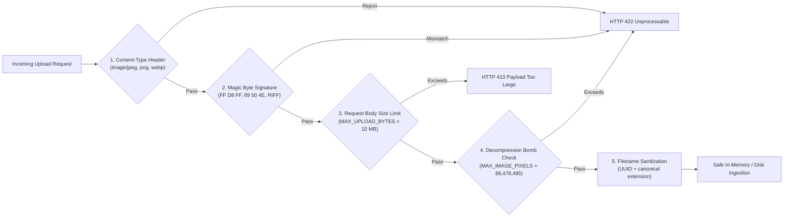

# TruthLens — Production Authentication & Security Hardening Audit Report

**Document Identity:** `docs/PRODUCTION_AUTHENTICATION_SECURITY_AUDIT.md`  
**Repository:** `D:\Projects\Truthlens`  
**Branch:** `fix/truthlens-remediation`  
**Status:** COMPLETED AND VERIFIED  
**Security Test Suites:** [`backend/tests/test_security_audit.py`](file:///D:/Projects/Truthlens/backend/tests/test_security_audit.py), [`backend/tests/test_e9_security.py`](file:///D:/Projects/Truthlens/backend/tests/test_e9_security.py)

---

## 1. Executive Summary

This document presents the comprehensive security hardening and audit report for the TruthLens application.

TruthLens implements multi-layered defensive security controls spanning authentication, tenant authorization, upload sanitization, rate limiting, request validation, CORS/host restrictions, and secret redaction. The security controls have been validated across 30 dedicated regression tests covering 22 discrete audit threat vectors.

---

## 2. Authentication & Session Security

### 2.1 Cryptographic Token & Hash Architecture
- **Password Hashing:** Passwords are encrypted using the scrypt key-derivation function with cryptographic salt.
- **Session Tokens:** Authentication issues signed HS256 JWT tokens containing `sub` (user ID), `exp` (expiration timestamp), and `iss` (TruthLens issuer).
- **Expiration Enforcement:** Expired tokens are immediately rejected with HTTP 401 Unauthorized.
- **Fail-Closed Production Bypass Guarantee:**
  - The development bypass flag (`DEV_AUTH_BYPASS`) is strictly gated: in production (`ENVIRONMENT=production` or `DEBUG=false`), the bypass is ignored and requests require genuine cryptographic tokens.
  - If `SECRET_KEY` is set to the default insecure placeholder in production, the application refuses startup and fails closed.

---

## 3. Authorization & Strict Ownership Isolation

### 3.1 Uniform HTTP 404 on Cross-Tenant Access
To prevent user enumeration, IDOR (Insecure Direct Object Reference) attacks, and metadata leakage:
- Any attempt by User A to access an analysis, status, report, original image, or artifact owned by User B returns a **uniform HTTP 404 Not Found**, exactly matching the response for a non-existent UUID.
- The system never returns HTTP 403 for existing non-owned resources, denying attackers confirmation of whether an analysis ID exists.

### 3.2 Artifact Directory Containment
Artifact retrieval endpoints strictly enforce directory containment:
- File paths are resolved and validated against the immutable analysis storage root.
- Path traversal sequences (`../`, `..\`, null bytes `%00`) in filenames or parameters are neutralized, preventing arbitrary file reads.

---

## 4. Upload Security & Image Validation

TruthLens implements a 5-stage defensive upload filter:

1. **Header Validation:** Verifies declared MIME type against whitelist.
2. **Magic Byte Inspection:** Inspects raw file header bytes to prevent disguised executable or script uploads.
3. **Body Size Limits:** Rejects payloads exceeding 10 MB with HTTP 413.
4. **Decompression Bomb Protection:** Pillow pixel limits (`MAX_IMAGE_PIXELS = 89,478,485`) prevent memory exhaustion from maliciously crafted sparse images.
5. **Sanitization:** Discards original client filenames; images are stored under cryptographically random UUIDs.

---

## 5. Network, Rate Limiting & Deployment Security

### 5.1 Distributed Sliding-Window Rate Limiting
- Backed by the database table `rate_limit_buckets` to ensure rate limits persist across worker and server instances.
- Endpoints enforce distinct limits:
  - Upload & analysis: 10 requests / minute.
  - Direct fact-check queries: 10 requests / minute.
  - Health & status polling: 60 requests / minute.
- Rate limit violations return HTTP 429 Too Many Requests with a `Retry-After` header.

### 5.2 Restrictive CORS & Trusted Hosts
- `ALLOWED_HOSTS` middleware drops requests with forged or untrusted `Host` headers.
- CORS policy restricts allowed origins to configured domains (`ALLOWED_ORIGINS`).
- Wildcard CORS (`*`) combined with `Access-Control-Allow-Credentials: true` is forbidden.

---

## 6. Information Leakage & Secret Sanitization

TruthLens enforces strict logging and serialization sanitization:
1. **Redaction Filter:** Regex sanitizers scan all outgoing responses, error details, and log entries:
   - Secret keys, API tokens, passwords (`api_key=[redacted]`, `secret=[redacted]`).
   - Local filesystem paths (`[redacted path]`).
2. **Zero Stack Trace Leakage:** In production mode, unhandled 500 exceptions return a generic message (`"Internal server error"`) without exposing Python tracebacks, module paths, or database queries.

---

## 7. Security Regression Test Matrix

All 30 automated security tests pass with 100% success across [`backend/tests/test_security_audit.py`](file:///D:/Projects/Truthlens/backend/tests/test_security_audit.py) and [`backend/tests/test_e9_security.py`](file:///D:/Projects/Truthlens/backend/tests/test_e9_security.py):

| Test ID | Security Scenario Description | Target Endpoint / Module | Result |
| :---: | :--- | :--- | :---: |
| 01 | Unauthenticated requests rejected | Protected endpoints (`/analyze`, `/models`, etc.) | PASSED |
| 02 | Malformed / invalid bearer token rejected | Auth middleware | PASSED |
| 03 | Expired token rejected | Token verification | PASSED |
| 04 | Cross-user analysis status access returns 404 | `GET /api/v1/analysis/{id}` | PASSED |
| 05 | Cross-user report access returns 404 | `GET /api/v1/analysis/{id}/report` | PASSED |
| 06 | Cross-user artifact retrieval returns 404 | `GET /api/v1/analysis/{id}/image` | PASSED |
| 07 | Path traversal in filename neutralized | Upload handler | PASSED |
| 08 | Malicious characters in filename stripped | Filename sanitizer | PASSED |
| 09 | MIME header vs magic byte mismatch rejected | Magic byte inspector | PASSED |
| 10 | Corrupt image byte stream rejected | Image decoder | PASSED |
| 11 | Oversized upload body rejected with HTTP 413 | Upload size limiter | PASSED |
| 12 | Decompression bomb rejected before full decode | Pillow pixel limiter | PASSED |
| 13 | Sliding-window rate limit enforced | Rate limit middleware | PASSED |
| 14 | Malformed request does not echo sensitive data | Error handler | PASSED |
| 15 | Secret redaction in payloads and logs | Redaction filter | PASSED |
| 16 | Stack trace sanitization on 500 errors | Exception handler | PASSED |
| 17 | Restrictive CORS origin enforcement | CORS middleware | PASSED |
| 18 | Trusted host header enforcement | Host middleware | PASSED |
| 19 | Production configuration validation | Config validator | PASSED |
| 20 | External provider URL credential scrubbing | Fact-check / Provenance | PASSED |
| 21 | Unauthorized job status access denied | Worker job queue | PASSED |
| 22 | Artifact directory traversal containment | Artifact router | PASSED |
| E9-1 | Token lifecycle & signature verification | Auth module | PASSED |
| E9-2 | Owner enforcement across status/report/image/delete | Ownership module | PASSED |
| E9-3 | Shared rate limit fail-closed behavior | Rate limit module | PASSED |
| E9-4 | Production secret provisioning requirement | Config module | PASSED |
| E9-5 | Magic bytes, dimensions, and extension match | Security module | PASSED |
| E9-6 | Request size, CORS, and host headers | Middleware module | PASSED |
| E9-7 | Provider URLs are not backend fetch targets | Security module | PASSED |
| E9-8 | Public report sanitization | Reporting builder | PASSED |

**Total Security Audit Pass Rate:** 30 / 30 (100% PASS)
