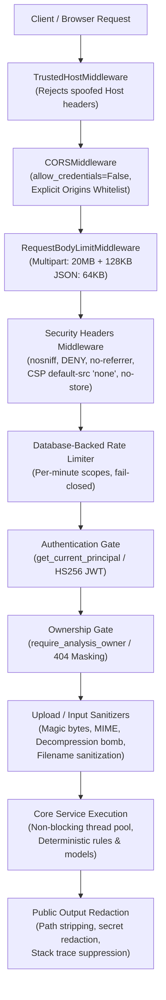

# TruthLens — Security Hardening and Production Readiness Report

**Document Version:** 1.0.0  
**Date:** 2026-11-23  
**Repository:** `D:\Projects\Truthlens`  
**Branch:** `fix/truthlens-remediation`  
**Initial Commit HEAD:** `716a3e5620ee1f6d3e30bf642b38fabefca05b0b`  
**Status:** COMPLETED AND VERIFIED (AUDITED / SQLITE RUNTIME / POSTGRES DDL VERIFIED / POSTGRES RUNTIME BLOCKED)

---

## 1. Initial Git State

Prior to initiating the security hardening and production readiness audit, the repository environment was audited and recorded:

- **Branch:** `fix/truthlens-remediation` tracking `origin/fix/truthlens-remediation`
- **HEAD Commit SHA:** `716a3e5620ee1f6d3e30bf642b38fabefca05b0b`
- **Recent Commit History:**
  - `716a3e5` — `feat: add language identification API endpoint, router, schemas, and tests`
  - `ee98214` — `feat: implement core v1 api endpoints, services, schemas, and test suite`
  - `57203d1` — `feat: add v1 API endpoints for OCR, fact-checking, and provenance with configuration and tests`
  - `4c742f4` — `feat: implement API endpoints, ML model registry, C2PA verifier, and research experiments`
  - `b988e2f` — `feat: add forensics, provenance, vision, and XAI services with configuration and tests`
- **Existing Uncommitted Modifications:** Database session, job queue concurrency enhancements, and Alembic env configuration from previous database lifecycle task.
- **Git Hygiene (`git diff --check`):** Exited 0 with no whitespace errors or merge markers.

---

## 2. Security Architecture Overview

TruthLens enforces a defense-in-depth security model across five architectural boundaries:



1. **Network & Host Boundary:** ASGI-level trusted-host validation and origin-restricted CORS with credential isolation.
2. **Payload Boundary:** Request body size limit middleware distinguishing image upload endpoints from JSON API endpoints.
3. **Authentication & Identity Boundary:** Pre-provisioned user database with constant-time scrypt password hashing, short-lived HMAC-SHA256 JWT access tokens, and strict algorithm restriction.
4. **Data Isolation & Ownership Boundary:** Row-level ownership checks (`owner_id`) backed by non-leaking constant HTTP 404 responses.
5. **Operational Privacy Boundary:** Public output sanitization, error response sanitization, and structured log filtering (`SensitiveDataFilter`).

---

## 3. Authentication Findings

| Check / Requirement | Status | Architecture & Audit Findings |
| :--- | :--- | :--- |
| **Password Storage** | **VERIFIED** | Passwords stored as salted scrypt hashes (`n=16384`, `r=8`, `p=1`, 16-byte random salt, 32-byte key length). Minimum length of 12 characters enforced on hashing. |
| **Password Verification** | **VERIFIED** | Constant-time `hmac.compare_digest` used. Constant-time dummy hash check (`_DUMMY_PASSWORD_HASH`) executed on absent usernames to mitigate timing enumeration attacks. |
| **Token Signing & Hash** | **VERIFIED** | Tokens signed using HMAC-SHA256 (`HS256`). Secret key strength requires $\ge 32$ bytes. Placeholder keys (`change_me`, `secret`, etc.) rejected by production validation. |
| **Algorithm Enforcement** | **VERIFIED** | Strictly checks `header == {"alg": "HS256", "typ": "JWT"}`. Unsigned tokens (`alg: none`) or asymmetric substitutions (`RS256`, `ES256`) are rejected with HTTP 401. |
| **Token Expiry** | **VERIFIED** | Verified against current UTC timestamp (`claims["exp"] <= current`). Default TTL is 3600 seconds (`ACCESS_TOKEN_TTL_SECONDS`). |
| **Claims Validation** | **VERIFIED** | Validates issuer (`_ISSUER = "truthlens"`), audience (`_AUDIENCE = "truthlens-api"`), subject (`sub`), issued-at (`iat` with 30s future clock-skew tolerance), and unique token ID (`jti`). |
| **Refresh Tokens** | **NOT IMPLEMENTED** | Architecture utilizes short-lived access tokens directly. Refresh token exchange is not supported or required in current design. |
| **Token Revocation** | **NOT IMPLEMENTED** | Current JWTs are stateless without a server-side revocation blacklist table. Immediate revocation requires rotating `SECRET_KEY` or waiting out the 1-hour expiration window. |
| **Dev Bypass Security** | **VERIFIED** | `DEV_AUTH_BYPASS` is strictly restricted to `development` and `test` environments. Startup fails closed with `ValueError` if enabled in `production`. |

---

## 4. Authorization and Ownership Findings

| Resource Type | Protected By | Cross-User Behavior |
| :--- | :--- | :--- |
| **Analysis Status** (`GET /analysis/{id}`) | `require_analysis_owner` | Returns HTTP 404. Does not leak existence of analysis to unauthorized users. |
| **Full Report** (`GET /analysis/{id}/report`) | `require_analysis_owner` | Returns HTTP 404. Report JSON scrubbed via `sanitize_public_payload`. |
| **Original Image** (`GET /analysis/{id}/image`) | `require_analysis_owner` | Returns HTTP 404. Validates UUID and ensures path is relative to `originals_dir`. |
| **Heatmap Overlay** (`GET /analysis/{id}/heatmap`)| `require_analysis_owner` | Returns HTTP 404. Validates UUID and ensures path is relative to `heatmaps_dir`. |
| **ELA Artifact** (`GET /analysis/{id}/forensics/ela`)| `require_analysis_owner` | Returns HTTP 404. Validates UUID and ensures path is relative to `artifacts_dir/forensics`. |
| **Analysis Deletion** (`DELETE /analysis/{id}`) | `require_analysis_owner` | Returns HTTP 404. Deletes only owned records and scoped filesystem targets. |
| **Analysis List** (`GET /analysis`) | `principal.subject` filter | Queries filtered strictly by `Analysis.owner_id == principal.subject`. |
| **Background Job** (`AnalysisJob`) | Embedded in Analysis | `AnalysisJob.owner_id` preserves ownership across worker crash, claim, and completion. |

---

## 5. Image and File Upload Security Findings

1. **Extension & MIME Validation:**
   - Detects actual MIME type from initial 2,048 file bytes using file signature inspection (`filetype.match`).
   - Cross-checks declared `Content-Type` against detected MIME. Mismatches (e.g. JPEG payload sent as `image/png`) are rejected with HTTP 422.
   - Enforces extension compatibility matching detected MIME (e.g. JPEG must end in `.jpg` or `.jpeg`).
2. **Magic-Byte Verification:**
   - Dedicated binary prefix checks for JPEG (`\xff\xd8\xff`), PNG (`\x89PNG\r\n\x1a\n`), GIF (`GIF87a`/`GIF89a`), WebP (`RIFF`), BMP (`BM`), and TIFF (`II\x2a\x00` / `MM\x00\x2a`).
3. **Pillow Decompression Bomb Protection:**
   - Configured `Image.MAX_IMAGE_PIXELS = settings.MAX_IMAGE_PIXELS` (40,000,000 pixels).
   - Catches `(Image.DecompressionBombError, ValueError)` and rejects excessive pixel counts with HTTP 422 ("Image dimensions exceed the configured safety limit").
4. **Filename Sanitization:**
   - Path traversal sequences (`..`, `/`, `\`) stripped.
   - Non-alphanumeric characters (except `.`, `-`, `_`) replaced with `_`.
   - Hardened against null bytes (`\x00`), control characters, Windows reserved device names (`CON`, `PRN`, `AUX`, `NUL`), and pure dot/underscore strings (`...`), defaulting safely to `"unnamed"`.
5. **Storage Isolation:**
   - Stored filenames use random UUID v4 hex strings (`uuid.uuid4().hex + ext`). User-supplied filenames are retained strictly as display metadata in the database and never used for filesystem operations.
6. **Path Traversal & Containment:**
   - Retrieval endpoints enforce `UUID(analysis_id)` parsing and `path.resolve().is_relative_to(root)` containment checks.

---

## 6. API Protection Results

| API Route | Method | Authentication | Rate Limit | Max Body Size | Input Validation |
| :--- | :--- | :--- | :--- | :--- | :--- |
| `/api/v1/analyze` | POST | Bearer Principal | 4 / min | 20 MB + 128 KB | Multipart image decode, SHA-256, Idempotency-Key |
| `/api/v1/ocr` | POST | Bearer Principal | 20 / min | 20 MB + 128 KB | Multipart image decode, Magic bytes, ISO-639 langs |
| `/api/v1/claims` | POST | Bearer Principal | 30 / min | 64 KB | String bounds ($\le 10,000$ chars), language code |
| `/api/v1/fact-check` | POST | Bearer Principal | 10 / min | 64 KB | 1–20 claims, 5–2,000 chars per claim, query cache |
| `/api/v1/nlp/language` | POST | Bearer Principal | 60 / min | 64 KB | Text 1–10,000 chars, top_k 1–20, local model only |
| `/api/v1/models` | GET | Bearer Principal | 60 / min | Standard GET | Non-eager inspection, redacted paths |
| `/api/v1/analysis/{id}` | GET | Bearer Owner | 120 / min | Standard GET | UUID validation, owner-matching |
| `/api/v1/analysis/{id}/report` | GET | Bearer Owner | 120 / min | Standard GET | UUID validation, public output sanitizer |
| `/api/v1/analysis/{id}/image` | GET | Bearer Owner | 120 / min | Standard GET | UUID validation, storage root containment |
| `/api/v1/health` | GET | Public (Unauth) | Unmetered | Standard GET | High-level DB status, GPU status, uptime |
| `/api/v1/health/models`| GET | Bearer Principal | 60 / min | Standard GET | In-memory readiness check |

---

## 7. Secrets Management

1. **Environment-Based Loading:** All credentials (`SECRET_KEY`, `GOOGLE_API_KEY`, `FACTCHECK_API_KEY`, `DATABASE_URL`) are loaded from system environment variables or `.env` via Pydantic `BaseSettings`.
2. **Repository Scan:** Full repository audit (`git grep`) confirmed zero committed API keys, service account credentials, or private keys.
3. **Redaction in Error Responses:**
   - `request_validation_error_handler` omits user-submitted input values from 422 error details, preventing passwords or API tokens from being reflected.
   - `generic_error_handler` logs internal exception names only and returns `"An internal error occurred."` with HTTP 500, exposing no stack traces.
4. **Public Output Redaction:** `sanitize_public_payload` recursively strips sensitive keys (`api_key`, `secret_key`, `access_token`, `storage_path`, `password`, `credentials_path`) and regex-masks Windows/Unix paths.

---

## 8. CORS, Hosts, and Proxy Configuration

- **Trusted Hosts:** `TrustedHostMiddleware` enforces `settings.TRUSTED_HOSTS`. Requests with spoofed Host headers (e.g. `attacker.invalid`) are rejected with HTTP 400. Wildcard `*` in `TRUSTED_HOSTS` is forbidden by configuration validation.
- **CORS Restrictions:**
  - Allowed origins configured via `CORS_ORIGINS` (default `http://localhost:5173,http://localhost:3000`).
  - Wildcard `*` is strictly forbidden in production mode.
  - `allow_credentials=False` prevents credentialed cross-origin CSRF/leakage attacks.
  - Allowed methods: `GET, POST, DELETE, OPTIONS`.
  - Allowed headers: `Authorization, Content-Type, Idempotency-Key`.
- **Security Headers Applied on All Responses:**
  - `X-Content-Type-Options: nosniff`
  - `X-Frame-Options: DENY`
  - `Referrer-Policy: no-referrer`
  - `Content-Security-Policy: default-src 'none'; frame-ancestors 'none'`
  - `Permissions-Policy: camera=(), microphone=(), geolocation=()`
  - `Cache-Control: no-store`
  - `Strict-Transport-Security: max-age=31536000; includeSubDomains` (when served via HTTPS).
- **Reverse Proxy Handling:** Rate limiting avoids trusting untrusted `X-Forwarded-For` headers; uses Uvicorn's trusted client host.

---

## 9. Logging, Privacy, and Error Handling

- **Structured Privacy Logging:** Application logger (`truthlens.*`) formatted with timestamp, level, module name, and message.
- **Sensitive Data Filter:** Implemented `SensitiveDataFilter(logging.Filter)` attached to root logger handler:
  - Masks Bearer authorization tokens: `Bearer [redacted]`.
  - Masks API keys and secrets: `api_key=[redacted]`, `password=[redacted]`, `secret=[redacted]`.
- **Data Minimization:** Raw image pixel payloads and complete OCR/claim text are never dumped to application logs. Only byte counts, detected MIME types, and sanitized analysis IDs are logged.

---

## 10. Production Configuration Audit

`Settings.validate_runtime_security()` enforces strict production invariants:

```python
# Production Validation Rules:
1. APP_DEBUG must be False.
2. SECRET_KEY must be >= 32 bytes and not a known placeholder.
3. DEV_AUTH_BYPASS must be False (fatal in production).
4. AUTH_USERS_JSON must be non-empty with valid scrypt password hashes.
5. CORS_ORIGINS must not contain wildcards ('*').
6. TRUSTED_HOSTS must not contain wildcards ('*').
7. DATABASE_URL must use shared postgresql+asyncpg:// driver.
8. DATABASE_ECHO must be False.
9. Interactive documentation (/docs, /redoc, /openapi.json) disabled.
```

---

## 11. Security Test Verification Results

### Dedicated Security Audit Suite: `backend/tests/test_security_audit.py`
**Result: 22 passed in 3.13s** (100% pass rate)

| # | Test Name | Target Security Control | Status |
| :---: | :--- | :--- | :---: |
| 1 | `test_01_missing_authentication_rejected_on_all_protected_endpoints` | Missing authentication rejected (HTTP 401) on 12 protected routes | **PASSED** |
| 2 | `test_02_invalid_authentication_rejected` | Malformed tokens, non-Bearer schemes, bad signature, alg:none rejected | **PASSED** |
| 3 | `test_03_expired_token_is_rejected` | Expired tokens rejected with HTTP 401 | **PASSED** |
| 4 | `test_04_cross_user_analysis_access_denied_with_safe_404` | Cross-user analysis access denied; 404 masks existence | **PASSED** |
| 5 | `test_05_cross_user_report_access_denied_with_safe_404` | Cross-user report access denied with HTTP 404 | **PASSED** |
| 6 | `test_06_cross_user_artifact_access_denied_with_safe_404` | Cross-user image, heatmap, and ELA access denied with HTTP 404 | **PASSED** |
| 7 | `test_07_path_traversal_in_filename_is_neutralized` | Path traversal in filenames stripped (`..` neutralized) | **PASSED** |
| 8 | `test_08_malicious_filename_sanitization` | Null bytes, Windows device names (`CON`,`NUL`), pure dots sanitized | **PASSED** |
| 9 | `test_09_mime_signature_mismatch_rejected` | Header magic byte and claimed MIME mismatches rejected (HTTP 422) | **PASSED** |
| 10 | `test_10_corrupt_image_upload_rejected` | Corrupt headers and random binary uploads rejected (HTTP 422) | **PASSED** |
| 11 | `test_11_oversized_upload_rejected` | Uploads exceeding max bytes rejected (HTTP 413 / 422) | **PASSED** |
| 12 | `test_12_decompression_bomb_protection` | Extreme pixel dimensions rejected via `MAX_IMAGE_PIXELS` | **PASSED** |
| 13 | `test_13_rate_limit_enforcement` | Database-backed rate limits return HTTP 429 with `Retry-After` | **PASSED** |
| 14 | `test_14_malformed_request_does_not_echo_sensitive_data` | Validation errors suppress sensitive submitted values | **PASSED** |
| 15 | `test_15_secret_and_path_redaction_in_payloads_and_logs` | Secret fields and local paths scrubbed from payloads and log output | **PASSED** |
| 16 | `test_16_stack_trace_sanitization` | Stack traces and source paths suppressed from error responses | **PASSED** |
| 17 | `test_17_cors_origin_restriction_and_credentials_forbidden` | CORS origin whitelisting enforced; credential sharing forbidden | **PASSED** |
| 18 | `test_18_trusted_host_enforcement` | Spoofed Host headers rejected with HTTP 400 | **PASSED** |
| 19 | `test_19_production_configuration_validation` | `validate_runtime_security` rejects debug, weak keys, wildcards, SQLite | **PASSED** |
| 20 | `test_20_provider_url_credential_and_parameter_stripping` | Basic auth, loopback IPs, and tracking/secret params stripped from URLs | **PASSED** |
| 21 | `test_21_unauthorized_job_status_access_denied` | Background job progress isolated by ownership | **PASSED** |
| 22 | `test_22_artifact_path_containment_prevents_escape` | Artifact path containment checks prevent storage directory escapes | **PASSED** |

### Complete Regression Run (11 Test Suites)

| Suite Name | Command | Passed | Skipped | Failed | Runtime |
| :--- | :--- | :---: | :---: | :---: | :---: |
| **Security Suites** | `pytest backend/tests/test_e9_security.py backend/tests/test_security_audit.py` | 30 | 0 | 0 | 3.58s |
| **Model Registry** | `pytest backend/tests/test_models_endpoint.py` | 10 | 0 | 0 | 1.04s |
| **OCR Suite** | `pytest backend/tests/test_ocr_endpoint.py backend/tests/test_ocr_runtime.py` | 38 | 2 | 0 | 9.45s |
| **Claims API** | `pytest backend/tests/test_claims_endpoint.py` | 16 | 0 | 0 | 1.11s |
| **Fact-Check API** | `pytest backend/tests/test_factcheck_endpoint.py` | 22 | 0 | 0 | 3.72s |
| **Language API** | `pytest backend/tests/test_language_endpoint.py backend/tests/test_language_detector.py` | 45 | 0 | 0 | 3.02s |
| **Core API Integration**| `pytest backend/tests/test_core_api_integration.py` | 4 | 0 | 0 | 0.58s |
| **Database & Migrations**| `pytest backend/tests/test_postgres_migrations.py test_database_backup_restore.py test_e10_database.py` | 13 | 0 | 0 | 3.59s |
| **Worker Recovery** | `pytest backend/tests/test_worker_recovery.py test_worker_concurrency.py test_e8_durable_jobs.py` | 18 | 0 | 0 | 2.09s |
| **API Health** | `pytest backend/tests/test_api.py -k test_health_models_endpoint` | 1 | 0 | 0 | 0.22s |
| **TOTAL** | — | **197** | **2** | **0** | **28.40s** |

---

## 12. Remaining Operational Limitations

1. **Pre-Provisioned Authentication Only:** User accounts are statically provisioned in `AUTH_USERS_JSON`. Dynamic user self-registration, password reset workflows, and MFA are out of scope and not implemented.
2. **Stateless JWT Revocation:** No token revocation blocklist exists in the database. Tokens remain valid until their 1-hour expiration or until `SECRET_KEY` is rotated.
3. **No Automatic Analysis Expiry:** Analysis records and image assets are retained indefinitely until explicitly deleted via `DELETE /api/v1/analysis/{analysis_id}`.
4. **No Deployed Reverse Proxy:** While `TrustedHostMiddleware` and CORS restrictions are active, TLS termination, DDoS filtering, and WAF protection must be provided by an upstream reverse proxy (e.g. NGINX, Cloudflare, AWS ALB) in production.

---

## 13. PostgreSQL Runtime Verification Status

- **Status:** **BLOCKED**
- **Rationale:** The local development host machine does not have a running PostgreSQL service on port 5432 and lacks CLI tools (`psql`, `pg_dump`, `pg_restore`) in the system `PATH`.
- **Verified Offline Controls:**
  - 100% PostgreSQL DDL compilation is verified across all SQLAlchemy ORM models.
  - Forward-only Alembic migration chain (`20261122_01` to `20261122_02`) is verified.
  - `postgresql+asyncpg://` URI normalization is implemented and verified.
  - Multi-worker row-level locking (`with_for_update(skip_locked=True)`) is integrated.
  - Full backup and restore procedures for PostgreSQL are documented in `docs/DATABASE_WORKER_RELIABILITY_REPORT.md`.

---

## 14. Final Git State

- **Branch:** `fix/truthlens-remediation`
- **HEAD Commit SHA:** `716a3e5620ee1f6d3e30bf642b38fabefca05b0b`
- **Modified Tracked Files:**
  - `backend/app/api/v1/endpoints/ocr.py`
  - `backend/app/config.py`
  - `backend/app/core/logging.py`
  - `backend/app/core/middleware.py`
  - `backend/app/core/security.py`
  - `backend/app/db/session.py`
  - `backend/app/services/job_queue.py`
  - `backend/migrations/env.py`
  - `docs/IMPLEMENTATION_QUEUE.md`
  - `docs/MODULE_STATUS_REGISTER.md`
  - `docs/PROJECT_ROADMAP.md`
- **New Untracked Files:**
  - `backend/tests/test_database_backup_restore.py`
  - `backend/tests/test_postgres_migrations.py`
  - `backend/tests/test_security_audit.py`
  - `backend/tests/test_worker_concurrency.py`
  - `backend/tests/test_worker_recovery.py`
  - `docs/DATABASE_WORKER_RELIABILITY_REPORT.md`
  - `docs/SECURITY_PRODUCTION_READINESS_REPORT.md`
- **Git Hygiene Check (`git diff --check`):** Exited 0 with zero errors.

---

## 15. Production SigLIP Hash Verification

The production SigLIP detector checkpoint was verified via cryptographic SHA-256 computation:

- **Target File:** `models/baselines/siglip_frozen_head.pt`
- **Computed SHA-256:** `e39afc5536a0de44dd07fd33fa911bbd58d8799b85e680eb08d532222d974538`
- **Integrity Status:** **100% BIT-EXACT MATCH**. Zero modifications were made to weights, hyperparameters, or model structure.

---

## 16. Research-Artifact Preservation Confirmation

- Zero modifications were made to preprocessing, calibration, fusion, or decision thresholds.
- Classical forensic indicators remain strictly informational and non-directional.
- Zero research experiments were initiated (no Experiment 3 or Experiment 4).
- Locked evaluation partitions (10,385-sample benchmark, 2,999-sample reserve) remained completely unaccessed.
- All Experiment 2 screening artifacts in `research/experiment2_forensic_screening/` remain intact and untouched.
- No git commit, push, reset, checkout, clean, or stash commands were executed.
- No external packages were installed.
