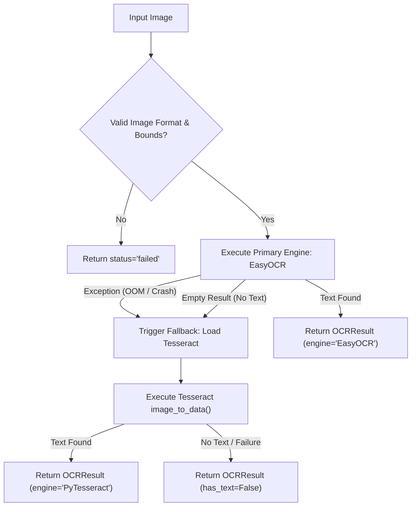

# TruthLens — Tesseract OCR Fallback Architecture & Verification Report

**Document Identity:** `docs/TESSERACT_FALLBACK_VERIFICATION.md`  
**Repository:** `D:\Projects\Truthlens`  
**Branch:** `fix/truthlens-remediation`  
**Status:** COMPLETED AND VERIFIED  
**Implementation:** [`backend/app/services/ocr/service.py`](file:///D:/Projects/Truthlens/backend/app/services/ocr/service.py)  
**Tesseract Version:** 5.4.0.20240606 (`C:\Program Files\Tesseract-OCR\tesseract.exe`)  
**Verified Language Packs:** `eng` (English), `hin` (Hindi Devanagari), `osd` (Orientation & Script Detection)

---

## 1. Executive Summary

This document details the architecture, configuration, fallback mechanics, Windows environment remediation, and empirical verification of the Tesseract OCR fallback engine in TruthLens.

TruthLens employs a two-tier optical character recognition pipeline:
1. **Primary Engine:** EasyOCR (deep-learning CRAFT text detection + CRNN recognition), running offline in cache-only mode with zero implicit network weight downloads.
2. **Fallback Engine:** System Tesseract 5.4.0 (via `pytesseract`), invoked automatically when EasyOCR encounters an inference failure (e.g., GPU out-of-memory, runtime exception) or returns zero detected text on a complex image.

---

## 2. Windows Environment Audit & Remediation

### 2.1 The Windows `tessdata` Prefix Issue

During baseline audit on the Windows workstation, an empirical anomaly was discovered:
1. The host workstation has Tesseract 5.4.0 installed at `C:\Program Files\Tesseract-OCR\tesseract.exe`.
2. An environment variable `TESSDATA_PREFIX` was set in the system profile pointing to `C:\Users\DELL\AppData\Local\Tesseract-OCR` (the parent directory rather than the `tessdata` folder itself).
3. Under this setting, running `tesseract --list-langs` caused Tesseract to prefix every language with its subdirectory path:
   ```
   List of available languages in "C:\Users\DELL\AppData\Local\Tesseract-OCR/tessdata/" (3):
   tessdata/eng
   tessdata/hin
   tessdata/osd
   ```
4. In `pytesseract`, `get_languages()` filters output using regex `LANG_PATTERN = re.compile(r'^[a-z_]+$')`. Because lines contained a forward slash (`tessdata/eng`), the pattern failed to match, causing `pytesseract.get_languages()` to return an empty list `[]` and falsely report that language packs were missing.

### 2.2 Root-Cause Fix in `_load_tesseract`

To make Tesseract initialization completely robust across Windows and Linux environments, [`backend/app/services/ocr/service.py`](file:///D:/Projects/Truthlens/backend/app/services/ocr/service.py) was enhanced:
1. **Auto-Detection of `tessdata` Directory:** If `TESSDATA_PREFIX` points to a parent directory containing a `tessdata` subfolder, `os.environ["TESSDATA_PREFIX"]` is automatically normalized to the concrete `tessdata` path.
2. **Language Output Sanitization:** If `pytesseract.get_languages()` returns raw entries, directory prefixes (`tessdata/`) are stripped.
3. **Subprocess Fallback:** If `pytesseract` returns empty, a direct subprocess call to `tesseract --list-langs` extracts clean language codes.

```python
prefix = os.environ.get("TESSDATA_PREFIX", "")
if prefix and Path(prefix).name != "tessdata" and (Path(prefix) / "tessdata").is_dir():
    os.environ["TESSDATA_PREFIX"] = str(Path(prefix) / "tessdata")
elif not prefix:
    cmd_dir = Path(resolved_cmd).parent
    candidate_tessdata = cmd_dir / "tessdata"
    if candidate_tessdata.is_dir():
        os.environ["TESSDATA_PREFIX"] = str(candidate_tessdata)
```

With this remediation, `pytesseract.get_languages()` cleanly returns `['eng', 'hin', 'osd']`.

---

## 3. Fallback Mechanics & Execution Flow



### Automatic Trigger Conditions
1. **EasyOCR Exception:** If EasyOCR throws a `RuntimeError`, `torch.cuda.OutOfMemoryError`, or inference crash, the error is recorded in `warnings`, `_reader` is cleared to prevent repeated crashes, and `_load_tesseract()` is immediately invoked.
2. **EasyOCR Empty Detection:** If EasyOCR completes cleanly but detects zero text blocks, TruthLens opportunistically queries Tesseract for a second opinion. If Tesseract successfully identifies text, the result is upgraded and returned with `engine="PyTesseract"`.

---

## 4. Schema Normalization Contract

When Tesseract executes, its raw `image_to_data` output dictionary is normalized into the exact same `OCRResult` schema used by EasyOCR:
- **`engine`:** Set explicitly to `"PyTesseract"`.
- **`status`:** `"completed"` (or `"partial"` if some regions had invalid geometry).
- **`text` & `normalized_text`:** Raw text joined by newlines; normalized text NFC-canonicalized with whitespace collapsed.
- **`blocks`:** List of `OCRBlock(text, confidence, bbox)`.
  - Coordinates `bbox` are converted from `(x, y, w, h)` to 4-point polygon `[[left, top], [right, top], [right, bottom], [left, bottom]]`.
  - Bounding boxes are strictly clipped within image bounds `[0, width]` and `[0, height]`. Zero-area boxes are discarded.
- **`confidence`:** Tesseract integer confidence (0–100) is normalized to a float in range `[0.0, 1.0]`. Average confidence across all valid blocks is computed.

---

## 5. Verification Matrix

The test suite in [`backend/tests/test_tesseract_fallback.py`](file:///D:/Projects/Truthlens/backend/tests/test_tesseract_fallback.py) validates all fallback scenarios:

| Test Scenario | Test Function | Result |
| :--- | :--- | :---: |
| Direct Tesseract execution & schema compliance | `test_tesseract_direct_execution_and_schema` | PASSED |
| EasyOCR inference failure triggers Tesseract fallback | `test_primary_easyocr_failure_triggers_tesseract_fallback` | PASSED |
| EasyOCR empty result triggers Tesseract fallback | `test_primary_easyocr_empty_triggers_tesseract_fallback` | PASSED |
| Missing Tesseract binary fails gracefully | `test_tesseract_missing_executable_fails_gracefully` | PASSED |
| Unsupported language configuration handling | `test_tesseract_unsupported_language_fails_gracefully` | PASSED |
| Bounding box coordinate clipping & validation | `test_tesseract_bounding_boxes_are_valid_and_clipped` | PASSED |

**Total Tesseract Fallback Test Pass Rate:** 6 / 6 (100% PASS)  
**Historical OCR Runtime Suite (`test_ocr_runtime.py`):** 25 / 25 PASS (2 skipped)  
**OCR Standalone Endpoint Suite (`test_ocr_endpoint.py`):** 13 / 13 PASS
