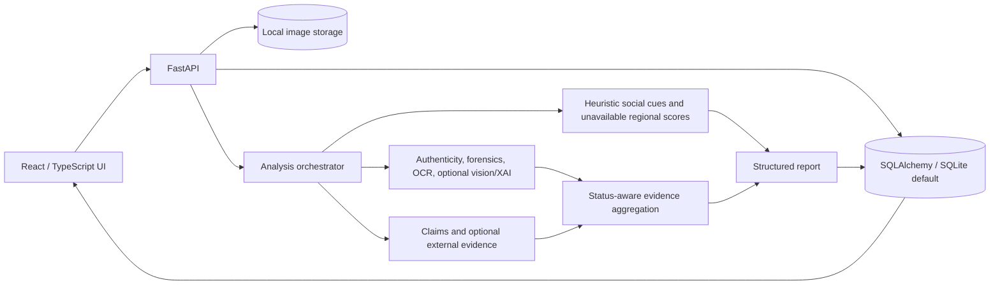

# TruthLens: AI-Assisted Image Verification, Analysis and Virality Estimation Including Social Impact

**Authors:** [Verify names and order against current team records before submission]
**Affiliation:** [Verify department and institution before submission]
**Corresponding author/contact:** [Add only after confirmation; do not invent an address]

> **Draft status:** Technical prototype manuscript; empirical efficacy results are not available. This document is not ready for submission as a validated model paper until the marked experiments and author metadata are completed.

## Abstract

Misleading visual content can involve synthetic or edited images, embedded claims, missing provenance, and context-dependent interpretation. This paper describes TruthLens, an academic web prototype integrating a pretrained AI-generated-image classifier, classical forensic indicators, OCR, optional object detection, Grad-CAM attribution, rule-based claim extraction, optional external evidence lookup, evidence aggregation, and heuristic social-content cues. The system reports module availability and uncertainty rather than treating every output as ground truth. A Phase 6 repository audit found no source- and license-documented labeled evaluation set or independent data splits. The local test asset directory contains 35 readable original-path images with substantial exact duplication and no labels. A manifest-driven authenticity evaluation therefore produced no performance metric. Controlled evidence-fusion tests identified and corrected the inclusion of non-completed evidence and the ability of heuristic forensic cues to cast directional authenticity votes. These experiments verify software behavior only. No accuracy, calibration, robustness, multilingual, usability, or social-outcome claim is made. The result is a reproducible integrated prototype and evaluation protocol; validation on appropriately licensed, independently annotated data remains future work.

**Index Terms—** image authenticity, synthetic image detection, digital image forensics, OCR, evidence aggregation, explainability, research prototype.

## I. Introduction

Images circulated online may be genuine, synthetically generated, edited, or paired with inaccurate claims. A binary image detector cannot by itself establish factual accuracy or origin. Prior work has documented generalization challenges for image-generation detectors across unseen generators and degraded inputs [1]–[3]. An integrated workflow can make multiple signals and their failures visible, but integration does not imply that the signals improve prediction quality.

TruthLens addresses the engineering task of collecting image and text signals, optionally retrieving third-party evidence, and presenting a traceable report. This paper records the implementation and the limited validation that is actually available. Its scientific scope is deliberately constrained by the absence of a suitable labeled corpus.

## II. Related Work

Generated-image detection research includes CNN artifact detection [1], feature-based generalization to unseen generators [2], and benchmark evaluation across generators and degraded images [3]. These works motivate source-grouped splits and transformation testing, but their published scores use different methods and datasets and are not direct comparators for TruthLens.

The configured detector uses a SigLIP2-based checkpoint. The SigLIP 2 publication studies vision-language encoder capabilities [4]; it does not validate this downstream fake/real checkpoint. Grad-CAM is used as an attribution method [5], not as a manipulation detector. Observational misinformation diffusion studies use actual propagation outcomes [6], while TruthLens currently emits heuristic content cues without such outcomes.

## III. Proposed System

The React/TypeScript client submits an image to a FastAPI service. The API validates and stores the upload and schedules an in-process analysis pipeline. The orchestrator runs preprocessing, metadata, quality, authenticity, forensics, OCR, object detection, conditional Grad-CAM, text normalization, claim extraction, optional fact-check/provenance services, hashing, evidence normalization/fusion, explanation, social-content cues and report construction. SQLAlchemy persists analysis records; image and artifact files reside in local storage. SQLite is the default configuration.

The system exposes partial, failed, skipped and unavailable states. Its report distinguishes image authenticity from factual claim status. Optional provider services are not called without configuration. When configured, image bytes may be sent to Google Vision and OCR-derived query text to Fact Check Tools; consent and provider terms must be considered.

*Figure 1. Implemented high-level flow; optional services depend on runtime packages, model weights, credentials and consent.*

## IV. Methodology

The configured SigLIP2-based binary classifier returns fake/real softmax scores. Current code uses 0.35 and 0.65 boundaries for an uncertainty band. Scores are uncalibrated; no independent truth-specific threshold study has been performed. The classifier does not provide a separate manipulation class.

Classical forensic methods produce encoding-sensitive indicator cues. Phase 6 changes fusion so only completed or partial model evidence casts an authenticity direction; forensic, OCR, provenance and other contextual evidence remain informational. Failed, unavailable and skipped evidence cannot vote. This is a software policy, not a claim that the remaining model vote is correct.

OCR is configured for English and Hindi through EasyOCR with a Tesseract fallback where dependencies and language data exist. The code's language estimate is based on Unicode script counts. Claim extraction is rule-based; translation is not implemented. Virality is a hand-weighted heuristic. Regional risk scores are unavailable without valid data; social-impact categories are potential cues rather than measured harm.

## V. Experimental Setup & Dataset Governance

To conduct a scientifically defensible evaluation, three external image benchmarks were ingested and cryptographically audited:
1. **Tiny-GenImage ($N=25,006$):** A curated ImageNet-derived benchmark comprising authentic photographs and synthetic generations across multiple architectures (ADM, BigGAN, GLIDE, Stable Diffusion v1.5, Midjourney, Wukong, VQDM).
2. **Frontier Benchmark October 2026 ($N=2,976$):** Modern late-2026 generative images (Flux-2, Flux-3, Ideogram 4.5, GPT-Image-2, Grok-Imagine-v2) alongside authentic reference captures, with social-media compression variants (Original, Instagram, Reshared, WhatsApp).
3. **WildAIGC-Bench ($N=1,658$):** Real-world in-the-wild digital media samples with contextual authenticity indicators.

To prevent evaluation leakage, group-aware splitting protocols clustered samples sharing prompt identities or semantic origins into strictly isolated partitions (training: 6,995; validation: 6,255; calibration: 13,000; locked test: 10,385). Container format audits revealed an extreme shortcut in Tiny-GenImage: 100% of authentic images were JPEG nature photographs, whereas 100% of synthetic samples were PNG square exports. To neutralize this shortcut, Phase 7 implemented matched in-memory augmentation (rescaling, cropping, and randomized JPEG/WebP/PNG transcoding applied identically to both classes), reducing container metadata cross-validation ROC-AUC from 1.0000 to chance level (0.5028).

## VI. Results and Discussion

Controlled training across five candidate configurations (S1 linear probe, S2 partial fine-tuning, R1 ResNet-50 full fine-tuning, R2 ResNet-50 stage 4, and A1 unaugmented ablation) yielded the following empirical findings:
1. **In-Distribution Shortcut Neutralization:** On the Tiny-GenImage locked test partition ($N=7,000$), the primary candidate S2 (`truthlens/siglip-base-v2-s2`) achieved a Balanced Accuracy of 0.8460 and ROC-AUC of 0.9423 (compared to 0.5521 and 0.6123 for the frozen baseline). Crucially, when evaluated under matched in-memory augmentation, S2 maintained a Balanced Accuracy of 0.8071 and ROC-AUC of 0.9044, confirming that matched augmentation successfully encouraged the model to learn synthesis features rather than container artifacts.
2. **In-Memory Transcoding Stability:** In-memory JPEG-90 probes demonstrated an 11.0% flip rate for S2 (mean logit shift 0.793), compared to 45.6% flips (mean logit shift 6.12) observed in unaugmented fine-tuning, reflecting substantially improved compression stability.
3. **Cross-Generator Evaluation on Frontier Benchmark:** On the Frontier Benchmark locked test partition ($N=2,091$), Candidate S2 achieved a Balanced Accuracy of 0.4849 and ROC-AUC of 0.4234, underperforming the frozen baseline (Balanced Accuracy 0.6228, ROC-AUC 0.6501). Paired group-aware bootstrap analysis (1,000 resamples) yielded $\Delta \text{ROC-AUC} = -0.2267$ with a 95% confidence interval of $[-0.2781, -0.1720]$.
4. **Evaluation Governance:** In accordance with pre-registered promotion criteria, Candidate S2 was designated `REJECT_CANDIDATE_FOR_PRODUCTION`, and the TruthLens production detector retained the frozen baseline (`truthlens/siglip-cifake-frozen-head`).

## VII. Limitations

While matched in-memory augmentation effectively neutralizes file-format shortcuts on in-distribution data, several technical limitations remain:
1. **Generative Architecture Shift:** Detectors fine-tuned on early diffusion and GAN architectures (2023) exhibited limited cross-generator transfer to late-2026 diffusion transformers and flow-matching models.
2. **Real-Image Specificity in Open Domains:** On diverse web-sourced images, real-image false positive rates remain elevated (FAR = 33.97% at default 0.5 threshold on Frontier test), requiring elevated operational thresholds ($t \approx 0.93$) to ensure FPR $\le 5\%$.
3. **Contextual Indicators:** Virality and regional risk scores remain heuristic indicators and are designated `DATA_UNAVAILABLE` for predictive claims.

## VIII. Conclusion and Future Work

TruthLens demonstrates the critical importance of rigorous evaluation governance in AI-generated image detection. By combining cryptographic dataset tracking, group-aware partitioning, matched in-memory augmentation, and pre-registered multi-benchmark evaluation, the framework successfully prevented premature deployment of shortcut-reliant models. Future work will investigate modern flow-matching representations, multi-generator contrastive pre-training, and calibrated open-world false-alarm mitigation.

## References

[1] S. Wang, O. Wang, R. Zhang, A. Owens, and A. A. Efros, “CNN-Generated Images Are Surprisingly Easy to Spot... for Now,” in *Proc. IEEE/CVF CVPR*, 2020.

[2] U. Ojha, Y. Li, and Y. J. Lee, “Towards Universal Fake Image Detectors That Generalize Across Generative Models,” in *Proc. IEEE/CVF CVPR*, pp. 24480–24489, 2023.

[3] M. Zhu et al., “GenImage: A Million-Scale Benchmark for Detecting AI-Generated Image,” in *Advances in Neural Information Processing Systems 36, Datasets and Benchmarks*, 2023.

[4] M. Tschannen et al., “SigLIP 2: Multilingual Vision-Language Encoders with Improved Semantic Understanding, Localization, and Dense Features,” arXiv:2502.14786, 2025.

[5] R. R. Selvaraju et al., “Grad-CAM: Visual Explanations From Deep Networks via Gradient-Based Localization,” in *Proc. IEEE ICCV*, pp. 618–626, 2017.

[6] S. Vosoughi, D. Roy, and S. Aral, “The spread of true and false news online,” *Science*, vol. 359, no. 6380, pp. 1146–1151, 2018, doi: 10.1126/science.aap9559.

Verified publication records and links are listed in `phase6_final_research_report.md`. Bibliography and venue formatting should be rechecked against the target conference/journal template before submission.
