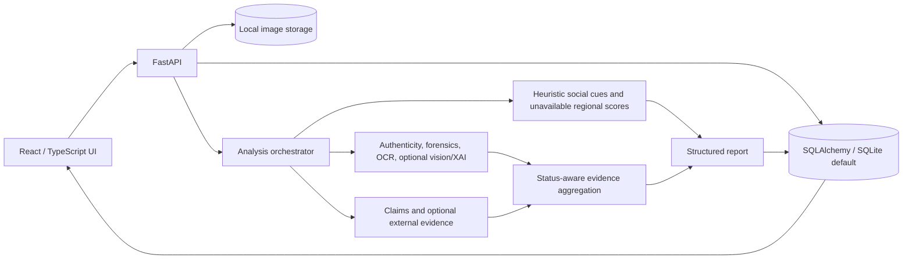

# TruthLens: AI-Assisted Image Verification, Analysis and Virality Estimation Including Social Impact

**Authors:** [Verify names and order against current team records before submission]
**Affiliation:** [Verify department and institution before submission]
**Corresponding author/contact:** [Add only after confirmation; do not invent an address]

> **Draft status:** Technical prototype manuscript; empirical efficacy results are not available. This document is not ready for submission as a validated model paper until the marked experiments and author metadata are completed.

## Abstract

Misleading visual content can involve synthetic or edited images, embedded claims, missing provenance, and context-dependent interpretation. This paper describes TruthLens, an academic web prototype integrating a pretrained AI-generated-image classifier, classical forensic indicators, OCR, optional object detection, Grad-CAM attribution, rule-based claim extraction, optional external evidence lookup, evidence aggregation, and heuristic social-content cues. The system reports module availability and uncertainty rather than treating every output as ground truth. A Phase 6 repository audit found no source- and license-documented labeled evaluation set or independent data splits. The local test asset directory contains 35 readable original-path images with substantial exact duplication and no labels. A manifest-driven authenticity evaluation therefore produced no performance metric. Controlled evidence-fusion tests identified and corrected the inclusion of non-completed evidence and the ability of heuristic forensic cues to cast directional authenticity votes. These experiments verify software behavior only. No accuracy, calibration, robustness, multilingual, usability, or social-outcome claim is made. The result is a reproducible integrated prototype and evaluation protocol; validation on appropriately licensed, independently annotated data remains future work.

**Index Terms—** image authenticity, synthetic image detection, digital image forensics, OCR, evidence aggregation, explainability, research prototype.

## I. Introduction

Images circulated online may be genuine, synthetically generated, edited, or paired with inaccurate claims. A binary image detector cannot by itself establish factual accuracy or origin. Prior work has documented generalization challenges for image-generation detectors across unseen generators and degraded inputs [1]–[3]. An integrated workflow can make multiple signals and their failures visible, but integration does not imply that the signals improve prediction quality.

TruthLens addresses the engineering task of collecting image and text signals, optionally retrieving third-party evidence, and presenting a traceable report. This paper records the implementation and the limited validation that is actually available. Its scientific scope is deliberately constrained by the absence of a suitable labeled corpus.

## II. Related Work

Generated-image detection research includes CNN artifact detection [1], feature-based generalization to unseen generators [2], and benchmark evaluation across generators and degraded images [3]. These works motivate source-grouped splits and transformation testing, but their published scores use different methods and datasets and are not direct comparators for TruthLens.

The configured detector uses a SigLIP2-based checkpoint. The SigLIP 2 publication studies vision-language encoder capabilities [4]; it does not validate this downstream fake/real checkpoint. Grad-CAM is used as an attribution method [5], not as a manipulation detector. Observational misinformation diffusion studies use actual propagation outcomes [6], while TruthLens currently emits heuristic content cues without such outcomes.

## III. Proposed System

The React/TypeScript client submits an image to a FastAPI service. The API validates and stores the upload and schedules an in-process analysis pipeline. The orchestrator runs preprocessing, metadata, quality, authenticity, forensics, OCR, object detection, conditional Grad-CAM, text normalization, claim extraction, optional fact-check/provenance services, hashing, evidence normalization/fusion, explanation, social-content cues and report construction. SQLAlchemy persists analysis records; image and artifact files reside in local storage. SQLite is the default configuration.

The system exposes partial, failed, skipped and unavailable states. Its report distinguishes image authenticity from factual claim status. Optional provider services are not called without configuration. When configured, image bytes may be sent to Google Vision and OCR-derived query text to Fact Check Tools; consent and provider terms must be considered.

*Figure 1. Implemented high-level flow; optional services depend on runtime packages, model weights, credentials and consent.*

## IV. Methodology

The configured SigLIP2-based binary classifier returns fake/real softmax scores. Current code uses 0.35 and 0.65 boundaries for an uncertainty band. Scores are uncalibrated; no independent truth-specific threshold study has been performed. The classifier does not provide a separate manipulation class.

Classical forensic methods produce encoding-sensitive indicator cues. Phase 6 changes fusion so only completed or partial model evidence casts an authenticity direction; forensic, OCR, provenance and other contextual evidence remain informational. Failed, unavailable and skipped evidence cannot vote. This is a software policy, not a claim that the remaining model vote is correct.

OCR is configured for English and Hindi through EasyOCR with a Tesseract fallback where dependencies and language data exist. The code's language estimate is based on Unicode script counts. Claim extraction is rule-based; translation is not implemented. Virality is a hand-weighted heuristic. Regional risk scores are unavailable without valid data; social-impact categories are potential cues rather than measured harm.

## V. Experimental Setup

An aggregate audit of `test_data/originals` found 35 readable files (31 JPEG, 4 PNG), with 31 exact duplicate extra copies, 33 exact dHash candidate extra copies, and 496 loose Hamming≤2 dHash candidate pairs. These near-duplicate candidates are not confirmed duplicates. The directory has no source/license records, ground-truth labels, source-event groups, generator IDs or split manifest. The full `test_data` tree includes derived thumbnails, resized images and heatmaps and is not an independent corpus. Runtime directories containing user/application data were excluded.

An evaluation harness now requires a CSV manifest with image path, binary label, split, group ID, source URL and license/permission reference. It checks for missing files and validation/test group overlap, uses fixed operational/diagnostic thresholds, and records inference time and predictions. No eligible labeled manifest was available; the recorded test run returned `NOT_EVALUABLE` with n=0. No accuracy metrics or model inference were produced by that run. No external dataset was downloaded or used.

## VI. Results and Discussion

The available evidence establishes the following: (1) software tests cover upload/report and evidence contracts; (2) the aggregate asset audit found duplicate test artifacts but no research labels or rights; (3) fusion logic scenarios verify that added informational items do not cast a direction and that unavailable evidence is ignored; and (4) no detector performance, calibration, robustness, localization, multilingual quality, or usability result is available.

The backend suite recorded before the final Phase 6 edit passed 184 tests with 10 skipped. Phase 6 targeted fusion tests passed after the fusion policy change. The final full-suite result is recorded in `phase6_implementation_report.md`. These are software regression results, not model-accuracy results.

## VII. Limitations

The detector has no independent labeled evaluation. No direct baseline comparison or predictive fusion ablation is possible. Grad-CAM lacks annotation-based localization or human evaluation. OCR lacks language-specific reference transcripts and was unavailable in the earlier runtime. Claim extraction and retrieval lack reviewed reference cases. Social modules have no observational outcomes. The application lacks public deployment controls noted in the deployment/security guides. Author names and affiliation details must be verified from current records before submission.

## VIII. Conclusion and Future Work

TruthLens integrates several analysis stages in a local academic prototype and exposes uncertainty and module status. Phase 6 adds reproducible dataset auditing, a guarded authenticity evaluation harness, controlled fusion checks, and honest academic documentation. The current evidence does not establish that the detector is accurate, calibrated, robust, multilingual, or useful to users. Future work is to secure dataset rights, define labels, group related examples, conduct held-out evaluation, measure OCR and claim quality, examine explanation faithfulness, run paired fusion ablations, and conduct consented user studies.

## References

[1] S. Wang, O. Wang, R. Zhang, A. Owens, and A. A. Efros, “CNN-Generated Images Are Surprisingly Easy to Spot... for Now,” in *Proc. IEEE/CVF CVPR*, 2020.

[2] U. Ojha, Y. Li, and Y. J. Lee, “Towards Universal Fake Image Detectors That Generalize Across Generative Models,” in *Proc. IEEE/CVF CVPR*, pp. 24480–24489, 2023.

[3] M. Zhu et al., “GenImage: A Million-Scale Benchmark for Detecting AI-Generated Image,” in *Advances in Neural Information Processing Systems 36, Datasets and Benchmarks*, 2023.

[4] M. Tschannen et al., “SigLIP 2: Multilingual Vision-Language Encoders with Improved Semantic Understanding, Localization, and Dense Features,” arXiv:2502.14786, 2025.

[5] R. R. Selvaraju et al., “Grad-CAM: Visual Explanations From Deep Networks via Gradient-Based Localization,” in *Proc. IEEE ICCV*, pp. 618–626, 2017.

[6] S. Vosoughi, D. Roy, and S. Aral, “The spread of true and false news online,” *Science*, vol. 359, no. 6380, pp. 1146–1151, 2018, doi: 10.1126/science.aap9559.

Verified publication records and links are listed in `phase6_final_research_report.md`. Bibliography and venue formatting should be rechecked against the target conference/journal template before submission.
