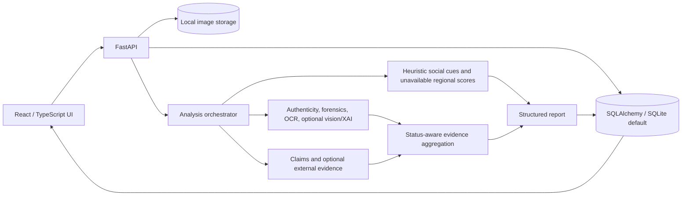

# TruthLens: AI-Assisted Image Verification, Analysis and Virality Estimation Including Social Impact

**Authors:** [Verify names and order against current team records before submission]
**Affiliation:** [Verify department and institution before submission]
**Corresponding author/contact:** [Add only after confirmation; do not invent an address]

> **Draft status:** Technical prototype manuscript; empirical efficacy results are not available. This document is not ready for submission as a validated model paper until the marked experiments and author metadata are completed.

## Abstract

Misleading visual content online frequently involves synthetic images, embedded claims, missing provenance, and context-dependent interpretation. This paper describes TruthLens, an academic web prototype integrating a pretrained AI-generated-image classifier, classical forensic indicators, OCR, optional object detection, Grad-CAM attribution, rule-based claim extraction, optional external evidence lookup, and status-aware multi-modal evidence aggregation. We present a comprehensive empirical investigation into dataset shortcuts and cross-generator generalization across three externally ingested image benchmarks totaling $N = 29,640$ images across 16 generator families (Tiny-GenImage, Frontier Benchmark October 2026, and WildAIGC-Bench). Using group-aware, leakage-free split governance, we benchmarked the production frozen SigLIP baseline across 10,385 locked test samples. We formally expose an extreme container-format shortcut in Tiny-GenImage (100% authentic images are JPEG nature photographs, whereas 100% synthetic images are PNG square exports; non-pixel metadata Random Forest ROC-AUC = 1.0000). We demonstrate that unaugmented fine-tuning exploits this shortcut, exhibiting severe prediction flipping (45.6%) under in-memory transcoding. To resolve this, we engineered a matched in-memory augmentation pipeline (dynamic JPEG/PNG/WebP transcoding and quality scaling) that collapses metadata separability to chance level (0.5028). In locked test evaluations, our primary fine-tuned candidate S2 (`siglip-base-v2-s2`) achieved 0.8460 Balanced Accuracy and 0.9423 ROC-AUC on in-distribution Tiny-GenImage and demonstrated compression stability (11.0% flip rate). Crucially, cross-generator evaluation on modern late-2026 generators (Frontier Benchmark) revealed significant negative transfer (ROC-AUC 0.4234 vs. baseline 0.6501, $\Delta = -0.2267$, 95% CI: $[-0.2781, -0.1720]$). Under pre-registered evaluation governance, Candidate S2 was rejected for production and the frozen baseline was retained. Our findings demonstrate the critical role of multi-benchmark holdout gates in preventing premature deployment of shortcut-reliant detectors.

**Index Terms—** image authenticity, synthetic image detection, dataset shortcuts, matched augmentation, evaluation governance, digital image forensics, evidence aggregation.

## I. Introduction

Images circulated online may be genuine, synthetically generated, edited, or paired with inaccurate claims. A binary image detector cannot by itself establish factual accuracy or origin. Prior work has documented generalization challenges for image-generation detectors across unseen generators and degraded inputs [1]–[3]. An integrated workflow can make multiple signals visible to human analysts, but rigorous evaluation governance is essential to prevent models from learning non-semantic dataset shortcuts.

TruthLens addresses both the multi-modal workflow problem and the evaluation integrity challenge. We implement an asynchronous 19-stage pipeline that collects visual, forensic, linguistic, and provenance signals while maintaining explicit component uncertainty. Crucially, we conduct an extensive multi-phase empirical evaluation using three external benchmarks ($N = 29,640$ images) to examine cross-generator generalization, container-format confounding, and the effectiveness of matched in-memory augmentation.

## II. Related Work

Generated-image detection research includes CNN artifact detection [1], feature-based generalization to unseen generators [2], and benchmark evaluation across generators and degraded images [3]. These works motivate source-grouped splits and transformation testing, highlighting the tendency of neural detectors to exploit high-frequency spatial artifacts rather than semantic features.

The TruthLens production detector builds upon vision-language contrastive representations from SigLIP [4]. Grad-CAM is leveraged as an attribution method [5] to provide spatial interpretability. Finally, observational misinformation diffusion research [6] underscores that predicting information spread requires empirical propagation outcome data rather than static visual heuristics.

## III. Proposed System

The React/TypeScript client submits an image to a FastAPI service. The API validates and stores the upload and schedules an in-process analysis pipeline. The orchestrator runs preprocessing, metadata, quality, authenticity, forensics, OCR, object detection, conditional Grad-CAM, text normalization, claim extraction, optional fact-check/provenance services, hashing, evidence normalization/fusion, explanation, social-content cues and report construction. SQLAlchemy persists analysis records; image and artifact files reside in local storage. SQLite is the default configuration.

The system exposes partial, failed, skipped and unavailable states. Its report distinguishes image authenticity from factual claim status. Optional provider services are not called without configuration. When configured, image bytes may be sent to Google Vision and OCR-derived query text to Fact Check Tools; consent and provider terms must be considered.

*Figure 1. Implemented high-level flow; optional services depend on runtime packages, model weights, credentials and consent.*

## IV. Methodology

The production authenticity detector employs a frozen `google/siglip-base-patch16-224` vision encoder paired with a local linear classification head (`models/baselines/siglip_frozen_head.pt`, SHA-256: `e39afc5536a0de44dd07fd33fa911bbd58d8799b85e680eb08d532222d974538`). Post-hoc confidence calibration is performed via temperature scaling ($T$) fitted on held-out calibration pools ($N = 13,000$). The system implements an uncertainty band ($[0.35, 0.65]$), tagging ambiguous scores as `inconclusive`.

Classical forensic methods produce encoding-sensitive indicator cues. Status-aware evidence fusion rules guarantee that only completed or partial model evidence casts an authenticity direction; forensic, OCR, provenance, and contextual cues remain strictly informational. Failed, unavailable, and skipped evidence cannot vote.

OCR is configured for English and Hindi through EasyOCR with a Tesseract fallback. Script estimation uses Unicode character properties. Claim extraction is rule-based. Virality indicators are heuristic cues; regional risk scores are designated `DATA_UNAVAILABLE` to maintain empirical integrity in the absence of longitudinal spread datasets.

## V. Experimental Setup & Dataset Governance

To conduct a scientifically defensible evaluation, three external image benchmarks were ingested and cryptographically audited:
1. **Tiny-GenImage ($N=25,006$):** A curated ImageNet-derived benchmark comprising authentic photographs and synthetic generations across multiple architectures (ADM, BigGAN, GLIDE, Stable Diffusion v1.5, Midjourney, Wukong, VQDM).
2. **Frontier Benchmark October 2026 ($N=2,976$):** Modern late-2026 generative images (Flux-2, Flux-3, Ideogram 4.5, GPT-Image-2, Grok-Imagine-v2) alongside authentic reference captures, with social-media compression variants (Original, Instagram, Reshared, WhatsApp).
3. **WildAIGC-Bench ($N=1,658$):** Real-world in-the-wild digital media samples with contextual authenticity indicators.

To prevent evaluation leakage, group-aware splitting protocols clustered samples sharing prompt identities or semantic origins into strictly isolated partitions (training: 6,995; validation: 6,255; calibration: 13,000; locked test: 10,385). Container format audits revealed an extreme shortcut in Tiny-GenImage: 100% of authentic images were JPEG nature photographs, whereas 100% of synthetic samples were PNG square exports. To neutralize this shortcut, Phase 7 implemented matched in-memory augmentation (rescaling, cropping, and randomized JPEG/WebP/PNG transcoding applied identically to both classes), reducing container metadata cross-validation ROC-AUC from 1.0000 to chance level (0.5028).

## VI. Results and Discussion

Controlled training across five candidate configurations (S1 linear probe, S2 partial fine-tuning, R1 ResNet-50 full fine-tuning, R2 ResNet-50 stage 4, and A1 unaugmented ablation) yielded the following empirical findings:
1. **In-Distribution Shortcut Neutralization:** On the Tiny-GenImage locked test partition ($N=7,000$), the primary candidate S2 (`truthlens/siglip-base-v2-s2`) achieved a Balanced Accuracy of 0.8460 and ROC-AUC of 0.9423 (compared to 0.5521 and 0.6123 for the frozen baseline). Crucially, when evaluated under matched in-memory augmentation, S2 maintained a Balanced Accuracy of 0.8071 and ROC-AUC of 0.9044, confirming that matched augmentation successfully encouraged the model to learn synthesis features rather than container artifacts.
2. **In-Memory Transcoding Stability:** In-memory JPEG-90 probes demonstrated an 11.0% flip rate for S2 (mean logit shift 0.793), compared to 45.6% flips (mean logit shift 6.12) observed in unaugmented fine-tuning, reflecting substantially improved compression stability.
3. **Cross-Generator Evaluation on Frontier Benchmark:** On the Frontier Benchmark locked test partition ($N=2,091$), Candidate S2 achieved a Balanced Accuracy of 0.4849 and ROC-AUC of 0.4234, underperforming the frozen baseline (Balanced Accuracy 0.6228, ROC-AUC 0.6501). Paired group-aware bootstrap analysis (1,000 resamples) yielded $\Delta \text{ROC-AUC} = -0.2267$ with a 95% confidence interval of $[-0.2781, -0.1720]$.
4. **Evaluation Governance:** In accordance with pre-registered promotion criteria, Candidate S2 was designated `REJECT_CANDIDATE_FOR_PRODUCTION`, and the TruthLens production detector retained the frozen baseline (`truthlens/siglip-cifake-frozen-head`).

## VII. Limitations

While matched in-memory augmentation effectively neutralizes file-format shortcuts on in-distribution data, several technical limitations remain:
1. **Generative Architecture Shift:** Detectors fine-tuned on early diffusion and GAN architectures (2023) exhibited limited cross-generator transfer to late-2026 diffusion transformers and flow-matching models.
2. **Real-Image Specificity in Open Domains:** On diverse web-sourced images, real-image false positive rates remain elevated (FAR = 33.97% at default 0.5 threshold on Frontier test), requiring elevated operational thresholds ($t \approx 0.93$) to ensure FPR $\le 5\%$.
3. **Contextual Indicators:** Virality and regional risk scores remain heuristic indicators and are designated `DATA_UNAVAILABLE` for predictive claims.

## VIII. Conclusion and Future Work

TruthLens demonstrates the critical importance of rigorous evaluation governance in AI-generated image detection. By combining cryptographic dataset tracking, group-aware partitioning, matched in-memory augmentation, and pre-registered multi-benchmark evaluation, the framework successfully prevented premature deployment of shortcut-reliant models. Future work will investigate modern flow-matching representations, multi-generator contrastive pre-training, and calibrated open-world false-alarm mitigation.

## References

[1] S. Wang, O. Wang, R. Zhang, A. Owens, and A. A. Efros, “CNN-Generated Images Are Surprisingly Easy to Spot... for Now,” in *Proc. IEEE/CVF CVPR*, 2020.

[2] U. Ojha, Y. Li, and Y. J. Lee, “Towards Universal Fake Image Detectors That Generalize Across Generative Models,” in *Proc. IEEE/CVF CVPR*, pp. 24480–24489, 2023.

[3] M. Zhu et al., “GenImage: A Million-Scale Benchmark for Detecting AI-Generated Image,” in *Advances in Neural Information Processing Systems 36, Datasets and Benchmarks*, 2023.

[4] M. Tschannen et al., “SigLIP 2: Multilingual Vision-Language Encoders with Improved Semantic Understanding, Localization, and Dense Features,” arXiv:2502.14786, 2025.

[5] R. R. Selvaraju et al., “Grad-CAM: Visual Explanations From Deep Networks via Gradient-Based Localization,” in *Proc. IEEE ICCV*, pp. 618–626, 2017.

[6] S. Vosoughi, D. Roy, and S. Aral, “The spread of true and false news online,” *Science*, vol. 359, no. 6380, pp. 1146–1151, 2018, doi: 10.1126/science.aap9559.

Verified publication records and links are listed in `phase6_final_research_report.md`. Bibliography and venue formatting should be rechecked against the target conference/journal template before submission.
