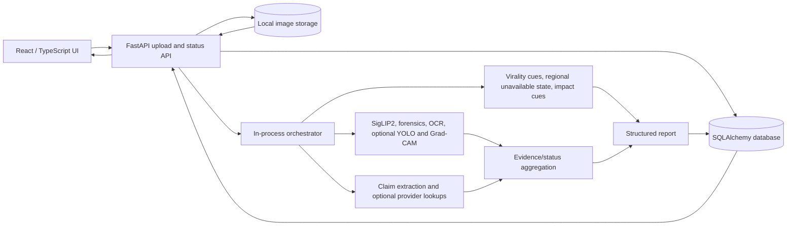

# TruthLens: AI-Assisted Image Verification, Analysis and Virality Estimation Including Social Impact

## Abstract

TruthLens is an academic research prototype that integrates image upload and preprocessing, a pretrained AI-generated-image detector, classical image-forensic indicators, OCR, optional object detection, conditional Grad-CAM, rule-based claim extraction, optional external fact-check/provenance services, evidence aggregation, and heuristic social-content indicators in one web application. Phase 6 audits the implemented system and creates a reproducible path for scientific evaluation. The checkout contains no source- and license-documented labeled authenticity corpus or independent train/validation/test split. An aggregate audit found 35 readable files in `test_data/originals`, including 31 exact duplicate extra copies, but no labels or rights records. A manifest-driven detector evaluation therefore returned `NOT_EVALUABLE` with zero eligible examples; no accuracy or calibration claim is made. Controlled fusion scenarios exposed and corrected two code inconsistencies: non-completed evidence could vote, and forensic cues could be treated directionally despite being documented as informational. The backend regression suite and UI build provide software verification, not model-performance evidence. Virality and social-impact outputs remain heuristics; regional predictions remain unavailable. The system is a local academic prototype, not a validated truth detector or public deployment. A publishable efficacy paper requires permitted data, independent labels, controlled comparisons, reviewer studies and repeated system evaluation that have not yet been conducted.

## 1. Introduction

Images can be synthetically generated, edited, deprived of context, or paired with inaccurate claims. An image classifier answers a narrow visual-distribution question; it does not establish where a picture originated or whether a caption is factually correct. Research on generated-image detection also documents generator shift and the difficulty of generalizing to unseen generation methods [1]–[3].

TruthLens was developed as an integrated workflow intended to expose multiple signals and their availability. This report describes the code that exists and the tests that were run. It does not claim that integration itself increases detection accuracy or reduces misinformation.

## 2. Problem statement

The engineering problem is to provide one auditable workflow for image-level signals, embedded text, optional evidence lookup, stage status, and limitations. The research problem is broader: whether those signals are accurate, complementary, understandable, and robust on independent real-world data. The repository currently supports the first as a prototype; the available data do not support the second.

## 3. Objectives and contribution boundary

Implemented objectives include upload validation, a configured pretrained two-class detector, classical forensic indicators, OCR integration points, optional vision and external-provider services, claim/evidence traceability, explicit unavailable/partial statuses, and a structured report UI. Phase 6 adds aggregate dataset auditing, a manifest-enforced authenticity evaluation harness, controlled fusion scenario artifacts, and research protocols.

No scientific novelty, accuracy improvement, calibrated confidence, validated multilingual coverage, virality prediction, regional susceptibility inference, or measured societal-harm prediction is claimed.

## 4. Related work

Work on generated-image detection includes CNN-generated-image detection across generators [1], generalization to unseen models with pretrained vision features [2], and the GenImage benchmark with cross-generator and degraded-image protocols [3]. These studies motivate source-aware splits and robustness checks; their reported results cannot be compared directly with TruthLens because this project ran no compatible benchmark.

The current default uses a locally supplied fine-tuned linear head with `google/siglip-base-patch16-224`; the runtime records the exact head digest and resolved backbone revision. The head's source branch reports results on a 200-image CIFAKE subset, but this project has not reproduced those results from a reviewed manifest and they do not establish external validity. Review the backbone license and head training-data provenance before publication. The SigLIP paper's encoder evaluation [4] does not evaluate this TruthLens detector or task. Grad-CAM produces class-conditioned attribution maps [5]; those maps do not prove image manipulation. Research on misinformation diffusion uses observed propagation outcomes [6], unlike TruthLens's current content-cue heuristic.

## 5. System architecture

The React/TypeScript frontend sends an image to a FastAPI upload endpoint. The API validates and stores the image, creates an analysis record, and starts an in-process background orchestrator. Stages include preprocessing, metadata, quality, authenticity, forensics, OCR, vision, conditional XAI, text normalization, claim extraction, optional fact checking, optional provenance, hashes, evidence collection, fusion, explanation, virality cues, regional context, social-impact cues, and report assembly. The database defaults to SQLite; image/artifact files are locally stored. Optional services and models can report unavailable, skipped, failed or partial states. The report and artifact routes return analysis-linked data to the UI.

The API-level upload → partial report → original-image retrieval integration test passed. Docker, authentication, retention/deletion, durable jobs, migrations and public deployment hardening are absent; see `deployment_guide.md`.

## 6. Methodology and implementation

The authenticity service defaults to the locally supplied SigLIP frozen-encoder/linear-head checkpoint and matching `google/siglip-base-patch16-224` backbone. Its raw head margin is represented through the existing two-class report schema. The user-facing tag is the larger raw softmax score (AI-generated on a strict greater-than comparison; otherwise real/authentic); the scores are uncalibrated and do not establish validated accuracy or real-world probability. It has real/AI-generated classes, not a distinct manipulation class. The previous hosted classifier remains selectable as an alternate backend. Classical forensics emits encoding-sensitive heuristic indicators. OCR uses EasyOCR with opportunistic Tesseract fallback when available; default configured languages are English and Hindi, but runtime support must be confirmed. Script estimation is not robust language identification and there is no translation implementation.

Claim extraction is rule-based. Fact-check and web-provenance lookup are optional, credential-dependent provider integrations. Virality is hand-weighted keyword/content cue logic; regional scores remain null without outcome data; social-impact outputs are exact-token category cues. Evidence fusion is a weighted rule engine. Phase 6 corrected it so failed/unavailable/skipped evidence cannot vote and only model evidence currently casts an authenticity direction; forensics and contextual items remain informational.

## 7. Dataset and experimental setup

`test_data/originals` aggregate scan: 35 readable files (31 JPEG, 4 PNG), 31 exact duplicate extra copies and 33 exact dHash candidate extra copies. No labels, licenses, provenance, annotator guide, event IDs, generator IDs, or split manifest were found. `test_data` contains 190 files including thumbnails, resized outputs and heatmaps; these are not 190 independent samples. `data/` and `temp/` runtime storage were excluded as user/application data. No external datasets were installed or used.

The evaluator `experiments/evaluate_authenticity.py` requires reviewed source/license references, labels, group identifiers, and validation/test split values. Running it with the blank template produced `NOT_EVALUABLE`, n=0; no detector inference or scientific metric was produced. Reproduction commands and dataset record are in `phase6_experiment_setup.md` and `phase6_experiment_dataset_inventory.md`.

## 8. Results

| Evaluation | Actual result | Interpretation |
|---|---|---|
| Dataset audit | 35 files; 31 exact duplicate extra copies; 496 loose dHash candidate pairs (Hamming≤2); no labels or license review | Not research-ready; candidate pairs are not confirmed duplicates; no model metrics possible |
| Authenticity detector | NOT_EVALUABLE, 0 eligible examples | No accuracy, precision, recall, F1, AUC, calibration or robustness result |
| Controlled fusion rules | Model-only synthetic direction → AI-generated label; completed informational cues do not vote; unavailable evidence excluded; forensic-only → inconclusive | Deterministic rule behavior only, not predictive quality |
| Backend verification | Final complete backend suite: 188 passed, 10 skipped; Phase 6 targeted checks: 8 passed after fusion correction; metric utility checks: 3 passed | Software behavior only; no model efficacy evidence |
| Performance | Earlier Phase 5 synthetic microbenchmarks only; one uncontrolled local run completed 14/20 stages in 40.4s | Not representative, not repeated, not included as system SLA or accuracy |
| Human evaluation | Not conducted | No usability or trust claims |

## 9. Comparative evaluation and ablation

No head-to-head model benchmark was performed. Published metrics on GenImage or other datasets are not presented as direct comparisons. The controlled fusion scenarios are an implementation ablation: adding forensic/OCR/provenance context does not alter the current authenticity vote because those channels are informational. This observation identifies a system-design property, not evidence that evidence fusion helps or harms accuracy. A labeled paired set is required for a predictive ablation.

## 10. Error analysis

No labeled evaluation set exists to count false positives/negatives. The qualitative issue log is in `phase6_error_analysis.md`. The two fusion inconsistencies found in controlled cases were corrected and covered by regression tests. Remaining likely error categories include generator/domain shift, recompression/cropping, OCR failure, limited Hindi claim cues, provider mismatch/unavailability, source ambiguity, missing metadata, and over-interpretation of heuristics. These are risks, not measured error rates.

## 11. Responsible AI

False authenticity accusations, false reassurance, overreliance, stale/incomplete fact-check evidence, OCR language disparity, political false alarms, privacy/retention, and demographic stereotyping are material risks. The full qualitative assessment and mitigations are in `phase6_responsible_ai_assessment.md`. A consent-based usability protocol is in `phase6_usability_protocol.md`; no participant study was conducted. No fairness or bias-free claim is made. The current app should not be used for high-impact decisions.

## 12. Limitations

The detector has no independent accuracy or calibration result. Test assets lack source/rights labels and contain duplicates. OCR/YOLO/XAI availability varies by environment. Translation and C2PA parsing are absent. External services can disclose image bytes or OCR claim queries when configured. There is no validated social outcome corpus, user study, full browser report-render verification, systematic load test, authenticated access, deletion/retention controls, or durable job system. Current limitations and reproducer details appear in the Phase 5 reports and Phase 6 workstream documents.

## 13. Conclusion and future work

TruthLens is a technically integrated academic prototype with explicit status reporting and a traceable report workflow. The verified evidence supports software-path behavior and highlights research-data gaps; it does not support efficacy claims. Next steps are to secure permitted datasets, define and adjudicate task-specific labels, group by source/event/generator, freeze thresholds on validation data, run held-out detector/OCR/claim/fusion/XAI experiments, and conduct consented usability evaluation. Only after those measurements should the paper present performance or claim scientific effectiveness.

## References

[1] S. Wang, O. Wang, R. Zhang, A. Owens, and A. A. Efros, “CNN-Generated Images Are Surprisingly Easy to Spot... for Now,” *Proc. IEEE/CVF CVPR*, 2020. https://openaccess.thecvf.com/content_CVPR_2020/html/Wang_CNN-Generated_Images_Are_Surprisingly_Easy_to_Spot..._for_Now_CVPR_2020_paper.html

[2] U. Ojha, Y. Li, and Y. J. Lee, “Towards Universal Fake Image Detectors That Generalize Across Generative Models,” *Proc. IEEE/CVF CVPR*, pp. 24480–24489, 2023. https://openaccess.thecvf.com/content/CVPR2023/html/Ojha_Towards_Universal_Fake_Image_Detectors_That_Generalize_Across_Generative_Models_CVPR_2023_paper.html

[3] M. Zhu et al., “GenImage: A Million-Scale Benchmark for Detecting AI-Generated Image,” *Advances in Neural Information Processing Systems 36, Datasets and Benchmarks*, 2023. https://papers.nips.cc/paper_files/paper/2023/hash/f4d4a021f9051a6c18183b059117e8b5-Abstract-Datasets_and_Benchmarks.html

[4] M. Tschannen et al., “SigLIP 2: Multilingual Vision-Language Encoders with Improved Semantic Understanding, Localization, and Dense Features,” arXiv:2502.14786, 2025. https://arxiv.org/abs/2502.14786

[5] R. R. Selvaraju et al., “Grad-CAM: Visual Explanations From Deep Networks via Gradient-Based Localization,” *Proc. IEEE ICCV*, pp. 618–626, 2017. https://openaccess.thecvf.com/content_iccv_2017/html/Selvaraju_Grad-CAM_Visual_Explanations_ICCV_2017_paper.html

[6] S. Vosoughi, D. Roy, and S. Aral, “The spread of true and false news online,” *Science*, vol. 359, no. 6380, pp. 1146–1151, 2018, doi: 10.1126/science.aap9559. https://pubmed.ncbi.nlm.nih.gov/29590045/
