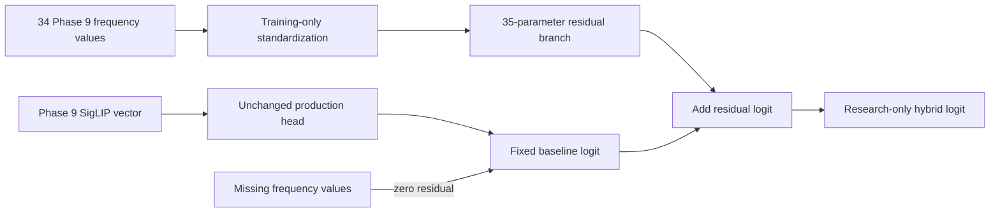

# R10 Hybrid Architecture

**Candidate ID:** `truthlens/r10-siglip-frequency-residual-v1`  
**Status:** Research only; separate from E11 and production inference.

## Feature eligibility

| Feature/source | Required conditions | Score semantics | R10 decision |
|---|---|---|---|
| Frozen SigLIP | Matching 768-dimensional Phase 9 embeddings, the unchanged local production head, and verified head/backbone identity | Existing frozen linear-head logit; uncalibrated score | Include as fixed visual anchor after archive/checkpoint integrity checks. |
| Phase 9 frequency features | 34 finite deterministic pixel features, matching sample order/group metadata, fit-only training standardization | Uncalibrated measurement, not an authenticity probability | Include in the low-capacity residual branch. |
| Other E6 forensic measurements | Valid output and justified, predeclared feature definitions | Heterogeneous heuristics | Exclude from the first R10 candidate to avoid post hoc feature selection. |
| YOLO | Real local inference with verified weights required | Object-detection confidence is not authenticity probability | Exclude: E6 records inference as mocked; no real local-weight evidence is available. |
| C2PA | Real verifier and valid signature/content-binding result required | Provenance evidence, not an authenticity label | Exclude: E7 records the optional SDK and signed verification fixture as unavailable locally. |
| OCR and language | A justified authenticity hypothesis and non-leaking, validated feature would be required | Contextual text/language output | Exclude; no independent authenticity relevance is established. |
| Third-party fact-check | Claim match and provider provenance would be required | Publisher-specific review, not image authenticity | Exclude; semantic claim overlap and publisher-rating leakage make it unsuitable as an image-authenticity feature. |
| XAI/Grad-CAM | Explanation output only | Attribution map, not an independent signal | Exclude; it explains model response and is not independent evidence. |

These decisions reflect the E6/E7 implementation reports and exact local code contracts. Missing or mocked outputs are not treated as measurements.

## Candidate

The visual baseline remains the existing frozen production SigLIP head. The candidate standardizes the 34 frequency values using the approved training rows only, then adds a linear residual logit to the unchanged baseline logit. The residual has 34 coefficients and one intercept. Its fit minimizes binary cross-entropy on the training partition with fixed L2 coefficient `1.0`; the baseline coefficient is fixed at one.

This additive form preserves the visual logit as its anchor and is small enough for CPU training. It avoids fine-tuning or loading another model. The candidate is not a probability model; its output has no calibration. If frequency input is missing, the specified fallback is the frozen baseline output unchanged.

The baseline and hybrid are compared on the same authorized training/validation feature rows. Training labels fit only the residual branch. Validation labels are opened only after the candidate is fixed to calculate the preregistered metrics. WildAIGC is reported only as a distinct contextual-label diagnostic. No calibration or locked evaluation is performed.

## Production isolation

The candidate configuration, script, result, and coefficients are stored under `research/r10_e11/`. The production checkpoint, calibration, detector identity, inference routing, and E11 policy remain unchanged. No code path automatically imports or loads the R10 candidate.
