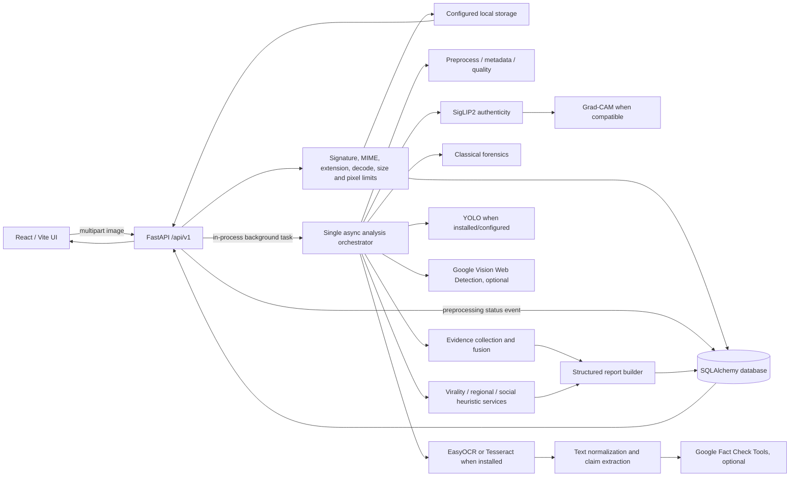

# TruthLens system architecture

## Components and data flow

The upload endpoint performs validation, hashing and preprocessing, persists analysis/image records plus a safe preprocessing status summary, and starts an in-process task. The orchestrator imports that upload-time result as its first stage, then executes the remaining stages with optional-stage error capture and writes a final report JSON to the `Analysis` row. UI polls status and loads the report. Original images and artifacts are local files addressed by database paths; response schemas and report sanitization do not reveal those paths.

## Implemented versus unavailable

The authenticity model, classical forensics, OCR adapters, YOLO object detection, Grad-CAM, claim extraction, fact-check API adapter, Google image provenance adapter, evidence/fusion/report services, and Phase 4 heuristic indicators exist. Integration is conditional on optional libraries, model cache, compatible model internals, and credentials. Text translation, VLM inference, C2PA parsing, trained spread/regional/social models, authentication, and a durable job queue are not implemented. The `/models` API remains a placeholder.

## Runtime and persistence

- Frontend: React 19, TypeScript, Vite; development proxy forwards `/api` to `http://localhost:8000`.
- Backend: FastAPI with async SQLAlchemy. SQLite is the default; PostgreSQL is supported by configured async URL/driver.
- Storage: `STORAGE_PATH` subdirectories `originals`, `thumbnails`, `processed`, `heatmaps`, `reports`, `artifacts`.
- Analysis status/progress, model runs, events, image metadata, and final report JSON are database-backed. The analysis task runs in the API process, so a process restart can interrupt it; no queue or automatic retention policy exists.
- API docs are generated from FastAPI at `/docs`, `/redoc`, and `/openapi.json`.
- `/api/v1/health/models` reports singleton load state and basic dependency/cache/checkpoint presence without triggering model loads; `/api/v1/models` remains a placeholder.
